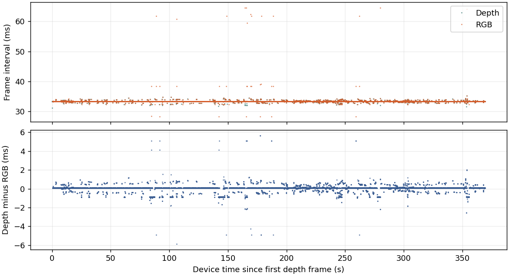
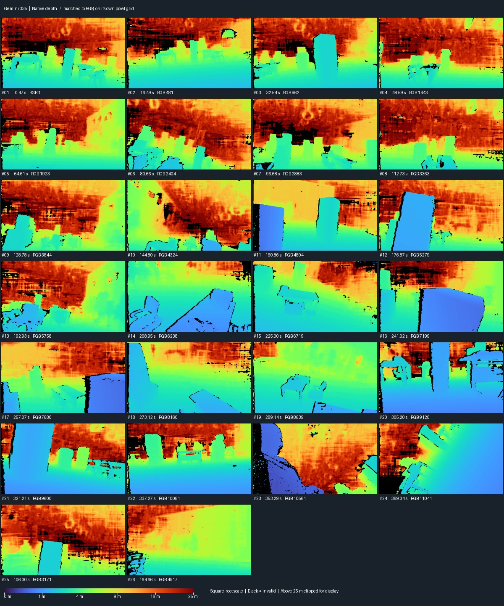
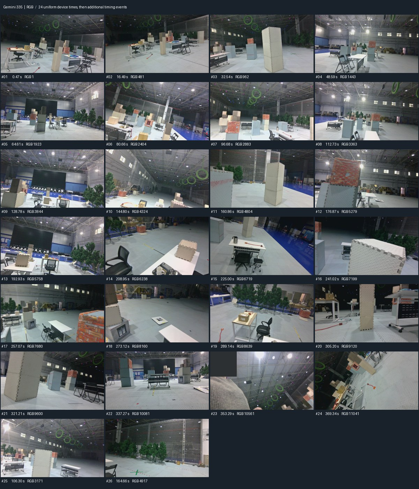

# Gemini 335 自有采集只读审计

**这段采集可以作为恢复位姿的 RGB-D 输入。** 彩色、原始数值深度、双相机标定和设备时间都可用。包里缺少相机在场景中的逐帧位姿，深度仍在深度相机的像素网格上。直接构造 DN-Splatter 的训练帧还缺这两项。[结构化结论](summary.json)

## 录制与覆盖

在 Windows 本机访问的 `H:\capture.bag` 是目录，其中唯一的普通文件为 `H:\capture.bag\capture.bag`。文件头为 `#ROSBAG V2.0`，共 11,072 个 LZ4 块。Orbbec Gemini 335 固件 1.3.70 写入了厂商扩展的 Image、Imu 和标定消息。实际大小为 **5,919,666,852 字节（5.513 GiB）**，修改时间为 2026-11-19 08:43:45.9115466 UTC。全文件流式 SHA-256 为 `3982cb269ea03ddf4234b45f74be27143eb66bcd807e4e471d0f3a9cd6b03b59`。审计前后文件字节数和修改时间一致。

按物理写入顺序读取 **11 个连接、168,383 条消息**，并用每条消息的连接、块内位置和记录时间核对索引。全部消息完成结构解析，图像像素抽查 26 对。采集时长按四路动态传感器的设备时间取首末差，为 **369.352598 s**。深度最先出现，最后一个 IMU 样本比最后一张深度晚约 12.7 ms。属性使用主机纪元时间，不能用整个容器的最小、最大记录时间计算拍摄时长。[话题清单](topic_inventory.json) · [时间统计](timing.json)

| 内容 | 话题 | 消息数 | 首末跨度 | 平均频率 |
| --- | --- | ---: | ---: | ---: |
| 彩色 MJPEG，1280×720 | `/cam/sensor_2/frameType_2` | 11,041 | 368.875 s | 29.929 Hz |
| 深度 mono16 / Y16，848×480 | `/cam/sensor_3/frameType_3` | 11,068 | 369.340 s | 29.964 Hz |
| 加速度计 | `/cam/sensor_4/frameType_4` | 73,082 | 369.299 s | 197.891 Hz |
| 陀螺仪 | `/cam/sensor_5/frameType_7` | 73,082 | 369.299 s | 197.891 Hz |
| 动态相机位姿、里程计、TF | 未发现对应话题 | 0 | — | — |

其余为 104 条属性、1 条设备信息、4 条流配置和 1 条视差参数。全部 ROS `frame_id` 为空，传感器角色通过 SDK 流类型、编码及载荷辨认。加速度计和陀螺仪都在整段提供三轴测量，姿态四元数和协方差矩阵全部为零。静态的加速度计到深度、深度到彩色变换均有来源。世界到相机的动态变换缺失，RGB 位姿覆盖 **0/11,041**，轨迹长度、方向、跳变和尺度一致性无法评价。[坐标关系](frame_graph.json) · [轨迹检查](trajectory.json)

## 时间同步

四路动态流中，每一帧的消息记录时间、Header.stamp 与扩展设备时间完全一致。分流按物理写入顺序检查，设备时间均无重复、回退或零值。RGB 有 13 个间隔超过本流中位间隔的 1.5 倍，最长 **64.530 ms**。两路 IMU 的主机接收时间各有 36,541 个重复值；设备时间仍然连续。按设备时间匹配，全程未平移时间戳。[时间与间断](timing.json)

| 最大允许绝对时差 | 唯一配对 | 占全部 RGB | 占全部深度 |
| --- | ---: | ---: | ---: |
| 5 ms | 11,028 | 99.88% | 99.64% |
| 10 / 20 / 33 ms | 11,041 | 100% | 99.76% |

每张 RGB 的最近深度本身就互不重复。10 ms 窗内剩余 27 张深度，其中 14 张早于第一组，13 张位于组间。深度减彩色的有符号中位数为 **+0.086 ms**。绝对时差中位数 **0.090 ms**，P95 **0.873 ms**，P99 **0.925 ms**，最大 **5.879 ms**。这些数值描述帧戳，不含曝光起止误差测量。[配对明细](sync.json)

## 标定、深度尺度与配准

| 原生网格 | fx / fy（px） | cx / cy（px） | 畸变 |
| --- | --- | --- | --- |
| 彩色 1280×720 | 694.276 / 694.215 | 646.467 / 358.383 | Brown–Conrady K6，保留 SDK 八系数顺序 |
| 深度 848×480 | 414.233 / 414.233 | 422.675 / 235.363 | Brown–Conrady，八系数均为 0 |

内参来自 `/cam/streamProfileType_2` 和 `/cam/streamProfileType_3`，各一条，全段图像格式及分辨率与对应配置一致。无标准 CameraInfo。深度到彩色的变换为 **p_color = R · p_depth + t**，平移 **[−13.604, +0.166, −1.764] mm**。硬件 D2C 属性 42 为关，包内没有彩色网格的注册深度。后续可据此变换做显式投影，并在物体前后缘处理遮挡。[内参、畸变与完整外参矩阵](calibration.json)

此记录的 **1 个深度计数 = 1 mm（0.001 m），表示光轴 Z**。依据为设备属性 176 的实测 float 值 1.0、视差参数 unit=1、硬件视差转深度开启，以及 Orbbec 对该型号读取单位和构造 XYZ 的实现。Image 扩展中的 depth_units 为默认 0，未用作比例。几何核验因缺少动态相机位姿而跳过，报告不提供实测配准残差。[深度与 SDK 证据](depth_quality.json)

26 张抽样深度合计 **10,583,040 像素**。按 SDK 的无效码规则剔除 0（4.15%）及 65,535（1.82%），有效码比例为 **94.04%**。有效 Z 的 P1 / 中位数 / P95 / P99 为 **0.467 / 6.143 / 24.799 / 34.337 m**。最远码值达 41.848 m，现场距离精度缺少独立参考。下图用统一平方根色标兼顾近物与大厅远景，25 m 以上截色，黑色表示无效像素。原值样本保留两个无效码。[原值统计](depth_quality.json)

## 场景、样例与接入建议

24 个均匀时刻覆盖首张到末张 RGB，另取绝对配对时差最大处及最长 RGB 间隔之后各一组。预览里的桌椅、立柱和堆叠箱体在多个角度重复出现，前后遮挡与可见侧面发生变化。样本没有完全重复画面，26 张图的拉普拉斯方差中位数为 554.2，范围 103.4–2362.7。第 23 组约 353.29 s 可见人员近距离遮挡，且清晰度分数最低。第 24 组相机明显侧倾。图像支持有多视角、存在可选静态目标的判断；连续可跟踪重叠、平移基线及全段动态占比仍待核实。[清晰度、曝光与相似度](image_quality.json)

**推荐先审阅 0.47–48.59 s（RGB 厂商帧号 1–1443）**，时间从首张深度算起。首四个均匀样本都可辨认同一组桌椅、箱体和柱体，其中兼有近物和较广视野。后续宜先为这段恢复米制 RGB 光心轨迹，再核对原生深度到彩色的边缘、遮挡与坐标尺度；IMU 可作为位姿估计的输入。逐帧位姿和配准深度通过小样本核验后，再决定是否转为 DN-Splatter 数据集。

可复核的四组为 #01（开头）、#13（中段）、#24（末尾侧倾）和 #25（最大绝对时差）。每组都有原始相机 JPEG 和保留 uint16 全分辨率数值的 NPZ，数组键为 `depth`。样本元数据记录原始时间、连接与帧号、标定来源、时差和读回校验。第 23 组公开 RGB 缩略图遮挡了左上角的人脸，像素统计使用原始画面。[样例与时间映射](samples_metadata.json) · [样例目录](samples/) · [文件大小与 SHA-256](artifact_manifest.json) · [命令与环境](execution.md)
