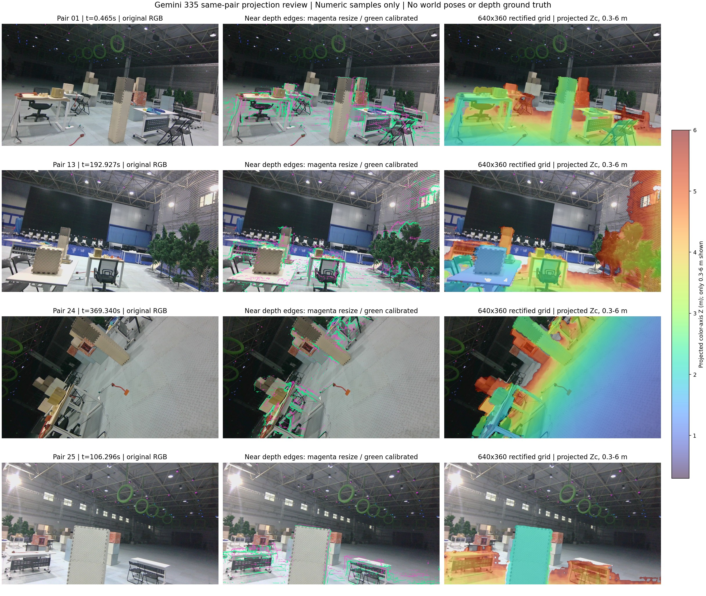

# Gemini 335 审计回传复核与下一步判断

日期：2026-11-19（Asia/Shanghai）。本次复核基于用户提交 `a13bb40445c1c049c2931094e533a5ed43472297`。原审计及其样例保持原样。

**结论：现有采集足以进入首个短片段的数据准备。已回传的内外参可以用于同帧 D2C，四组原数值样例已完成实际投影检查；逐帧相机位姿和跨视角米制几何仍未恢复/验证，因此还不能直接开始 DN-Splatter 训练。**

本轮不是只复述原报告：已获取并核对仓库文件的 Git blob 身份，阅读审计脚本及原厂关键实现；对四组公开 JPEG/NPZ 校验原 JPEG 与深度像素 SHA-256，再进行显式投影、去畸变、Z-buffer 和距离分布计算。本次没有访问 Windows H 盘、没有重新扫描 6GB 原件、没有运行 SfM/SLAM 或训练。实际数值见 [numeric_review.json](numeric_review.json)，可重复脚本为 [capture_registration_review.py](../../../scripts/capture_registration_review.py)。

## 1. 对原审计结论的判断

真实输入为 `H:\capture.bag\capture.bag`，上层 `H:\capture.bag` 是目录。Gemini 335、ROS1 v2.0 厂商扩展、11,041 张 RGB、11,068 张深度、完整时间扫描和同步结果均以原审计为来源；这里没有对未取得的原包重新验证完整性。[A1]

单位解释有充分支持：设备属性 176 的值为 1.0，录制视差参数 unit=1，硬件视差转深度开启，匹配 SDK 以该属性恢复深度单位，坐标构造使用深度值作为 Z。应理解为 **每计数 1mm 的轴向深度**。Image 扩展中的默认零值 depth_units 没有被误当成物理比例。[A2][S1]

没有动态 pose/TF 不妨碍同帧配准。所需关系只是：

`p_D = Z_D * K_D^{-1} [u_D,v_D,1]^T`，
`p_C = R_(C<-D) @ p_D + t_(C<-D)`。

其中平移先从毫米换成米，然后把 `p_C` 投影到目标 RGB 图像。世界相机位姿只在跨时刻点云/图像投影时需要。原报告因缺 pose 而跳过跨视图核验是正确边界；若把它扩大为“不能先检查 D2C”，则没有必要。后续顺序调整为先确认图像网格，再恢复轨迹。

## 2. 四组样例的实际结果

使用公开样例 #01、#13、#24、#25；这些横跨整段，不是首段的连续四帧。原始深度 0/65535 排除，其他值保留用于数值诊断。外参方向固定为 `p_color=R@p_depth+t`，不通过试转置、试取逆挑选视觉结果。

RGB 原生网格显式使用完整 rational Brown；另构造 640×360 的去畸变针孔 RGB 网格，反向 remap 彩色图、正向投影深度点，按最近正 `Z_C` 处理目标像素冲突。没有补洞、深度平滑或跨边界插值。

| 样例 | 相对首张深度时间 | 1280×720 原生 RGB 单点投影覆盖 | 640×360 去畸变网格覆盖 | resize-only 与标定投影的坐标差中位数 |
| --- | ---: | ---: | ---: | ---: |
| #01 | 0.465 s | 32.76% | 90.67% | 39.90 px |
| #13 | 192.927 s | 34.67% | 95.97% | 39.04 px |
| #24 | 369.340 s | 33.77% | 93.07% | 37.03 px |
| #25 | 106.296 s | 33.95% | 93.93% | 39.01 px |

**表中坐标差是两种计算方法之间的差，不是相对于人工标记或真值测得的标定误差。** 它说明直接 resize 会给这些样例带来明显不同的像素对应。忽略 RGB 畸变的投影差 P95 为 7.12–7.42 px，最大约 8.79 px；畸变处理也不能省略。

原生深度只有 848×480 个像素。一个点只投到一个 1280×720 像素时，理论覆盖上限是 44.17%，加上无效码、视野差和冲突后，约三分之一覆盖并不异常。640 网格的高覆盖主要说明采样密度更合适，**不能解释成 91%–96% 的深度准确率**。这些覆盖统计包括所有非哨兵距离；图中彩色深度只显示 0.3–6m，二者统计范围不同。



中列绿色为按标定投影的近物深度边界，紫色为仅按尺寸缩放的边界。目视可见绿色在桌面、箱体/柱体轮廓上大体对应 RGB；细椅腿、遮挡边界和无效区域仍有缺失与偏离。右列可辨认近处桌椅、箱体和地面。

该结果支持已有标定与图像在主要轮廓上相容，值得继续做首段几何准备；它不是全时段标定验收，也不是厘米级深度精度证据。四组样例没有世界轨迹，不能据此推出平移基线、漂移或重建完整度。

## 3. 深度长尾应单独处理

原审计的 26 张抽样结果为：非 0/65535 比例 94.04%，有效数值 P50=6.143m、P95=24.799m、P99=34.337m，最大 41.848m。这是“有数值”及分布，不是误差测量。[A2]

本次四样例中，0.3–6m 占各自非哨兵像素的 26.08%–75.68%；20m 以上占 11.97%–26.18%。它们来自不同朝向，不是对整段数据的比例估计。大厅墙体和顶棚可能真实很远，不能仅凭几十米数值断言单位错或数据损坏。

Gemini 335 官方资料将 0.1–20m+ 工作范围与约 0.3–3m 理想区间分开，空间精度示例还有分辨率、距离和ROI条件；这些指标不能直接外推到本次848×480远景测量。[S2] 首段应分别检查0.3–3m、0.3–6m、0.3–10m的覆盖、尺度拟合支持和跨视图残差，再确定实际用于初始化/监督的范围。保留原深度，不无声清除远景。

## 4. 直接接入历史 DN 时的实际风险

以下风险已通过固定历史 DN 和 Nerfstudio v1.1.3 源码核对，下一阶段已写进协议：

1. **畸变网格。** SDK 的 D 数组顺序为 k1,k2,k3,k4,k5,k6,p1,p2，不能直接传给 OpenCV。SDK Align 的目标畸变默认关闭，不能把该输出无条件与原生畸变JPEG搭配。先离线去畸变 RGB、将深度投到同一 K' 最明确。[S3]
2. **sensor_depth 自动处理缺口。** 父 datamanager 的图像去畸变没有同步处理 DN 使用的 sensor_depth。只设置原生畸变参数并期待它一起修复 RGB-D，会造成网格不一致。[S4]
3. **深度格式和无效码。** 原样例NPZ用于回传；派生输入推荐 float32 米制 .npy、depth_unit_scale_factor=1。65535 必须转换为派生图中的0；历史损失只有下限有效性选择，不会自动把65.535m认成Orbbec哨兵。深度有效mask不能直接用作全RGB mask_path。[S4]
4. **像素中心。** 保存K_cv和K_colmap/ns，主点+0.5只做一次；缩小图像还需使用对应采样映射更新K。固定版本的相机ray约定和COLMAP说明支持这一转换。[S5]
5. **姿态和尺度。** COLMAP输出w2c，先求逆，再将OpenCV c2w右乘diag(1,-1,-1,1)转成OpenGL c2w。全局尺度必须一致作用于相机平移和世界点。保持auto_scale_poses=False和scale_factor=1，避免米制场景又被归一化。[S6]
6. **初始化与法线。** 初始化仅用训练帧可信RGB-D；法线以后在最终处理网格RGB上生成并保存normals_from_pretrain/*.png。历史normal_file_path字段不能代替此机制。num_downscales=0保持已有DN默认，不改变算法损失。

## 5. 下一阶段已确定的具体任务

按 [docs/08](../../../docs/08_capture_geometry_plan.md) 和 [协议](../../../configs/capture_geometry_protocol.json) 执行：

- **本地**：复用厂商解析和SQLite索引，按设备时间选择0.465019–48.589426s首段；5Hz时间格计划241个目标，实际导出数由唯一帧选择、同步和质量检查决定。只导出选定原JPEG+原值深度+标定/时间清单，准备可验证的紧凑传输包。
- **服务器**：在独立预处理环境执行共享固定内参的COLMAP RGB SfM，以训练帧sensor depth恢复一个全局米制尺度；仅在实际连通性问题后补缺口帧/必要长程匹配，仍失败才走Open3D RGB-D位姿图备选。
- **评价口径**：质量筛选后冻结train/val/test。主协议训练图建图，留出RGB只对固定地图定位；尺度和初始化不使用留出深度。全图SfM若尝试则单独披露。相邻时间留出不等同独立新轨迹，无独立几何GT不输出Faro/F-score。
- **交付**：同帧和多帧几何报告、真实相机轨迹/尺度、实际prepared dataset与文件清单。当前尚未导出首段、传输服务器或运行轨迹求解。下一轮到几何报告为止，暂不自动生成法线或训练。

本地入口：[local_capture_geometry.md](../../../prompts/local_capture_geometry.md)。AutoDL入口：[autodl_capture_geometry.md](../../../prompts/autodl_capture_geometry.md)。无需重新安装DN训练栈，也无需为了本阶段上传整个原包。

## 6. 本次执行与验证

在仓库根目录执行：

```bash
python scripts/capture_registration_review.py \
  --audit-dir reports/capture-bag-audit/20261119T091841Z-3982cb26 \
  --output-dir reports/capture-bag-review/2026-11-19
```

脚本只读取公开回传样例，输出此处JSON和预览；软件版本、脚本SHA256、输入哈希、投影方法及局限记录在numeric_review.json。对四组depth像素和原JPEG均通过原审计哈希核对。报告中没有填造相机轨迹、重建准确率或训练指标。

## 依据

- [A1] [用户原审计](../../capture-bag-audit/20261119T091841Z-3982cb26/overview.md)、[summary](../../capture-bag-audit/20261119T091841Z-3982cb26/summary.json)、[同步](../../capture-bag-audit/20261119T091841Z-3982cb26/sync.json)。
- [A2] [标定](../../capture-bag-audit/20261119T091841Z-3982cb26/calibration.json)、[深度统计](../../capture-bag-audit/20261119T091841Z-3982cb26/depth_quality.json)、[样例映射](../../capture-bag-audit/20261119T091841Z-3982cb26/samples_metadata.json)。
- [S1] 固定OrbbecSDK [Frame.h](https://github.com/orbbec/OrbbecSDK_v2/blob/f5d59930ccb9a189f200e58fba4e2ae42664792d/include/libobsensor/h/Frame.h)、[G330Device.cpp](https://github.com/orbbec/OrbbecSDK_v2/blob/f5d59930ccb9a189f200e58fba4e2ae42664792d/src/device/gemini330/G330Device.cpp)、[CoordinateUtil.cpp](https://github.com/orbbec/OrbbecSDK_v2/blob/f5d59930ccb9a189f200e58fba4e2ae42664792d/src/shared/utils/CoordinateUtil.cpp)。
- [S2] [Gemini 330系列官方datasheet v1.4](https://www.orbbec.com/wp-content/uploads/2024/04/Gemini-330-series-Datasheet-V1.4_20250124.pdf)。
- [S3] 固定OrbbecSDK [Align.cpp](https://github.com/orbbec/OrbbecSDK_v2/blob/f5d59930ccb9a189f200e58fba4e2ae42664792d/src/filter/publicfilters/Align.cpp)、[AlignImpl.cpp](https://github.com/orbbec/OrbbecSDK_v2/blob/f5d59930ccb9a189f200e58fba4e2ae42664792d/src/filter/publicfilters/AlignImpl.cpp)。
- [S4] 固定DN [dn_dataset.py](https://github.com/maturk/dn-splatter/blob/811f5cdf342d92d12a9d9a4be185d374c430c184/dn_splatter/data/dn_dataset.py)、[dn_model.py](https://github.com/maturk/dn-splatter/blob/811f5cdf342d92d12a9d9a4be185d374c430c184/dn_splatter/dn_model.py)，Nerfstudio [FullImageDatamanager v1.1.3](https://github.com/nerfstudio-project/nerfstudio/blob/v1.1.3/nerfstudio/data/datamanagers/full_images_datamanager.py)。
- [S5] [COLMAP FAQ](https://colmap.github.io/faq.html)，Nerfstudio [Cameras v1.1.3](https://github.com/nerfstudio-project/nerfstudio/blob/v1.1.3/nerfstudio/cameras/cameras.py)。
- [S6] [COLMAP输出格式](https://colmap.github.io/format.html)、[Nerfstudio数据约定](https://docs.nerf.studio/quickstart/data_conventions.html)。
