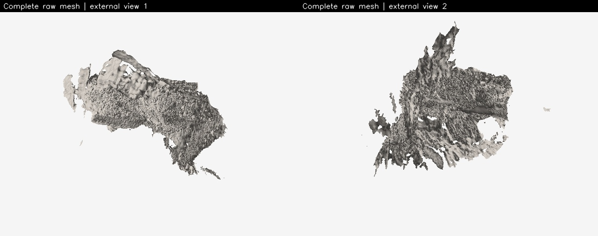

# 全程 capture 首次 30k 测试

状态 completed。共请求 1846 帧，取得位姿 1846 帧，缺口 0 帧。
米制尺度为 1.4541853 m/SfM 单位。以 2,001,906 个训练点初始化，最终 172,425 个高斯，累计 30,000 次更新。

| 划分 | 请求 | 位姿 | 评估 | PSNR | SSIM | LPIPS | 合并像素深度 MAE (m) |
|---|---:|---:|---:|---:|---:|---:|---:|
| train | 1478 | 1478 | 0 | — | — | — | — |
| val | 184 | 184 | 184 | 15.7850 | 0.6380 | 0.4378 | 0.4868 |
| test | 184 | 184 | 184 | 15.8256 | 0.6384 | 0.4384 | 0.4915 |

全轨迹视频包含 1846 个时间位置，回放 368.920 秒。视频与检查点身份见 [视频清单](video_manifest.json)。
原始 Poisson 使用 1478 个训练视角和 5,000,074 个样点，得到 1,044,849 个顶点、2,102,867 个面；最大连通分量占全部面的 96.8%。

同采集传感器深度用于一致性比较。每个时间窗的覆盖、误差和有效像素数见 [分时段结果](metrics_by_time.json)。相同源帧的旧基线和本轮结果见 [同帧比较](comparison_s01_same_sources.json)。

留出图最低 PSNR 为 7.96 dB，对应 frame_01409。见 [该帧参考与渲染](previews/frame_01409_timeline.jpg)。
三个固定局部中，table 的网格与传感器 Z 偏差最大（MAE 3.589 m）。下一步优先在这个区域核查模型、样点和网格各自的深度覆盖与误差。各层匹配像素分母见 [局部对照](mesh_validation.json)。

[大产物路径、字节数与 SHA256](artifact_manifest.json) · [阶段耗时和资源](run_manifest.json) · [测试集逐帧指标](metrics_test.json)
