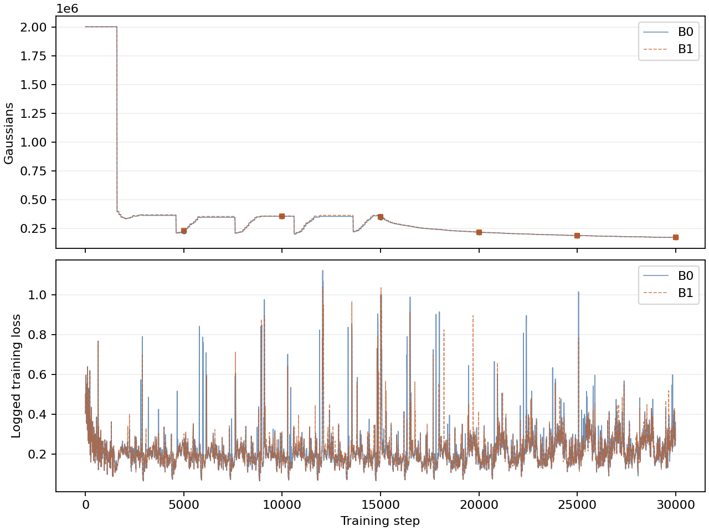
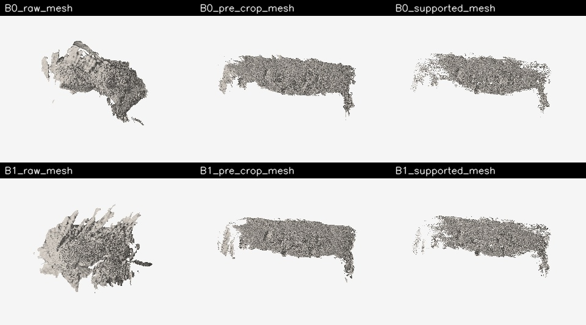

# capture-full 全程 Metric3D v2 法线对照

从相同的 2,001,906 个点初始化，B1 完成 30,000 次更新，最终 step 29,999，共 171,417 个高斯。B0 最终有 172,425 个高斯。两组使用同一 1,478 张训练图和相同配置，B1 训练使用 Metric3D v2 ViT-Large 法线与原传感器 Z。

## 全部留出视角

| 划分 | 模型 | 帧数 | PSNR (dB) | SSIM | LPIPS | 合并像素 MAE (m) | 合并像素 RMSE (m) | 有效参考像素 | 无效预测 |
|---|---|---:|---:|---:|---:|---:|---:|---:|---:|
| val | B0 | 184 | 15.785 | 0.6380 | 0.4378 | 0.4868 | 1.0152 | 29,222,080 | 0 |
| val | B1 | 184 | 16.941 | 0.6658 | 0.4097 | 0.3127 | 0.6946 | 29,222,080 | 0 |
| test | B0 | 184 | 15.826 | 0.6384 | 0.4384 | 0.4915 | 1.0211 | 29,100,252 | 0 |
| test | B1 | 184 | 16.885 | 0.6641 | 0.4130 | 0.3365 | 0.7852 | 29,100,252 | 0 |

本次留出集上的各项均值均向改善方向变化。 这些数值来自本次采集的完整划分。

- val 的 PSNR 有 117 帧上升、67 帧下降。原 s01 同源 24 帧中有 7 帧上升。独立保存的 Metric3D 单帧深度与传感器有 29,222,080/29,222,080 个有效配对，条件 MAE 为 0.5091 m。逐帧差值和 30 秒窗见 [配对明细](paired_val.json)。
- test 的 PSNR 有 119 帧上升、65 帧下降。原 s01 同源 24 帧中有 9 帧上升。独立保存的 Metric3D 单帧深度与传感器有 29,100,252/29,100,252 个有效配对，条件 MAE 为 0.5093 m。逐帧差值和 30 秒窗见 [配对明细](paired_test.json)。

## 高斯数量与训练曲线

B1 单次净减少最大出现在 step 1600，由 2,001,906 到 398,115。该次剔除并集为 1,644,258，父点替换为 20,105。B0 的历史记录提供了各保存步数量和日志中的剔除数。详细原因及其重叠以 B1 实际回调记录为准。[B0 曲线](B0_training_curve.json) · [B1 剔除记录](B1_refinement.json)。

## 网格及其有效覆盖

覆盖率使用 0.3–6 m 的全部有效传感器像素作分母。正确覆盖要求误差不超过 max(0.05 m, 参考深度的 3%)。近于参考且超过同一容差的首交点计入前方冲突。

| 划分 | 模型 | 导出 | 命中 / 参考像素 | 命中率 | 正确覆盖率 | 命中 MAE (m) | 前方冲突 / 全部参考 |
|---|---|---|---:|---:|---:|---:|---:|
| val | B0 | 原始 depth 9 | 29,222,080 / 29,222,080 | 1.0000 | 0.0306 | 2.4690 | 0.9627 |
| val | B0 | depth 11 裁前 | 28,387,989 / 29,222,080 | 0.9715 | 0.3427 | 0.3898 | 0.5907 |
| val | B0 | 支持裁剪后 | 26,755,576 / 29,222,080 | 0.9156 | 0.5334 | 0.2070 | 0.2156 |
| val | B1 | 原始 depth 9 | 29,222,073 / 29,222,080 | 1.0000 | 0.0539 | 2.4104 | 0.9368 |
| val | B1 | depth 11 裁前 | 28,353,336 / 29,222,080 | 0.9703 | 0.3586 | 0.3754 | 0.5781 |
| val | B1 | 支持裁剪后 | 26,980,067 / 29,222,080 | 0.9233 | 0.5371 | 0.2090 | 0.2246 |
| test | B0 | 原始 depth 9 | 29,100,020 / 29,100,252 | 1.0000 | 0.0233 | 2.4878 | 0.9735 |
| test | B0 | depth 11 裁前 | 28,211,384 / 29,100,252 | 0.9695 | 0.3464 | 0.3851 | 0.5860 |
| test | B0 | 支持裁剪后 | 26,560,996 / 29,100,252 | 0.9127 | 0.5355 | 0.2043 | 0.2138 |
| test | B1 | 原始 depth 9 | 29,099,961 / 29,100,252 | 1.0000 | 0.0529 | 2.4319 | 0.9389 |
| test | B1 | depth 11 裁前 | 28,206,513 / 29,100,252 | 0.9693 | 0.3631 | 0.3719 | 0.5734 |
| test | B1 | 支持裁剪后 | 26,801,630 / 29,100,252 | 0.9210 | 0.5385 | 0.2051 | 0.2229 |

- B0 的训练深度筛选得到 32,812,907 个样点，1 cm 融合后为 9,844,160 点。支持裁剪保留 9,476,092/18,550,588 个面。同一模型更换导出时，test 命中覆盖变化 -8.73 个百分点，正确覆盖变化 +51.22 个百分点。
- B1 的训练深度筛选得到 34,303,050 个样点，1 cm 融合后为 11,056,838 点。支持裁剪保留 9,534,116/18,293,412 个面。同一模型更换导出时，test 命中覆盖变化 -7.90 个百分点，正确覆盖变化 +48.57 个百分点。

法线的作用可在相同导出下比较 B0 与 B1，筛选与裁剪的作用可在同一模型内比较。这里只评价同次采集传感器的一致性。逐帧、等权帧、合并像素、5/10/20 cm 正确覆盖、共同命中和三个固定局部见 [test 网格指标](surface_test_metrics.json)、[val 网格指标](surface_val_metrics.json)和[局部结果](surface_local.json)。

## 视频与产物

全程视频按采集时间播放，共 1,846 帧、368.920 秒，从左到右为参考 RGB、B0 与 B1。源权重、训练输入、checkpoint、完整视频、点云和网格的路径与哈希见[产物清单](artifact_manifest.json)。精度与坐标转换见[先验记录](normal_prior.json)，B1 与 B0 的配置逐项核对见[配置差异](config_diff.json)。

本轮中学习率、首遍以后的顺序采样和 15k 停止增密均与 B0 一致。判断训练预算或采样顺序的作用还需单独的完整对照。
