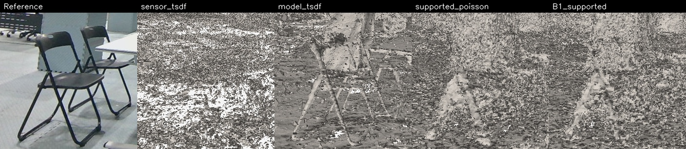

# DN-Splatter 全程重建 · B2 详细指标对比

2026 年 11 月 22 日 · capture-full · B1 Metric3D 30k 对比 B2 210k 主模型及 B2 240k 最终模型

## 结果摘要

**模型改善明显。** 在相同的 184 张固定开发测试图上，B2 主模型的 PSNR 从 16.885 升至 24.681 dB（+7.796 dB），深度 MAE 从 33.65 cm 降至 12.36 cm（−63.27%）。184 张图的 PSNR 全部提高，172 张图的逐帧深度 MAE 降低。4–6 m 的参考像素改善最大，MAE 从 81.27 cm 降至 28.85 cm，也仍是误差最大的一段。

**网格覆盖改善，几何精度改善较小。** 在全部测试参考像素上，支持 Poisson 网格的 10 cm 正确覆盖从 59.02% 升至 61.95%（按未舍入值计算为 +2.92 个百分点），命中率从 92.10% 升至 96.27%。按各自命中集合计算，MAE 从 20.51 cm 升至 20.73 cm。若只比较两个网格都命中的 26,499,902 个像素，MAE 从 20.26 cm 降至 19.51 cm。新增覆盖与原有表面精度要分开看。

**完整视频**长 6 分 08.92 秒，左、中、右依次为同位置实拍参考、B1、B2 210k。保留了 1,846 个采集位置及原显示时间戳。05:49.08 至 05:54.86 的 30 个画面按既有隐私规则遮挡，时间轴连续。文件名为 `reference_B1_B2_public.mp4`，大小 484,070,855 字节。[视频清单与 SHA-256](video_manifest.json)

## 一、评价口径

全程共 1,846 张主帧，其中 1,478 张用于训练，184 张用于验证，184 张用于固定开发测试。两轮保留相同的 RGB、传感器参考与划分，各自使用本轮相机位姿。B2 同时改动局部位姿、训练点初始化、采样、增密和训练时长，所以差值衡量整套方法的端到端变化。

RGB 按帧等权。PSNR（dB）和 SSIM 越高越好，LPIPS 越低越好。深度采用同次采集、RGB 相机光轴上的有效传感器 Z ∈ [0.3, 6.0] m；验证和测试分别有 29,222,080 和 29,100,252 个参考像素。测试有效参考占全部 184 张图像像素的 17.16%。结论适用于有参考的位置，传感器 Z 也带有测量误差。

深度 MAE 是预测与参考深度的绝对差平均值，RMSE 对大误差更敏感。AbsRel 是绝对差除以参考深度再取平均，下表用百分比表示。P50、P95 对应绝对误差中位数和第 95 百分位。除标明“帧均”外，深度量按全部有效参考像素合并。带符号偏差定义为预测 Z 减参考 Z，负值表示预测偏近。

## 二、模型整体指标

B0 采用 Omnidata 法线，B1 和 B2 均采用 Metric3D v2 法线。B0 作为历史对照，主比较使用 B1 最终 30k 与按验证集规则选出的 B2 210k。

| 划分 | 模型 | PSNR ↑ | SSIM ↑ | LPIPS ↓ | 像素 MAE (cm) ↓ | 帧均 MAE (cm) ↓ | RMSE (cm) ↓ | AbsRel ↓ | P50 (cm) ↓ | P95 (cm) ↓ |
|---|---|---|---|---|---|---|---|---|---|---|
| val | B0 30k | 15.785 | 0.6380 | 0.4378 | 48.68 | 50.24 | 101.52 | 14.23% | 9.79 | 248.94 |
| val | B1 30k | 16.941 | 0.6658 | 0.4097 | 31.27 | 34.65 | 69.46 | 9.14% | 8.25 | 149.14 |
| val | B2 210k 主 | 24.644 | 0.8045 | 0.1990 | 12.04 | 13.50 | 37.75 | 3.85% | 4.08 | 42.15 |
| val | B2 240k 末 | 24.638 | 0.8047 | 0.1978 | 12.24 | 13.74 | 37.84 | 3.88% | 4.10 | 43.87 |
| test | B0 30k | 15.826 | 0.6384 | 0.4384 | 49.15 | 51.00 | 102.11 | 14.32% | 10.25 | 247.93 |
| test | B1 30k | 16.885 | 0.6641 | 0.4130 | 33.65 | 37.78 | 78.52 | 10.23% | 8.22 | 167.59 |
| test | B2 210k 主 | 24.681 | 0.8044 | 0.2010 | 12.36 | 13.94 | 38.93 | 3.81% | 3.98 | 44.13 |
| test | B2 240k 末 | 24.703 | 0.8045 | 0.1999 | 12.72 | 14.48 | 39.25 | 3.88% | 4.01 | 47.49 |

### 从像素误差看近景与远景

各距离段均按参考 Z 分组，前三段左闭右开，最后一段包含 6.0 m。正确率的分母为该段全部有效参考像素，误差阈值 10 cm。

| 划分 | 距离 (m) | 参考像素 | B1 MAE (cm) | B2 MAE (cm) | MAE 降幅 | B1 ≤10 cm | B2 ≤10 cm | B2 偏差 (cm) |
|---|---|---|---|---|---|---|---|---|
| val | 0.3–1 | 3,045,420 | 4.17 | 2.90 | 30.53% | 93.76% | 97.74% | 1.28 |
| val | 1–2 | 6,339,081 | 6.94 | 4.64 | 33.21% | 84.14% | 94.80% | 1.73 |
| val | 2–4 | 13,018,364 | 26.54 | 9.97 | 62.45% | 50.33% | 75.80% | -0.75 |
| val | 4–6 | 6,819,215 | 75.00 | 26.96 | 64.05% | 16.82% | 34.40% | -8.01 |
| test | 0.3–1 | 3,063,057 | 6.92 | 2.46 | 64.49% | 92.67% | 98.24% | 0.94 |
| test | 1–2 | 6,300,951 | 6.50 | 4.08 | 37.25% | 85.20% | 95.29% | 1.15 |
| test | 2–4 | 12,937,785 | 28.17 | 10.07 | 64.25% | 50.17% | 76.05% | -1.02 |
| test | 4–6 | 6,798,459 | 81.27 | 28.85 | 64.50% | 16.79% | 33.98% | -8.74 |

| 划分 | 模型深度 | ≤5 cm | ≤10 cm | ≤20 cm | 平均偏差 (cm) |
|---|---|---|---|---|---|
| val | B1 30k | 38.77% | 54.37% | 68.48% | -21.64 |
| val | B2 210k | 55.18% | 72.55% | 86.12% | -1.70 |
| test | B1 30k | 38.76% | 54.43% | 68.80% | -23.31 |
| test | B2 210k | 55.86% | 72.72% | 86.01% | -2.15 |

## 三、八个验证节点与选点依据

每累计 30k 更新评价全部 184 张验证图。先要求 PSNR、SSIM 不低于 B1 最终值且 LPIPS 不高于该值，再按最小像素合并深度 MAE 选主模型。八个节点均通过 RGB 门槛。210k 的验证深度 MAE 最低，为 12.04 cm；240k 为 12.24 cm。240k 的测试 PSNR 略高、深度 MAE 略高，仍单独列入最终结果。

| 累计更新 | PSNR (dB) | SSIM | LPIPS | 合并深度 MAE (cm) | 通过 RGB 门槛 |
|---|---|---|---|---|---|
| 30,000 | 23.203 | 0.7878 | 0.2251 | 12.57 | 是 |
| 60,000 | 23.561 | 0.7932 | 0.2169 | 12.81 | 是 |
| 90,000 | 23.740 | 0.7955 | 0.2112 | 12.62 | 是 |
| 120,000 | 23.728 | 0.7948 | 0.2134 | 13.18 | 是 |
| 150,000 | 24.358 | 0.8021 | 0.2041 | 12.39 | 是 |
| 180,000 | 24.456 | 0.8034 | 0.2006 | 12.54 | 是 |
| 210,000 | 24.644 | 0.8045 | 0.1990 | 12.04 | 是 |
| 240,000 | 24.638 | 0.8047 | 0.1978 | 12.24 | 是 |

展开 B1 六个历史检查点的同口径验证

| B1 保存 step（零基） | 验证帧 | PSNR (dB) | SSIM | LPIPS | 深度 MAE (cm) |
|---|---|---|---|---|---|
| 5,000 | 184 | 16.431 | 0.6163 | 0.4911 | 27.89 |
| 10,000 | 184 | 18.156 | 0.6699 | 0.4331 | 24.57 |
| 15,000 | 184 | 17.091 | 0.6350 | 0.4657 | 43.26 |
| 20,000 | 184 | 18.022 | 0.6762 | 0.4053 | 18.84 |
| 25,000 | 184 | 18.221 | 0.6786 | 0.3987 | 20.35 |
| 29,999 | 184 | 16.941 | 0.6658 | 0.4097 | 31.27 |

## 四、三种网格与 B1 支持网格

下表使用验证集选定的 210k 主模型。原生传感器 TSDF 仅融合训练深度，作为输入几何参照。模型 TSDF 融合训练视角中透明度累积值 α ≥ 0.5 的模型预测 Z。B2 支持 Poisson 沿用 B1 的训练深度支持筛选，两种 TSDF 均使用 1 cm 体素、4 cm 截断距离。

命中指从参考像素发出的射线首先交到有限正深度的网格表面。5/10/20 cm 正确覆盖要求命中且绝对深度误差在阈值内。前方冲突指交点比参考表面靠前超过 max(5 cm, 3% × 参考 Z)。这些百分比均以全部有效参考像素为分母，最后三列只在命中像素上计算。

| 划分 | 网格 | 命中 ↑ | 缺失 ↓ | ≤5 cm ↑ | ≤10 cm ↑ | ≤20 cm ↑ | 前方冲突 ↓ | 命中 MAE (cm) | P50 (cm) | P95 (cm) |
|---|---|---|---|---|---|---|---|---|---|---|
| val | B1 支持 Poisson | 92.33% | 7.67% | 40.57% | 58.76% | 73.52% | 22.46% | 20.90 | 6.16 | 86.69 |
| val | 原生传感器 TSDF | 75.33% | 24.67% | 3.15% | 5.79% | 11.68% | 17.41% | 182.65 | 100.93 | 623.67 |
| val | B2 模型 TSDF | 98.01% | 1.99% | 39.62% | 55.64% | 70.16% | 14.32% | 47.30 | 7.43 | 290.88 |
| val | B2 支持 Poisson | 96.43% | 3.57% | 43.81% | 61.61% | 76.84% | 22.50% | 21.10 | 5.94 | 83.16 |
| test | B1 支持 Poisson | 92.10% | 7.90% | 40.75% | 59.02% | 73.60% | 22.29% | 20.51 | 6.10 | 84.61 |
| test | 原生传感器 TSDF | 75.53% | 24.47% | 3.23% | 5.79% | 11.68% | 17.57% | 182.15 | 100.29 | 628.21 |
| test | B2 模型 TSDF | 98.03% | 1.97% | 40.23% | 56.10% | 70.45% | 14.21% | 47.78 | 7.25 | 298.00 |
| test | B2 支持 Poisson | 96.27% | 3.73% | 44.18% | 61.95% | 77.04% | 22.26% | 20.73 | 5.84 | 81.30 |

两种模型网格的验证命中率都超过 90%。按预定的第二项规则，支持 Poisson 的验证 10 cm 正确覆盖为 61.61%，高于模型 TSDF 的 55.64%，因此选作主网格。测试上，模型 TSDF 的前方冲突较低（14.21%），但命中 MAE 较大（47.78 cm）。原生传感器 TSDF 的测试 10 cm 正确覆盖仅 5.79%，命中 MAE 为 182.15 cm；现有评价未单独确定其误差成因。

| 划分 | 与 B1 配对的网格 | 两者共同命中像素 | B1 MAE (cm) | 该网格 MAE (cm) | 变化 (cm) |
|---|---|---|---|---|---|
| val | 原生传感器 TSDF | 20,352,005 | 21.36 | 181.82 | 160.45 |
| val | B2 模型 TSDF | 26,493,787 | 20.87 | 41.84 | 20.97 |
| val | B2 支持 Poisson | 26,677,283 | 20.64 | 19.81 | -0.83 |
| test | 原生传感器 TSDF | 20,282,878 | 21.00 | 182.03 | 161.03 |
| test | B2 模型 TSDF | 26,327,492 | 20.47 | 42.03 | 21.56 |
| test | B2 支持 Poisson | 26,499,902 | 20.26 | 19.51 | -0.75 |

### 网格正确覆盖随距离的变化

| 测试距离 (m) | 参考像素 | B1 支持 Poisson | 原生传感器 TSDF | B2 模型 TSDF | B2 支持 Poisson |
|---|---|---|---|---|---|
| 0.3–1 | 3,063,057 | 77.51% | 5.58% | 95.32% | 79.13% |
| 1–2 | 6,300,951 | 82.42% | 6.89% | 78.02% | 84.51% |
| 2–4 | 12,937,785 | 63.02% | 6.84% | 53.41% | 66.16% |
| 4–6 | 6,798,459 | 21.41% | 2.85% | 23.22% | 25.28% |

### 固定相机局部

同一裁剪从左至右是实拍、原生传感器 TSDF、B2 模型 TSDF、B2 支持 Poisson 和 B1 支持 Poisson。模型 TSDF 的柱面与椅背较容易辨认，支持 Poisson 在椅腿周围仍有明显碎面。局部图与全分母统计分别反映可见结构和总体覆盖。

[桌沿固定视角](previews/surface_table.jpg) · [柱面固定视角](previews/surface_pillar.jpg)

## 五、对照视频时间索引

下表每 30 秒聚合一次，末段截至片尾。窗口内 PSNR 按帧等权，深度 MAE 按该窗口的有效参考像素加权；网格列给出全部参考像素的 10 cm 正确覆盖。可按左侧时间直接定位视频。

### 测试集

RGB 增益最大的时段从 06:00 开始，PSNR 增加 14.03 dB。深度 MAE 降幅最大的时段从 02:30 开始，降低 40.18 cm。

| 片内时间 | 帧数 | B1 PSNR | B2 PSNR | Δ dB | B1 MAE (cm) | B2 MAE (cm) | B1 网格 ≤10 cm | B2 网格 ≤10 cm |
|---|---|---|---|---|---|---|---|---|
| 00:00–00:30 | 14 | 19.58 | 26.49 | 6.91 | 30.92 | 12.07 | 58.72% | 60.61% |
| 00:30–01:00 | 15 | 16.15 | 25.89 | 9.75 | 39.99 | 14.37 | 55.03% | 57.59% |
| 01:00–01:30 | 15 | 15.29 | 24.48 | 9.19 | 31.14 | 25.87 | 40.63% | 39.81% |
| 01:30–02:00 | 15 | 15.58 | 24.08 | 8.50 | 36.98 | 17.63 | 41.10% | 42.55% |
| 02:00–02:30 | 15 | 15.07 | 23.20 | 8.14 | 38.05 | 19.46 | 42.63% | 43.43% |
| 02:30–03:00 | 15 | 15.80 | 23.49 | 7.69 | 52.07 | 11.88 | 53.84% | 59.53% |
| 03:00–03:30 | 15 | 16.78 | 24.04 | 7.26 | 44.23 | 12.29 | 53.96% | 57.60% |
| 03:30–04:00 | 15 | 17.46 | 25.11 | 7.65 | 32.61 | 9.33 | 62.08% | 64.87% |
| 04:00–04:30 | 15 | 17.65 | 23.64 | 5.99 | 41.08 | 11.43 | 57.95% | 63.54% |
| 04:30–05:00 | 15 | 17.93 | 23.82 | 5.89 | 44.14 | 10.81 | 53.06% | 58.11% |
| 05:00–05:30 | 15 | 17.82 | 24.32 | 6.50 | 14.93 | 10.36 | 72.71% | 73.65% |
| 05:30–06:00 | 15 | 16.92 | 24.86 | 7.94 | 21.15 | 11.91 | 70.94% | 73.98% |
| 06:00–06:08.92 | 5 | 19.23 | 33.26 | 14.03 | 7.06 | 4.27 | 85.91% | 86.13% |

展开验证集的全部 30 秒窗口

| 片内时间 | 帧数 | B1 PSNR | B2 PSNR | Δ dB | B1 MAE (cm) | B2 MAE (cm) | B1 网格 ≤10 cm | B2 网格 ≤10 cm |
|---|---|---|---|---|---|---|---|---|
| 00:00–00:30 | 14 | 19.90 | 25.93 | 6.03 | 23.50 | 12.38 | 58.86% | 60.70% |
| 00:30–01:00 | 15 | 16.39 | 25.47 | 9.08 | 26.30 | 13.83 | 54.59% | 56.89% |
| 01:00–01:30 | 15 | 15.27 | 24.23 | 8.96 | 27.75 | 21.33 | 40.51% | 39.48% |
| 01:30–02:00 | 15 | 15.62 | 23.85 | 8.23 | 35.50 | 18.50 | 40.42% | 42.58% |
| 02:00–02:30 | 15 | 15.04 | 23.88 | 8.84 | 33.33 | 16.92 | 43.95% | 44.20% |
| 02:30–03:00 | 15 | 16.01 | 23.69 | 7.68 | 51.55 | 11.89 | 55.01% | 60.50% |
| 03:00–03:30 | 15 | 16.90 | 24.18 | 7.28 | 41.47 | 11.34 | 53.95% | 57.48% |
| 03:30–04:00 | 15 | 17.27 | 25.01 | 7.74 | 33.95 | 10.26 | 60.11% | 62.81% |
| 04:00–04:30 | 15 | 17.46 | 23.36 | 5.89 | 41.02 | 11.59 | 56.69% | 62.43% |
| 04:30–05:00 | 15 | 17.89 | 24.22 | 6.33 | 43.66 | 10.20 | 53.32% | 57.79% |
| 05:00–05:30 | 15 | 18.01 | 24.46 | 6.46 | 14.91 | 10.37 | 72.57% | 73.58% |
| 05:30–06:00 | 15 | 16.95 | 24.65 | 7.70 | 18.29 | 12.04 | 70.52% | 73.91% |
| 06:00–06:08.92 | 5 | 19.24 | 33.28 | 14.04 | 7.08 | 4.09 | 85.84% | 86.03% |

### 可直接跳看的测试画面

| 选取依据 | 时间 | 帧 | B1 → B2 PSNR (dB) | B1 → B2 MAE (cm) |
|---|---|---|---|---|
| B2 画质最低 | 04:44.27 | frame_01419 | 13.72 → 19.67 | 96.53 → 26.50 |
| B2 深度误差最大 | 01:06.28 | frame_00329 | 15.05 → 21.86 | 41.90 → 93.85 |
| PSNR 提升最多 | 01:52.26 | frame_00559 | 11.33 → 25.91 | 198.94 → 17.83 |
| 深度 MAE 恶化最多 | 01:06.28 | frame_00329 | 15.05 → 21.86 | 41.90 → 93.85 |

## 六、原 s01 的 24 张同源画面

在验证集和测试集内分别取 24 张与原 s01 拍摄索引和时间戳相同的图。每一组使用相同的图像与传感器参考。

| 划分 | 模型 | 同源帧数 | PSNR | SSIM | LPIPS | 合并 MAE (cm) |
|---|---|---|---|---|---|---|
| val | s01 专用 30k | 24 | 23.243 | 0.7793 | 0.2977 | 12.21 |
| val | B1 全程 30k | 24 | 18.576 | 0.7199 | 0.3586 | 22.77 |
| val | B2 全程 210k | 24 | 25.845 | 0.8364 | 0.1681 | 12.27 |
| test | s01 专用 30k | 24 | 23.350 | 0.7793 | 0.3041 | 16.46 |
| test | B1 全程 30k | 24 | 18.407 | 0.7164 | 0.3676 | 27.47 |
| test | B2 全程 210k | 24 | 26.429 | 0.8454 | 0.1718 | 12.17 |

## 七、工程目标与仍存问题

| 按验证集预设的目标 | 实测 | 结论 |
|---|---|---|
| 模型 PSNR 相对 B1 提高 ≥2 dB | +7.704 dB | 达到 |
| 模型深度 MAE 相对 B1 降低 ≥25% | 61.50% | 达到 |
| 主网格命中率 ≥90% | 96.43% | 达到 |
| 主网格 10 cm 正确覆盖 ≥70% | 61.61% | 未达到 |
| 主网格前方冲突 ≤15% | 22.50% | 未达到 |

14 个候选位姿中，11 个得到了外部训练观测支持的修正。01304、01305 的内点各只来自一个外部训练视角，01514 缺少可接受解。这三帧保留原估计，训练与评价继续沿用原划分。B2 的新初始化包含 2,011,213 个传感器种子和 60,134 个 SfM 种子。

## 附录 · 368 张留出图逐帧对比

每行可用帧号或片内时间定位。模型列比较 B1 最终和 B2 210k。零参考深度的行以“—”标记；网格列给出本帧有效参考像素中误差 ≤10 cm 的比例。

展开 test 的全部 184 张图

| 帧 | 时间 | 参考像素 | PSNR B1 → B2 | SSIM B1 → B2 | LPIPS B1 → B2 | B1 MAE (cm) | B2 MAE (cm) | 网格 ≤10 cm B1 → B2 |
|---|---|---|---|---|---|---|---|---|
| frame_00009 | 00:02.27 | 123,833 | 19.68 → 26.32 | 0.704 → 0.846 | 0.397 → 0.186 | 13.70 | 11.47 | 58.19% → 58.11% |
| frame_00019 | 00:04.27 | 163,997 | 20.30 → 27.80 | 0.724 → 0.861 | 0.329 → 0.156 | 10.66 | 8.29 | 66.78% → 66.88% |
| frame_00029 | 00:06.27 | 175,495 | 21.01 → 26.77 | 0.770 → 0.835 | 0.289 → 0.160 | 12.39 | 12.48 | 70.79% → 70.73% |
| frame_00039 | 00:08.28 | 190,060 | 20.91 → 27.37 | 0.773 → 0.869 | 0.272 → 0.154 | 10.38 | 8.32 | 71.09% → 71.44% |
| frame_00049 | 00:10.28 | 153,014 | 17.73 → 24.68 | 0.707 → 0.819 | 0.390 → 0.203 | 43.90 | 13.31 | 38.03% → 48.32% |
| frame_00059 | 00:12.28 | 198,382 | 21.21 → 27.56 | 0.742 → 0.839 | 0.315 → 0.167 | 12.99 | 8.90 | 63.83% → 67.42% |
| frame_00069 | 00:14.25 | 203,175 | 20.68 → 27.94 | 0.781 → 0.870 | 0.278 → 0.179 | 12.54 | 9.40 | 68.67% → 71.80% |
| frame_00079 | 00:16.25 | 172,716 | 19.69 → 27.30 | 0.742 → 0.864 | 0.282 → 0.153 | 24.98 | 13.92 | 60.21% → 62.03% |
| frame_00089 | 00:18.25 | 138,788 | 20.52 → 26.43 | 0.728 → 0.837 | 0.345 → 0.157 | 17.28 | 17.42 | 54.33% → 55.35% |
| frame_00099 | 00:20.26 | 146,758 | 20.69 → 25.37 | 0.730 → 0.826 | 0.366 → 0.174 | 51.38 | 14.82 | 54.46% → 55.51% |
| frame_00109 | 00:22.26 | 147,069 | 14.89 → 25.02 | 0.646 → 0.825 | 0.510 → 0.198 | 202.08 | 17.10 | 44.64% → 46.03% |
| frame_00119 | 00:24.26 | 137,846 | 18.91 → 26.09 | 0.696 → 0.833 | 0.410 → 0.210 | 16.08 | 14.80 | 47.18% → 46.76% |
| frame_00129 | 00:26.26 | 157,345 | 18.87 → 26.37 | 0.735 → 0.848 | 0.373 → 0.189 | 16.15 | 13.15 | 46.94% → 47.67% |
| frame_00139 | 00:28.27 | 157,834 | 18.96 → 25.83 | 0.718 → 0.848 | 0.343 → 0.176 | 12.16 | 9.27 | 64.35% → 67.08% |
| frame_00149 | 00:30.27 | 158,930 | 18.39 → 26.83 | 0.716 → 0.863 | 0.345 → 0.158 | 12.28 | 15.26 | 59.97% → 61.52% |
| frame_00159 | 00:32.27 | 156,197 | 19.64 → 27.17 | 0.739 → 0.842 | 0.394 → 0.205 | 12.32 | 10.99 | 68.04% → 69.01% |
| frame_00169 | 00:34.27 | 147,888 | 17.90 → 25.78 | 0.703 → 0.818 | 0.375 → 0.152 | 12.73 | 10.61 | 68.93% → 67.96% |
| frame_00179 | 00:36.28 | 137,179 | 16.51 → 27.26 | 0.678 → 0.846 | 0.402 → 0.175 | 13.25 | 11.05 | 70.18% → 68.85% |
| frame_00189 | 00:38.28 | 145,231 | 17.75 → 25.31 | 0.742 → 0.814 | 0.337 → 0.162 | 12.32 | 11.11 | 68.09% → 68.09% |
| frame_00199 | 00:40.28 | 122,462 | 15.69 → 27.70 | 0.699 → 0.870 | 0.390 → 0.162 | 13.46 | 12.41 | 57.50% → 61.84% |
| frame_00209 | 00:42.25 | 116,708 | 15.27 → 27.18 | 0.698 → 0.869 | 0.394 → 0.141 | 14.92 | 12.20 | 53.41% → 55.60% |
| frame_00219 | 00:44.25 | 116,697 | 15.38 → 26.73 | 0.686 → 0.872 | 0.401 → 0.152 | 14.22 | 11.85 | 42.89% → 45.45% |
| frame_00229 | 00:46.25 | 99,286 | 14.43 → 24.41 | 0.673 → 0.840 | 0.432 → 0.179 | 49.53 | 15.19 | 30.33% → 37.27% |
| frame_00239 | 00:48.26 | 99,370 | 16.77 → 25.07 | 0.662 → 0.837 | 0.454 → 0.178 | 85.89 | 13.86 | 39.00% → 44.52% |
| frame_00249 | 00:50.26 | 124,004 | 14.68 → 25.14 | 0.632 → 0.822 | 0.424 → 0.145 | 42.50 | 13.27 | 49.86% → 53.02% |
| frame_00259 | 00:52.26 | 126,359 | 16.51 → 23.76 | 0.621 → 0.818 | 0.432 → 0.143 | 19.02 | 14.96 | 53.61% → 57.56% |
| frame_00269 | 00:54.26 | 124,803 | 15.06 → 26.10 | 0.624 → 0.847 | 0.439 → 0.152 | 18.32 | 14.98 | 57.28% → 63.33% |
| frame_00279 | 00:56.27 | 116,839 | 11.04 → 24.50 | 0.535 → 0.807 | 0.533 → 0.143 | 299.52 | 19.33 | 39.55% → 43.33% |
| frame_00289 | 00:58.27 | 118,763 | 17.21 → 25.47 | 0.632 → 0.830 | 0.443 → 0.135 | 30.26 | 31.50 | 45.34% → 48.83% |
| frame_00299 | 01:00.27 | 103,280 | 16.02 → 25.21 | 0.609 → 0.835 | 0.464 → 0.132 | 81.93 | 21.52 | 35.95% → 38.11% |
| frame_00309 | 01:02.27 | 116,928 | 15.92 → 24.72 | 0.607 → 0.846 | 0.463 → 0.149 | 24.99 | 33.23 | 35.69% → 36.96% |
| frame_00319 | 01:04.27 | 100,395 | 15.16 → 25.11 | 0.594 → 0.823 | 0.451 → 0.136 | 25.98 | 13.89 | 42.02% → 41.77% |
| frame_00329 | 01:06.28 | 119,967 | 15.05 → 21.86 | 0.583 → 0.743 | 0.446 → 0.160 | 41.90 | 93.85 | 26.81% → 26.48% |
| frame_00339 | 01:08.28 | 113,140 | 16.02 → 25.42 | 0.645 → 0.824 | 0.414 → 0.131 | 19.32 | 17.39 | 42.51% → 40.48% |
| frame_00349 | 01:10.28 | 111,601 | 17.33 → 26.05 | 0.627 → 0.834 | 0.431 → 0.146 | 20.53 | 16.25 | 47.58% → 45.14% |
| frame_00359 | 01:12.25 | 126,754 | 17.57 → 25.73 | 0.638 → 0.826 | 0.426 → 0.159 | 35.88 | 16.28 | 51.09% → 48.98% |
| frame_00369 | 01:14.25 | 116,449 | 16.06 → 24.52 | 0.637 → 0.787 | 0.426 → 0.152 | 25.75 | 15.20 | 54.15% → 51.54% |
| frame_00379 | 01:16.26 | 112,679 | 15.35 → 23.09 | 0.607 → 0.763 | 0.448 → 0.173 | 26.25 | 18.87 | 41.39% → 40.52% |
| frame_00389 | 01:18.26 | 63,584 | 14.05 → 24.18 | 0.555 → 0.758 | 0.509 → 0.179 | 26.82 | 17.98 | 40.28% → 40.27% |
| frame_00399 | 01:20.26 | 69,366 | 14.79 → 23.53 | 0.582 → 0.749 | 0.487 → 0.176 | 22.84 | 18.46 | 37.92% → 37.94% |
| frame_00409 | 01:22.26 | 82,928 | 15.98 → 25.10 | 0.599 → 0.821 | 0.460 → 0.175 | 18.33 | 17.14 | 36.20% → 35.47% |
| frame_00419 | 01:24.26 | 42,214 | 13.81 → 24.68 | 0.557 → 0.774 | 0.516 → 0.217 | 21.59 | 17.99 | 40.55% → 38.26% |
| frame_00429 | 01:26.26 | 22,714 | 12.35 → 24.10 | 0.535 → 0.821 | 0.563 → 0.174 | 37.58 | 28.06 | 25.30% → 23.43% |
| frame_00439 | 01:28.27 | 47,928 | 13.85 → 23.85 | 0.579 → 0.848 | 0.514 → 0.161 | 30.55 | 24.55 | 30.99% → 30.00% |
| frame_00449 | 01:30.27 | 78,867 | 17.46 → 24.14 | 0.641 → 0.792 | 0.429 → 0.167 | 23.04 | 23.40 | 42.77% → 41.34% |
| frame_00459 | 01:32.27 | 76,289 | 16.75 → 24.05 | 0.645 → 0.822 | 0.452 → 0.189 | 20.29 | 20.40 | 40.59% → 40.99% |
| frame_00469 | 01:34.27 | 71,926 | 15.99 → 23.91 | 0.632 → 0.819 | 0.488 → 0.207 | 19.84 | 18.31 | 44.17% → 44.70% |
| frame_00479 | 01:36.28 | 80,252 | 17.71 → 24.99 | 0.652 → 0.823 | 0.472 → 0.209 | 21.55 | 21.54 | 26.38% → 25.95% |
| frame_00489 | 01:38.28 | 66,567 | 17.55 → 25.74 | 0.648 → 0.817 | 0.483 → 0.215 | 19.19 | 19.36 | 30.53% → 31.82% |
| frame_00499 | 01:40.25 | 66,979 | 17.49 → 22.94 | 0.677 → 0.818 | 0.465 → 0.223 | 19.00 | 17.62 | 49.42% → 49.08% |
| frame_00509 | 01:42.25 | 78,034 | 18.40 → 21.55 | 0.670 → 0.795 | 0.449 → 0.213 | 21.35 | 18.70 | 53.51% → 55.22% |
| frame_00519 | 01:44.25 | 91,356 | 17.29 → 21.61 | 0.717 → 0.813 | 0.456 → 0.225 | 18.22 | 12.78 | 48.48% → 49.02% |
| frame_00529 | 01:46.26 | 71,335 | 15.01 → 21.92 | 0.625 → 0.748 | 0.458 → 0.219 | 21.95 | 20.47 | 50.31% → 50.46% |
| frame_00539 | 01:48.26 | 81,092 | 13.81 → 24.09 | 0.624 → 0.812 | 0.454 → 0.182 | 15.27 | 14.42 | 54.40% → 55.39% |
| frame_00549 | 01:50.26 | 91,054 | 13.98 → 24.76 | 0.632 → 0.834 | 0.454 → 0.177 | 21.93 | 12.80 | 48.16% → 50.82% |
| frame_00559 | 01:52.26 | 66,646 | 11.33 → 25.91 | 0.505 → 0.839 | 0.530 → 0.183 | 198.94 | 17.83 | 19.92% → 24.64% |
| frame_00569 | 01:54.27 | 69,521 | 13.79 → 24.96 | 0.593 → 0.796 | 0.489 → 0.171 | 99.48 | 17.08 | 23.52% → 28.21% |
| frame_00579 | 01:56.27 | 76,464 | 13.64 → 24.81 | 0.584 → 0.800 | 0.491 → 0.149 | 39.28 | 15.44 | 30.12% → 33.87% |
| frame_00589 | 01:58.27 | 69,229 | 13.43 → 25.81 | 0.562 → 0.834 | 0.511 → 0.142 | 23.36 | 16.33 | 47.89% → 50.94% |
| frame_00599 | 02:00.27 | 73,161 | 13.03 → 23.82 | 0.540 → 0.768 | 0.525 → 0.161 | 79.87 | 17.54 | 43.40% → 49.65% |
| frame_00609 | 02:02.28 | 61,945 | 13.17 → 24.19 | 0.531 → 0.802 | 0.508 → 0.155 | 33.99 | 18.34 | 31.22% → 32.57% |
| frame_00619 | 02:04.28 | 60,160 | 14.02 → 23.55 | 0.545 → 0.757 | 0.499 → 0.161 | 59.01 | 20.99 | 15.03% → 16.03% |
| frame_00629 | 02:06.28 | 72,003 | 14.45 → 23.06 | 0.555 → 0.712 | 0.501 → 0.158 | 160.41 | 21.25 | 19.26% → 21.81% |
| frame_00639 | 02:08.25 | 83,673 | 14.03 → 22.67 | 0.527 → 0.717 | 0.506 → 0.153 | 21.74 | 18.24 | 39.01% → 42.42% |
| frame_00649 | 02:10.25 | 87,867 | 13.75 → 22.84 | 0.589 → 0.694 | 0.490 → 0.170 | 24.74 | 21.21 | 36.35% → 37.63% |
| frame_00659 | 02:12.25 | 53,276 | 13.65 → 23.75 | 0.552 → 0.781 | 0.514 → 0.164 | 49.72 | 25.34 | 32.28% → 33.28% |
| frame_00669 | 02:14.26 | 59,209 | 14.33 → 22.27 | 0.596 → 0.689 | 0.485 → 0.209 | 31.43 | 23.20 | 34.83% → 34.22% |
| frame_00679 | 02:16.26 | 76,205 | 16.00 → 24.01 | 0.605 → 0.797 | 0.478 → 0.178 | 28.99 | 18.21 | 37.43% → 36.83% |
| frame_00689 | 02:18.26 | 101,333 | 17.42 → 23.62 | 0.653 → 0.770 | 0.425 → 0.194 | 20.96 | 19.14 | 39.58% → 40.05% |
| frame_00699 | 02:20.26 | 121,704 | 19.64 → 23.31 | 0.671 → 0.743 | 0.366 → 0.191 | 25.91 | 26.29 | 46.40% → 45.96% |
| frame_00709 | 02:22.27 | 74,224 | 17.00 → 25.48 | 0.613 → 0.784 | 0.490 → 0.247 | 22.28 | 19.01 | 43.36% → 42.25% |
| frame_00719 | 02:24.27 | 47,688 | 13.36 → 22.55 | 0.623 → 0.777 | 0.507 → 0.257 | 35.29 | 31.55 | 35.35% → 36.46% |
| frame_00729 | 02:26.27 | 78,030 | 14.55 → 21.25 | 0.649 → 0.750 | 0.510 → 0.299 | 22.67 | 19.63 | 57.12% → 52.85% |
| frame_00739 | 02:28.27 | 167,047 | 17.59 → 21.62 | 0.680 → 0.776 | 0.474 → 0.306 | 13.05 | 8.36 | 74.15% → 75.33% |
| frame_00749 | 02:30.28 | 98,938 | 15.01 → 22.15 | 0.594 → 0.702 | 0.474 → 0.226 | 52.73 | 17.96 | 48.47% → 49.96% |
| frame_00759 | 02:32.28 | 147,298 | 15.68 → 22.53 | 0.598 → 0.701 | 0.469 → 0.198 | 20.63 | 7.87 | 65.79% → 70.51% |
| frame_00769 | 02:34.25 | 116,707 | 13.17 → 26.80 | 0.561 → 0.843 | 0.497 → 0.179 | 138.23 | 12.26 | 46.81% → 51.17% |
| frame_00779 | 02:36.25 | 124,940 | 17.88 → 24.80 | 0.618 → 0.816 | 0.451 → 0.196 | 36.08 | 26.22 | 40.99% → 43.72% |
| frame_00789 | 02:38.25 | 134,770 | 17.01 → 26.06 | 0.618 → 0.832 | 0.444 → 0.212 | 30.37 | 9.37 | 63.12% → 67.11% |
| frame_00799 | 02:40.26 | 161,302 | 19.26 → 24.35 | 0.632 → 0.778 | 0.442 → 0.191 | 20.68 | 5.28 | 76.97% → 82.67% |
| frame_00809 | 02:42.26 | 122,879 | 15.96 → 22.76 | 0.512 → 0.747 | 0.515 → 0.184 | 32.93 | 7.95 | 53.35% → 59.71% |
| frame_00819 | 02:44.26 | 136,469 | 17.40 → 20.68 | 0.563 → 0.671 | 0.490 → 0.259 | 21.71 | 8.65 | 59.14% → 63.92% |
| frame_00829 | 02:46.26 | 128,712 | 17.64 → 21.69 | 0.569 → 0.690 | 0.488 → 0.295 | 68.74 | 21.68 | 15.28% → 23.37% |
| frame_00839 | 02:48.26 | 94,308 | 15.34 → 21.81 | 0.673 → 0.817 | 0.465 → 0.329 | 104.35 | 18.00 | 23.89% → 38.71% |
| frame_00849 | 02:50.27 | 103,676 | 11.99 → 24.32 | 0.642 → 0.825 | 0.501 → 0.270 | 198.92 | 11.69 | 26.91% → 43.19% |
| frame_00859 | 02:52.27 | 96,499 | 15.87 → 25.14 | 0.683 → 0.837 | 0.455 → 0.229 | 63.16 | 14.81 | 29.65% → 42.68% |
| frame_00869 | 02:54.27 | 111,786 | 14.10 → 23.47 | 0.648 → 0.791 | 0.464 → 0.211 | 33.56 | 12.64 | 51.23% → 59.24% |
| frame_00879 | 02:56.27 | 99,849 | 15.65 → 23.19 | 0.624 → 0.751 | 0.500 → 0.224 | 41.12 | 11.38 | 59.60% → 61.10% |
| frame_00889 | 02:58.28 | 221,253 | 15.11 → 22.68 | 0.685 → 0.808 | 0.430 → 0.238 | 10.38 | 4.42 | 90.84% → 89.88% |
| frame_00899 | 03:00.28 | 138,758 | 16.15 → 22.36 | 0.661 → 0.732 | 0.418 → 0.260 | 45.90 | 12.47 | 57.45% → 60.54% |
| frame_00909 | 03:02.28 | 94,502 | 16.35 → 23.11 | 0.610 → 0.744 | 0.484 → 0.261 | 57.08 | 12.45 | 29.48% → 33.33% |
| frame_00919 | 03:04.25 | 101,006 | 15.86 → 24.64 | 0.596 → 0.760 | 0.499 → 0.244 | 61.79 | 9.92 | 45.76% → 52.18% |
| frame_00929 | 03:06.25 | 139,032 | 16.65 → 24.40 | 0.606 → 0.739 | 0.529 → 0.313 | 65.32 | 7.37 | 63.08% → 72.21% |
| frame_00939 | 03:08.25 | 99,629 | 12.66 → 24.38 | 0.610 → 0.787 | 0.506 → 0.285 | 292.53 | 11.08 | 22.93% → 47.15% |
| frame_00949 | 03:10.26 | 143,000 | 18.11 → 23.84 | 0.648 → 0.733 | 0.368 → 0.215 | 157.49 | 29.63 | 21.45% → 28.01% |
| frame_00959 | 03:12.26 | 165,489 | 15.90 → 23.86 | 0.585 → 0.754 | 0.424 → 0.188 | 20.69 | 16.99 | 34.80% → 38.07% |
| frame_00969 | 03:14.26 | 106,805 | 15.02 → 25.32 | 0.606 → 0.843 | 0.468 → 0.157 | 19.40 | 16.63 | 50.84% → 51.60% |
| frame_00979 | 03:16.26 | 98,658 | 15.54 → 24.05 | 0.633 → 0.788 | 0.436 → 0.149 | 21.13 | 18.94 | 40.91% → 41.95% |
| frame_00989 | 03:18.27 | 153,381 | 17.42 → 22.44 | 0.662 → 0.787 | 0.377 → 0.169 | 21.92 | 10.12 | 64.85% → 64.21% |
| frame_00999 | 03:20.27 | 239,707 | 18.03 → 22.99 | 0.707 → 0.807 | 0.336 → 0.207 | 11.95 | 9.29 | 67.55% → 67.41% |
| frame_01009 | 03:22.27 | 263,131 | 17.33 → 24.89 | 0.763 → 0.848 | 0.280 → 0.186 | 12.41 | 8.56 | 65.60% → 67.56% |
| frame_01019 | 03:24.28 | 254,943 | 18.48 → 26.07 | 0.738 → 0.849 | 0.265 → 0.159 | 9.66 | 7.98 | 66.47% → 67.29% |
| frame_01029 | 03:26.28 | 229,355 | 19.63 → 23.88 | 0.700 → 0.808 | 0.319 → 0.187 | 19.95 | 16.18 | 58.16% → 59.39% |
| frame_01039 | 03:28.28 | 254,317 | 18.52 → 24.34 | 0.745 → 0.834 | 0.297 → 0.193 | 27.10 | 7.87 | 60.94% → 66.32% |
| frame_01049 | 03:30.25 | 245,941 | 18.63 → 28.17 | 0.765 → 0.884 | 0.295 → 0.161 | 31.76 | 5.90 | 69.31% → 74.08% |
| frame_01059 | 03:32.25 | 285,254 | 17.07 → 26.80 | 0.730 → 0.857 | 0.310 → 0.166 | 18.91 | 6.05 | 64.93% → 67.86% |
| frame_01069 | 03:34.25 | 258,498 | 15.18 → 25.92 | 0.700 → 0.855 | 0.339 → 0.176 | 31.62 | 6.88 | 65.01% → 68.95% |
| frame_01079 | 03:36.26 | 260,240 | 15.09 → 21.17 | 0.705 → 0.771 | 0.354 → 0.245 | 37.67 | 14.67 | 64.15% → 66.17% |
| frame_01089 | 03:38.26 | 197,702 | 19.03 → 25.42 | 0.749 → 0.859 | 0.315 → 0.140 | 15.99 | 8.85 | 63.39% → 65.21% |
| frame_01099 | 03:40.26 | 219,534 | 18.89 → 27.20 | 0.745 → 0.856 | 0.343 → 0.165 | 22.49 | 6.55 | 65.43% → 65.07% |
| frame_01109 | 03:42.27 | 227,507 | 18.36 → 21.08 | 0.777 → 0.845 | 0.313 → 0.185 | 24.63 | 12.13 | 52.28% → 56.08% |
| frame_01119 | 03:44.27 | 213,272 | 17.54 → 26.11 | 0.749 → 0.871 | 0.292 → 0.152 | 14.71 | 8.73 | 58.21% → 63.21% |
| frame_01129 | 03:46.27 | 221,729 | 18.30 → 26.58 | 0.755 → 0.866 | 0.326 → 0.156 | 16.31 | 7.98 | 53.35% → 56.51% |
| frame_01139 | 03:48.27 | 177,385 | 17.28 → 26.22 | 0.718 → 0.853 | 0.347 → 0.143 | 32.01 | 8.51 | 60.55% → 63.64% |
| frame_01149 | 03:50.27 | 187,533 | 18.51 → 28.30 | 0.749 → 0.868 | 0.365 → 0.158 | 102.73 | 8.83 | 55.74% → 62.06% |
| frame_01159 | 03:52.28 | 161,567 | 14.53 → 23.57 | 0.576 → 0.779 | 0.421 → 0.164 | 114.80 | 13.67 | 61.60% → 66.27% |
| frame_01169 | 03:54.28 | 181,802 | 17.83 → 24.74 | 0.753 → 0.847 | 0.453 → 0.261 | 15.45 | 14.00 | 56.49% → 56.42% |
| frame_01179 | 03:56.28 | 197,800 | 17.99 → 23.65 | 0.744 → 0.807 | 0.428 → 0.286 | 29.19 | 9.61 | 55.51% → 56.92% |
| frame_01189 | 03:58.25 | 224,513 | 17.73 → 21.79 | 0.702 → 0.785 | 0.366 → 0.251 | 11.58 | 9.95 | 79.73% → 79.18% |
| frame_01199 | 04:00.25 | 201,961 | 16.48 → 23.27 | 0.676 → 0.838 | 0.343 → 0.232 | 13.69 | 11.13 | 59.69% → 62.87% |
| frame_01209 | 04:02.25 | 176,608 | 18.15 → 22.01 | 0.671 → 0.787 | 0.371 → 0.245 | 22.79 | 28.86 | 68.44% → 68.54% |
| frame_01219 | 04:04.26 | 191,366 | 18.70 → 23.05 | 0.625 → 0.739 | 0.362 → 0.233 | 37.77 | 12.93 | 36.57% → 47.33% |
| frame_01229 | 04:06.26 | 238,210 | 18.86 → 24.36 | 0.645 → 0.739 | 0.433 → 0.318 | 92.62 | 10.01 | 39.51% → 49.79% |
| frame_01239 | 04:08.26 | 173,445 | 21.00 → 27.78 | 0.847 → 0.897 | 0.271 → 0.221 | 71.86 | 13.41 | 44.93% → 62.67% |
| frame_01249 | 04:10.26 | 198,399 | 19.70 → 25.27 | 0.806 → 0.860 | 0.302 → 0.195 | 13.76 | 7.99 | 61.54% → 72.70% |
| frame_01259 | 04:12.27 | 180,043 | 17.32 → 21.47 | 0.710 → 0.783 | 0.347 → 0.192 | 16.18 | 10.49 | 63.13% → 65.60% |
| frame_01269 | 04:14.27 | 162,617 | 17.71 → 24.26 | 0.632 → 0.791 | 0.450 → 0.229 | 25.65 | 9.98 | 65.21% → 68.71% |
| frame_01279 | 04:16.27 | 173,956 | 17.99 → 23.86 | 0.647 → 0.751 | 0.463 → 0.266 | 13.60 | 6.12 | 64.49% → 70.40% |
| frame_01289 | 04:18.27 | 136,060 | 16.93 → 25.24 | 0.696 → 0.820 | 0.428 → 0.295 | 75.22 | 9.31 | 33.00% → 45.43% |
| frame_01299 | 04:20.27 | 150,788 | 15.67 → 20.90 | 0.715 → 0.819 | 0.460 → 0.312 | 59.09 | 18.55 | 66.08% → 50.20% |
| frame_01309 | 04:22.28 | 222,136 | 14.38 → 23.16 | 0.609 → 0.717 | 0.551 → 0.325 | 64.82 | 5.83 | 53.24% → 63.59% |
| frame_01319 | 04:24.28 | 242,692 | 15.65 → 23.18 | 0.678 → 0.756 | 0.506 → 0.313 | 48.26 | 10.37 | 73.15% → 75.77% |
| frame_01329 | 04:26.25 | 211,028 | 16.74 → 22.60 | 0.632 → 0.725 | 0.454 → 0.271 | 44.47 | 11.81 | 69.25% → 72.60% |
| frame_01339 | 04:28.25 | 224,447 | 19.48 → 24.14 | 0.666 → 0.748 | 0.448 → 0.288 | 13.81 | 8.46 | 65.54% → 68.71% |
| frame_01349 | 04:30.25 | 197,346 | 18.67 → 25.97 | 0.756 → 0.850 | 0.329 → 0.220 | 60.15 | 8.63 | 48.23% → 57.54% |
| frame_01359 | 04:32.26 | 215,116 | 17.13 → 26.22 | 0.740 → 0.846 | 0.369 → 0.229 | 41.64 | 9.34 | 47.58% → 56.55% |
| frame_01369 | 04:34.26 | 202,080 | 17.59 → 25.46 | 0.692 → 0.796 | 0.438 → 0.285 | 34.06 | 6.53 | 63.56% → 71.08% |
| frame_01379 | 04:36.26 | 200,260 | 19.19 → 25.75 | 0.732 → 0.819 | 0.373 → 0.252 | 71.43 | 9.52 | 49.29% → 57.62% |
| frame_01389 | 04:38.26 | 116,463 | 16.79 → 22.73 | 0.609 → 0.702 | 0.507 → 0.394 | 106.39 | 11.04 | 45.40% → 50.71% |
| frame_01399 | 04:40.27 | 240,283 | 13.46 → 20.45 | 0.604 → 0.694 | 0.567 → 0.387 | 70.67 | 9.60 | 45.97% → 46.88% |
| frame_01409 | 04:42.27 | 234,779 | 15.22 → 22.33 | 0.632 → 0.753 | 0.522 → 0.309 | 76.45 | 9.91 | 53.78% → 61.07% |
| frame_01419 | 04:44.27 | 215,450 | 13.72 → 19.67 | 0.617 → 0.699 | 0.477 → 0.366 | 96.53 | 26.50 | 39.84% → 44.86% |
| frame_01429 | 04:46.27 | 268,307 | 20.25 → 23.02 | 0.681 → 0.744 | 0.409 → 0.273 | 13.98 | 6.07 | 53.76% → 58.06% |
| frame_01439 | 04:48.28 | 255,134 | 19.22 → 23.35 | 0.759 → 0.813 | 0.264 → 0.180 | 34.82 | 13.48 | 48.10% → 53.19% |
| frame_01449 | 04:50.28 | 257,257 | 19.67 → 23.73 | 0.697 → 0.769 | 0.355 → 0.208 | 14.89 | 13.76 | 53.10% → 53.45% |
| frame_01459 | 04:52.28 | 241,823 | 17.43 → 22.16 | 0.745 → 0.826 | 0.306 → 0.162 | 24.66 | 8.72 | 64.00% → 69.49% |
| frame_01469 | 04:54.25 | 304,300 | 21.15 → 27.84 | 0.822 → 0.872 | 0.237 → 0.147 | 22.77 | 9.02 | 61.93% → 66.31% |
| frame_01479 | 04:56.25 | 264,002 | 19.61 → 24.96 | 0.737 → 0.816 | 0.278 → 0.179 | 21.51 | 9.98 | 60.11% → 63.46% |
| frame_01489 | 04:58.25 | 227,265 | 19.84 → 23.65 | 0.677 → 0.753 | 0.319 → 0.221 | 29.41 | 11.12 | 52.66% → 55.69% |
| frame_01499 | 05:00.26 | 207,515 | 19.14 → 22.22 | 0.667 → 0.711 | 0.328 → 0.217 | 17.67 | 12.89 | 51.79% → 54.15% |
| frame_01509 | 05:02.26 | 267,273 | 19.81 → 24.29 | 0.661 → 0.718 | 0.407 → 0.285 | 12.53 | 9.53 | 70.57% → 72.13% |
| frame_01519 | 05:04.26 | 241,738 | 16.17 → 23.73 | 0.642 → 0.772 | 0.394 → 0.246 | 11.33 | 7.97 | 80.45% → 81.52% |
| frame_01529 | 05:06.26 | 254,614 | 17.11 → 25.54 | 0.666 → 0.800 | 0.379 → 0.239 | 9.28 | 7.46 | 78.60% → 78.65% |
| frame_01539 | 05:08.27 | 244,560 | 17.19 → 22.05 | 0.685 → 0.754 | 0.374 → 0.244 | 10.87 | 12.50 | 68.08% → 67.67% |
| frame_01549 | 05:10.27 | 208,616 | 17.31 → 23.85 | 0.700 → 0.793 | 0.366 → 0.203 | 13.21 | 11.45 | 64.17% → 64.13% |
| frame_01559 | 05:12.27 | 168,836 | 16.78 → 23.56 | 0.670 → 0.783 | 0.423 → 0.232 | 16.49 | 13.54 | 60.27% → 60.78% |
| frame_01569 | 05:14.27 | 182,095 | 16.72 → 24.76 | 0.697 → 0.824 | 0.383 → 0.191 | 18.09 | 12.48 | 65.86% → 69.15% |
| frame_01579 | 05:16.28 | 178,317 | 18.82 → 25.04 | 0.738 → 0.797 | 0.367 → 0.202 | 14.11 | 11.78 | 76.49% → 75.94% |
| frame_01589 | 05:18.28 | 202,945 | 17.45 → 27.13 | 0.677 → 0.811 | 0.428 → 0.243 | 8.11 | 6.34 | 77.01% → 77.97% |
| frame_01599 | 05:20.28 | 229,693 | 21.16 → 26.19 | 0.741 → 0.825 | 0.375 → 0.234 | 15.66 | 7.61 | 83.45% → 84.98% |
| frame_01609 | 05:22.25 | 200,996 | 18.95 → 25.01 | 0.728 → 0.801 | 0.365 → 0.246 | 31.42 | 11.30 | 77.50% → 79.16% |
| frame_01619 | 05:24.25 | 208,063 | 17.05 → 25.64 | 0.699 → 0.816 | 0.389 → 0.232 | 16.90 | 9.99 | 77.06% → 77.80% |
| frame_01629 | 05:26.25 | 222,024 | 17.13 → 23.44 | 0.695 → 0.795 | 0.375 → 0.256 | 14.52 | 10.78 | 77.48% → 78.44% |
| frame_01639 | 05:28.26 | 226,445 | 16.57 → 22.37 | 0.642 → 0.764 | 0.396 → 0.246 | 17.62 | 11.83 | 76.50% → 77.12% |
| frame_01649 | 05:30.26 | 209,017 | 16.78 → 23.55 | 0.668 → 0.760 | 0.386 → 0.221 | 17.47 | 13.02 | 77.48% → 77.27% |
| frame_01659 | 05:32.26 | 193,973 | 16.82 → 24.46 | 0.688 → 0.782 | 0.383 → 0.198 | 24.65 | 13.49 | 66.89% → 71.58% |
| frame_01669 | 05:34.26 | 191,775 | 17.37 → 25.57 | 0.674 → 0.812 | 0.415 → 0.189 | 25.23 | 11.90 | 63.87% → 70.84% |
| frame_01679 | 05:36.27 | 203,840 | 17.16 → 26.27 | 0.675 → 0.815 | 0.427 → 0.210 | 20.78 | 10.11 | 62.86% → 71.20% |
| frame_01689 | 05:38.27 | 189,948 | 15.99 → 25.55 | 0.635 → 0.812 | 0.435 → 0.208 | 19.17 | 12.79 | 66.30% → 71.10% |
| frame_01699 | 05:40.27 | 179,462 | 15.08 → 24.92 | 0.657 → 0.823 | 0.423 → 0.181 | 22.15 | 14.26 | 62.65% → 69.69% |
| frame_01709 | 05:42.27 | 161,250 | 14.73 → 25.04 | 0.626 → 0.831 | 0.426 → 0.176 | 26.45 | 15.75 | 65.98% → 69.91% |
| frame_01719 | 05:44.27 | 183,912 | 15.73 → 23.66 | 0.628 → 0.775 | 0.396 → 0.188 | 26.45 | 23.83 | 65.51% → 69.82% |
| frame_01729 | 05:46.28 | 189,540 | 16.35 → 23.40 | 0.646 → 0.795 | 0.387 → 0.178 | 20.86 | 14.41 | 71.36% → 73.35% |
| frame_01739 | 05:48.28 | 168,283 | 15.63 → 22.79 | 0.604 → 0.783 | 0.411 → 0.193 | 16.45 | 13.14 | 62.75% → 63.89% |
| frame_01749 | 05:50.25 | 180,918 | 18.41 → 22.54 | 0.628 → 0.748 | 0.405 → 0.224 | 14.32 | 13.48 | 67.82% → 69.35% |
| frame_01759 | 05:52.25 | 144,868 | 17.71 → 20.73 | 0.653 → 0.739 | 0.373 → 0.244 | 81.79 | 12.35 | 61.44% → 62.94% |
| frame_01769 | 05:54.26 | 211,758 | 17.44 → 22.75 | 0.705 → 0.828 | 0.325 → 0.119 | 7.72 | 6.56 | 85.67% → 85.81% |
| frame_01779 | 05:56.26 | 222,533 | 18.98 → 29.36 | 0.720 → 0.892 | 0.320 → 0.091 | 7.33 | 4.02 | 86.24% → 86.51% |
| frame_01789 | 05:58.26 | 223,362 | 19.56 → 32.31 | 0.731 → 0.924 | 0.327 → 0.097 | 7.55 | 4.26 | 85.69% → 85.82% |
| frame_01799 | 06:00.26 | 227,505 | 19.31 → 33.50 | 0.730 → 0.929 | 0.327 → 0.091 | 7.36 | 4.04 | 85.88% → 86.05% |
| frame_01809 | 06:02.26 | 231,932 | 19.25 → 33.81 | 0.733 → 0.933 | 0.326 → 0.089 | 7.05 | 4.27 | 85.97% → 86.25% |
| frame_01819 | 06:04.27 | 231,407 | 19.24 → 33.25 | 0.730 → 0.928 | 0.328 → 0.089 | 6.97 | 4.06 | 85.98% → 86.23% |
| frame_01829 | 06:06.27 | 231,283 | 19.25 → 33.41 | 0.731 → 0.930 | 0.332 → 0.092 | 6.83 | 3.85 | 86.08% → 86.38% |
| frame_01839 | 06:08.27 | 234,868 | 19.12 → 32.34 | 0.730 → 0.923 | 0.332 → 0.092 | 7.08 | 5.13 | 85.65% → 85.76% |

展开 val 的全部 184 张图

| 帧 | 时间 | 参考像素 | PSNR B1 → B2 | SSIM B1 → B2 | LPIPS B1 → B2 | B1 MAE (cm) | B2 MAE (cm) | 网格 ≤10 cm B1 → B2 |
|---|---|---|---|---|---|---|---|---|
| frame_00008 | 00:02.07 | 126,513 | 19.66 → 26.64 | 0.701 → 0.852 | 0.402 → 0.189 | 13.81 | 11.17 | 59.00% → 58.82% |
| frame_00018 | 00:04.07 | 162,509 | 20.28 → 26.53 | 0.739 → 0.852 | 0.320 → 0.156 | 11.13 | 8.79 | 67.96% → 67.42% |
| frame_00028 | 00:06.07 | 171,641 | 20.94 → 26.38 | 0.773 → 0.835 | 0.285 → 0.159 | 12.57 | 9.51 | 68.89% → 69.08% |
| frame_00038 | 00:08.08 | 185,144 | 20.82 → 26.86 | 0.772 → 0.857 | 0.274 → 0.152 | 11.11 | 8.70 | 71.86% → 72.35% |
| frame_00048 | 00:10.08 | 142,020 | 17.35 → 23.25 | 0.708 → 0.801 | 0.385 → 0.189 | 43.41 | 15.02 | 42.59% → 52.41% |
| frame_00058 | 00:12.08 | 191,253 | 21.14 → 25.72 | 0.730 → 0.806 | 0.322 → 0.168 | 15.50 | 10.24 | 62.85% → 65.55% |
| frame_00068 | 00:14.05 | 184,646 | 20.25 → 25.79 | 0.765 → 0.835 | 0.287 → 0.169 | 12.77 | 10.19 | 66.75% → 69.98% |
| frame_00078 | 00:16.05 | 176,706 | 19.57 → 27.38 | 0.744 → 0.872 | 0.279 → 0.153 | 21.86 | 12.81 | 58.81% → 61.59% |
| frame_00088 | 00:18.05 | 146,204 | 20.60 → 27.14 | 0.737 → 0.853 | 0.335 → 0.151 | 14.82 | 14.95 | 57.13% → 58.46% |
| frame_00098 | 00:20.06 | 153,428 | 21.00 → 25.24 | 0.732 → 0.811 | 0.354 → 0.181 | 37.22 | 16.08 | 52.57% → 53.01% |
| frame_00108 | 00:22.06 | 150,316 | 19.47 → 25.12 | 0.703 → 0.831 | 0.416 → 0.188 | 100.11 | 15.05 | 47.01% → 50.77% |
| frame_00118 | 00:24.06 | 147,567 | 19.18 → 24.50 | 0.707 → 0.824 | 0.385 → 0.194 | 16.19 | 19.95 | 47.61% → 47.60% |
| frame_00128 | 00:26.06 | 154,812 | 18.98 → 26.37 | 0.731 → 0.847 | 0.377 → 0.196 | 16.71 | 14.18 | 45.93% → 47.04% |
| frame_00138 | 00:28.07 | 162,885 | 19.39 → 26.18 | 0.731 → 0.852 | 0.332 → 0.169 | 12.20 | 9.56 | 65.80% → 66.70% |
| frame_00148 | 00:30.07 | 155,540 | 18.23 → 24.16 | 0.726 → 0.799 | 0.320 → 0.149 | 12.62 | 13.59 | 61.57% → 63.30% |
| frame_00158 | 00:32.07 | 162,121 | 19.49 → 26.49 | 0.754 → 0.843 | 0.363 → 0.182 | 11.62 | 10.29 | 66.16% → 67.49% |
| frame_00168 | 00:34.07 | 153,054 | 18.19 → 25.68 | 0.712 → 0.823 | 0.366 → 0.154 | 13.05 | 10.35 | 69.62% → 69.12% |
| frame_00178 | 00:36.08 | 132,451 | 16.62 → 26.73 | 0.684 → 0.836 | 0.394 → 0.165 | 11.99 | 9.66 | 71.05% → 70.08% |
| frame_00188 | 00:38.08 | 135,521 | 16.17 → 24.94 | 0.707 → 0.793 | 0.362 → 0.158 | 13.25 | 10.45 | 66.54% → 66.37% |
| frame_00198 | 00:40.08 | 131,397 | 16.92 → 26.33 | 0.732 → 0.828 | 0.357 → 0.162 | 14.01 | 13.80 | 56.90% → 61.61% |
| frame_00208 | 00:42.05 | 114,290 | 14.72 → 26.28 | 0.675 → 0.862 | 0.406 → 0.150 | 15.91 | 12.69 | 55.38% → 56.04% |
| frame_00218 | 00:44.05 | 109,312 | 15.06 → 26.47 | 0.672 → 0.869 | 0.416 → 0.148 | 14.81 | 14.28 | 42.41% → 45.72% |
| frame_00228 | 00:46.05 | 106,276 | 14.64 → 25.00 | 0.669 → 0.851 | 0.422 → 0.177 | 38.21 | 12.96 | 37.47% → 44.18% |
| frame_00238 | 00:48.06 | 103,972 | 17.19 → 25.12 | 0.672 → 0.843 | 0.449 → 0.174 | 91.25 | 14.22 | 38.67% → 44.18% |
| frame_00248 | 00:50.06 | 130,700 | 14.77 → 24.62 | 0.643 → 0.814 | 0.414 → 0.153 | 59.55 | 14.97 | 51.49% → 52.92% |
| frame_00258 | 00:52.06 | 127,216 | 16.47 → 24.84 | 0.637 → 0.830 | 0.425 → 0.137 | 20.34 | 15.34 | 50.64% → 53.13% |
| frame_00268 | 00:54.06 | 117,867 | 14.95 → 25.93 | 0.614 → 0.845 | 0.439 → 0.138 | 18.53 | 16.28 | 54.47% → 60.74% |
| frame_00278 | 00:56.07 | 116,417 | 14.86 → 24.01 | 0.617 → 0.787 | 0.430 → 0.142 | 58.24 | 16.79 | 39.34% → 42.53% |
| frame_00288 | 00:58.07 | 131,115 | 17.57 → 25.46 | 0.666 → 0.803 | 0.424 → 0.160 | 25.19 | 23.80 | 39.64% → 41.31% |
| frame_00298 | 01:00.07 | 101,062 | 15.60 → 25.24 | 0.601 → 0.833 | 0.466 → 0.134 | 46.01 | 18.73 | 32.20% → 33.26% |
| frame_00308 | 01:02.07 | 119,513 | 15.88 → 23.21 | 0.622 → 0.801 | 0.440 → 0.146 | 22.74 | 48.28 | 31.06% → 28.96% |
| frame_00318 | 01:04.07 | 110,499 | 15.39 → 23.29 | 0.595 → 0.764 | 0.436 → 0.147 | 26.48 | 13.13 | 43.27% → 45.51% |
| frame_00328 | 01:06.08 | 112,739 | 14.55 → 22.55 | 0.573 → 0.746 | 0.445 → 0.149 | 55.52 | 39.89 | 35.54% → 34.59% |
| frame_00338 | 01:08.08 | 124,881 | 16.30 → 24.16 | 0.647 → 0.786 | 0.401 → 0.143 | 17.24 | 13.85 | 45.91% → 44.68% |
| frame_00348 | 01:10.08 | 113,212 | 17.49 → 25.72 | 0.630 → 0.827 | 0.421 → 0.143 | 16.99 | 16.26 | 47.16% → 44.53% |
| frame_00358 | 01:12.05 | 127,503 | 17.15 → 25.89 | 0.639 → 0.825 | 0.412 → 0.155 | 24.52 | 12.83 | 50.72% → 48.31% |
| frame_00368 | 01:14.05 | 115,783 | 16.20 → 25.91 | 0.614 → 0.828 | 0.445 → 0.162 | 25.07 | 14.08 | 50.57% → 46.10% |
| frame_00378 | 01:16.06 | 102,730 | 15.13 → 24.17 | 0.577 → 0.786 | 0.473 → 0.161 | 26.74 | 18.80 | 38.60% → 38.47% |
| frame_00388 | 01:18.06 | 59,125 | 13.98 → 23.99 | 0.552 → 0.745 | 0.518 → 0.178 | 30.59 | 22.25 | 36.62% → 36.94% |
| frame_00398 | 01:20.06 | 72,659 | 14.97 → 24.45 | 0.568 → 0.790 | 0.502 → 0.185 | 21.93 | 17.02 | 35.13% → 35.11% |
| frame_00408 | 01:22.06 | 91,528 | 15.97 → 23.67 | 0.607 → 0.790 | 0.437 → 0.167 | 17.84 | 16.10 | 40.16% → 39.68% |
| frame_00418 | 01:24.06 | 51,516 | 14.37 → 23.58 | 0.581 → 0.733 | 0.480 → 0.221 | 22.14 | 18.53 | 43.50% → 42.34% |
| frame_00428 | 01:26.06 | 22,410 | 12.39 → 24.35 | 0.566 → 0.824 | 0.552 → 0.169 | 43.63 | 32.58 | 21.88% → 21.24% |
| frame_00438 | 01:28.07 | 47,269 | 13.63 → 23.26 | 0.564 → 0.839 | 0.524 → 0.177 | 32.43 | 24.91 | 28.65% → 28.38% |
| frame_00448 | 01:30.07 | 71,778 | 16.71 → 23.66 | 0.623 → 0.750 | 0.437 → 0.173 | 25.28 | 25.50 | 36.87% → 36.53% |
| frame_00458 | 01:32.07 | 72,439 | 16.68 → 24.01 | 0.647 → 0.819 | 0.448 → 0.184 | 19.91 | 31.70 | 39.52% → 40.07% |
| frame_00468 | 01:34.07 | 66,365 | 16.06 → 24.80 | 0.630 → 0.821 | 0.499 → 0.213 | 20.52 | 18.18 | 43.25% → 43.82% |
| frame_00478 | 01:36.08 | 87,362 | 17.81 → 23.89 | 0.687 → 0.800 | 0.458 → 0.229 | 22.21 | 21.49 | 30.99% → 31.32% |
| frame_00488 | 01:38.08 | 69,084 | 17.71 → 25.25 | 0.643 → 0.807 | 0.482 → 0.220 | 22.45 | 22.72 | 28.12% → 29.35% |
| frame_00498 | 01:40.08 | 60,710 | 17.49 → 24.42 | 0.625 → 0.797 | 0.502 → 0.247 | 16.69 | 14.94 | 54.46% → 53.09% |
| frame_00508 | 01:42.05 | 76,728 | 18.07 → 22.03 | 0.642 → 0.793 | 0.467 → 0.221 | 14.89 | 15.54 | 52.51% → 54.74% |
| frame_00518 | 01:44.05 | 82,750 | 17.64 → 22.94 | 0.708 → 0.805 | 0.484 → 0.245 | 19.82 | 17.86 | 40.11% → 40.03% |
| frame_00528 | 01:46.06 | 71,846 | 15.16 → 22.33 | 0.664 → 0.815 | 0.443 → 0.184 | 16.99 | 15.76 | 54.49% → 54.54% |
| frame_00538 | 01:48.06 | 83,904 | 13.85 → 23.38 | 0.633 → 0.798 | 0.437 → 0.183 | 14.01 | 13.24 | 51.91% → 56.61% |
| frame_00548 | 01:50.06 | 97,315 | 14.20 → 25.15 | 0.635 → 0.846 | 0.457 → 0.187 | 18.64 | 12.48 | 49.74% → 51.94% |
| frame_00558 | 01:52.06 | 70,515 | 11.54 → 25.33 | 0.538 → 0.830 | 0.506 → 0.166 | 182.62 | 17.10 | 21.03% → 26.30% |
| frame_00568 | 01:54.07 | 76,253 | 14.25 → 23.94 | 0.622 → 0.776 | 0.468 → 0.167 | 71.42 | 17.27 | 36.39% → 39.73% |
| frame_00578 | 01:56.07 | 80,178 | 13.71 → 22.87 | 0.581 → 0.736 | 0.471 → 0.155 | 53.00 | 18.97 | 29.69% → 35.38% |
| frame_00588 | 01:58.07 | 68,503 | 13.35 → 23.74 | 0.556 → 0.733 | 0.497 → 0.139 | 23.83 | 16.83 | 36.04% → 43.53% |
| frame_00598 | 02:00.07 | 72,064 | 12.93 → 23.82 | 0.548 → 0.775 | 0.522 → 0.156 | 66.40 | 13.48 | 47.02% → 50.85% |
| frame_00608 | 02:02.08 | 64,333 | 13.12 → 24.37 | 0.524 → 0.808 | 0.512 → 0.155 | 36.50 | 17.45 | 35.61% → 36.99% |
| frame_00618 | 02:04.08 | 57,341 | 13.98 → 25.10 | 0.545 → 0.819 | 0.503 → 0.151 | 50.34 | 17.07 | 22.84% → 22.90% |
| frame_00628 | 02:06.08 | 82,254 | 14.87 → 24.96 | 0.553 → 0.828 | 0.501 → 0.145 | 108.97 | 14.58 | 27.58% → 29.96% |
| frame_00638 | 02:08.05 | 98,898 | 14.50 → 24.08 | 0.542 → 0.791 | 0.492 → 0.158 | 22.14 | 16.93 | 38.52% → 40.95% |
| frame_00648 | 02:10.05 | 82,169 | 13.73 → 24.42 | 0.552 → 0.780 | 0.502 → 0.146 | 24.26 | 19.89 | 33.36% → 34.47% |
| frame_00658 | 02:12.05 | 46,793 | 13.51 → 24.96 | 0.531 → 0.793 | 0.542 → 0.172 | 50.54 | 27.86 | 30.85% → 31.96% |
| frame_00668 | 02:14.06 | 48,482 | 14.15 → 22.81 | 0.560 → 0.732 | 0.501 → 0.168 | 32.67 | 22.99 | 32.56% → 30.19% |
| frame_00678 | 02:16.06 | 69,194 | 15.78 → 25.33 | 0.582 → 0.819 | 0.501 → 0.186 | 28.04 | 17.28 | 37.39% → 36.36% |
| frame_00688 | 02:18.06 | 84,305 | 16.80 → 24.69 | 0.625 → 0.793 | 0.464 → 0.177 | 21.79 | 18.31 | 36.01% → 36.15% |
| frame_00698 | 02:20.06 | 115,074 | 19.38 → 23.70 | 0.685 → 0.766 | 0.368 → 0.180 | 16.86 | 17.11 | 47.27% → 45.82% |
| frame_00708 | 02:22.07 | 85,135 | 17.73 → 24.79 | 0.654 → 0.773 | 0.450 → 0.221 | 23.37 | 19.98 | 44.60% → 43.70% |
| frame_00718 | 02:24.07 | 52,573 | 13.46 → 22.75 | 0.601 → 0.801 | 0.494 → 0.208 | 25.88 | 21.21 | 45.19% → 45.99% |
| frame_00728 | 02:26.07 | 72,337 | 14.27 → 21.80 | 0.622 → 0.749 | 0.518 → 0.284 | 26.72 | 18.83 | 52.78% → 48.37% |
| frame_00738 | 02:28.07 | 167,288 | 17.46 → 20.64 | 0.680 → 0.762 | 0.504 → 0.337 | 10.87 | 8.34 | 76.39% → 76.66% |
| frame_00748 | 02:30.08 | 99,162 | 15.04 → 23.76 | 0.580 → 0.743 | 0.479 → 0.204 | 52.13 | 16.48 | 48.41% → 49.90% |
| frame_00758 | 02:32.08 | 147,265 | 16.32 → 24.35 | 0.592 → 0.767 | 0.485 → 0.206 | 19.27 | 9.16 | 63.71% → 67.87% |
| frame_00768 | 02:34.05 | 128,164 | 13.56 → 25.70 | 0.581 → 0.843 | 0.465 → 0.171 | 111.69 | 13.22 | 51.93% → 56.22% |
| frame_00778 | 02:36.05 | 118,136 | 17.90 → 24.11 | 0.628 → 0.789 | 0.439 → 0.196 | 26.34 | 14.74 | 42.25% → 45.31% |
| frame_00788 | 02:38.05 | 125,006 | 17.03 → 25.72 | 0.614 → 0.825 | 0.452 → 0.210 | 33.24 | 12.95 | 63.60% → 68.24% |
| frame_00798 | 02:40.06 | 160,455 | 19.22 → 26.08 | 0.622 → 0.826 | 0.458 → 0.205 | 17.61 | 4.33 | 80.03% → 84.05% |
| frame_00808 | 02:42.06 | 118,918 | 16.88 → 22.64 | 0.544 → 0.711 | 0.492 → 0.179 | 72.68 | 8.19 | 48.94% → 57.44% |
| frame_00818 | 02:44.06 | 168,785 | 17.25 → 22.18 | 0.542 → 0.715 | 0.526 → 0.242 | 28.02 | 17.54 | 67.67% → 71.06% |
| frame_00828 | 02:46.06 | 139,822 | 17.24 → 20.37 | 0.544 → 0.613 | 0.471 → 0.277 | 58.17 | 15.54 | 21.12% → 29.09% |
| frame_00838 | 02:48.06 | 89,926 | 15.68 → 20.97 | 0.678 → 0.797 | 0.475 → 0.358 | 75.79 | 16.06 | 24.28% → 39.05% |
| frame_00848 | 02:50.07 | 107,016 | 12.39 → 24.10 | 0.645 → 0.812 | 0.494 → 0.279 | 187.42 | 12.12 | 29.67% → 42.66% |
| frame_00858 | 02:52.07 | 91,386 | 16.22 → 24.94 | 0.711 → 0.814 | 0.435 → 0.229 | 64.22 | 16.96 | 28.51% → 41.45% |
| frame_00868 | 02:54.07 | 103,943 | 14.24 → 24.52 | 0.635 → 0.824 | 0.475 → 0.194 | 39.96 | 13.78 | 47.81% → 53.25% |
| frame_00878 | 02:56.07 | 101,203 | 15.50 → 23.86 | 0.640 → 0.763 | 0.501 → 0.220 | 43.01 | 10.16 | 61.65% → 65.22% |
| frame_00888 | 02:58.08 | 216,373 | 15.74 → 22.08 | 0.716 → 0.795 | 0.426 → 0.286 | 16.54 | 5.45 | 89.63% → 90.01% |
| frame_00898 | 03:00.08 | 137,964 | 16.22 → 23.75 | 0.615 → 0.785 | 0.464 → 0.224 | 44.61 | 11.58 | 58.04% → 61.88% |
| frame_00908 | 03:02.08 | 102,452 | 16.88 → 24.72 | 0.629 → 0.787 | 0.467 → 0.254 | 59.83 | 13.27 | 33.36% → 37.97% |
| frame_00918 | 03:04.05 | 104,204 | 15.92 → 24.84 | 0.603 → 0.782 | 0.500 → 0.255 | 53.17 | 9.89 | 45.58% → 53.16% |
| frame_00928 | 03:06.05 | 131,378 | 16.54 → 24.35 | 0.609 → 0.740 | 0.516 → 0.291 | 61.65 | 7.25 | 60.16% → 69.19% |
| frame_00938 | 03:08.05 | 93,404 | 13.19 → 24.68 | 0.615 → 0.795 | 0.509 → 0.269 | 376.91 | 14.23 | 16.99% → 38.97% |
| frame_00948 | 03:10.06 | 119,704 | 18.04 → 23.64 | 0.618 → 0.695 | 0.385 → 0.220 | 94.68 | 13.23 | 23.47% → 32.02% |
| frame_00958 | 03:12.06 | 174,341 | 16.15 → 23.38 | 0.606 → 0.754 | 0.385 → 0.172 | 23.16 | 20.16 | 33.35% → 36.93% |
| frame_00968 | 03:14.06 | 106,505 | 15.02 → 24.06 | 0.615 → 0.795 | 0.457 → 0.153 | 19.20 | 16.57 | 48.82% → 49.00% |
| frame_00978 | 03:16.06 | 114,492 | 15.44 → 22.76 | 0.620 → 0.762 | 0.426 → 0.149 | 19.16 | 17.58 | 49.10% → 49.63% |
| frame_00988 | 03:18.07 | 163,319 | 17.79 → 23.22 | 0.673 → 0.789 | 0.358 → 0.166 | 23.00 | 10.56 | 63.53% → 62.27% |
| frame_00998 | 03:20.07 | 237,322 | 18.45 → 23.30 | 0.715 → 0.796 | 0.322 → 0.193 | 11.27 | 9.10 | 68.19% → 68.54% |
| frame_01008 | 03:22.07 | 262,129 | 17.43 → 23.94 | 0.762 → 0.848 | 0.276 → 0.178 | 12.80 | 9.40 | 64.24% → 66.51% |
| frame_01018 | 03:24.08 | 254,628 | 18.17 → 26.55 | 0.744 → 0.864 | 0.269 → 0.160 | 10.61 | 8.19 | 65.74% → 66.44% |
| frame_01028 | 03:26.08 | 233,160 | 19.50 → 25.18 | 0.703 → 0.832 | 0.318 → 0.178 | 16.78 | 11.85 | 59.28% → 60.21% |
| frame_01038 | 03:28.08 | 246,656 | 18.83 → 24.35 | 0.731 → 0.826 | 0.304 → 0.195 | 23.39 | 7.30 | 60.07% → 64.61% |
| frame_01048 | 03:30.05 | 239,947 | 18.45 → 27.60 | 0.766 → 0.882 | 0.291 → 0.166 | 36.49 | 6.11 | 67.69% → 72.90% |
| frame_01058 | 03:32.05 | 289,514 | 17.47 → 26.83 | 0.733 → 0.851 | 0.319 → 0.174 | 19.46 | 7.02 | 65.27% → 68.43% |
| frame_01068 | 03:34.05 | 260,130 | 15.25 → 25.91 | 0.695 → 0.858 | 0.337 → 0.174 | 29.97 | 6.49 | 64.49% → 68.41% |
| frame_01078 | 03:36.06 | 255,951 | 15.39 → 23.35 | 0.726 → 0.823 | 0.321 → 0.215 | 40.93 | 14.46 | 52.25% → 54.16% |
| frame_01088 | 03:38.06 | 190,575 | 18.87 → 24.48 | 0.729 → 0.838 | 0.308 → 0.144 | 22.73 | 10.19 | 63.23% → 64.80% |
| frame_01098 | 03:40.06 | 210,691 | 18.93 → 27.45 | 0.747 → 0.865 | 0.349 → 0.165 | 21.30 | 6.62 | 64.46% → 65.04% |
| frame_01108 | 03:42.07 | 226,266 | 17.10 → 18.88 | 0.758 → 0.815 | 0.332 → 0.208 | 28.56 | 14.75 | 45.44% → 49.30% |
| frame_01118 | 03:44.07 | 214,433 | 17.15 → 24.98 | 0.731 → 0.854 | 0.309 → 0.169 | 17.74 | 9.65 | 59.77% → 64.25% |
| frame_01128 | 03:46.07 | 236,488 | 18.77 → 27.96 | 0.787 → 0.881 | 0.295 → 0.141 | 16.77 | 8.52 | 53.30% → 56.87% |
| frame_01138 | 03:48.07 | 175,905 | 17.48 → 27.76 | 0.715 → 0.864 | 0.353 → 0.145 | 25.02 | 15.14 | 64.90% → 67.65% |
| frame_01148 | 03:50.07 | 187,913 | 17.49 → 28.60 | 0.732 → 0.865 | 0.373 → 0.163 | 101.99 | 7.89 | 58.49% → 64.98% |
| frame_01158 | 03:52.08 | 156,616 | 14.91 → 24.04 | 0.584 → 0.782 | 0.420 → 0.160 | 116.06 | 12.46 | 59.68% → 64.09% |
| frame_01168 | 03:54.08 | 180,829 | 17.00 → 21.19 | 0.742 → 0.841 | 0.458 → 0.261 | 21.00 | 16.86 | 51.95% → 51.72% |
| frame_01178 | 03:56.08 | 193,031 | 16.70 → 23.49 | 0.730 → 0.817 | 0.442 → 0.288 | 35.45 | 13.49 | 46.52% → 45.40% |
| frame_01188 | 03:58.05 | 226,746 | 18.07 → 22.61 | 0.722 → 0.798 | 0.359 → 0.252 | 9.15 | 8.32 | 80.79% → 80.14% |
| frame_01198 | 04:00.05 | 201,399 | 16.26 → 21.66 | 0.675 → 0.821 | 0.330 → 0.233 | 11.18 | 11.71 | 61.74% → 63.08% |
| frame_01208 | 04:02.05 | 172,408 | 18.07 → 24.47 | 0.648 → 0.790 | 0.391 → 0.241 | 22.37 | 14.84 | 70.18% → 69.16% |
| frame_01218 | 04:04.06 | 212,854 | 18.94 → 23.88 | 0.655 → 0.777 | 0.334 → 0.199 | 34.41 | 11.73 | 45.11% → 53.49% |
| frame_01228 | 04:06.06 | 227,880 | 18.93 → 24.26 | 0.676 → 0.737 | 0.395 → 0.255 | 88.13 | 10.84 | 37.97% → 50.40% |
| frame_01238 | 04:08.06 | 174,482 | 17.32 → 21.94 | 0.840 → 0.896 | 0.287 → 0.246 | 104.85 | 24.47 | 21.34% → 31.59% |
| frame_01248 | 04:10.06 | 185,795 | 19.74 → 25.43 | 0.804 → 0.865 | 0.301 → 0.184 | 15.34 | 9.40 | 57.74% → 68.41% |
| frame_01258 | 04:12.07 | 186,160 | 18.04 → 23.87 | 0.722 → 0.810 | 0.360 → 0.183 | 13.49 | 8.73 | 64.65% → 68.26% |
| frame_01268 | 04:14.07 | 181,434 | 18.90 → 23.77 | 0.707 → 0.778 | 0.369 → 0.201 | 23.76 | 9.29 | 71.24% → 73.70% |
| frame_01278 | 04:16.07 | 178,456 | 17.76 → 21.33 | 0.672 → 0.697 | 0.427 → 0.322 | 13.13 | 12.91 | 61.83% → 65.69% |
| frame_01288 | 04:18.07 | 133,030 | 17.22 → 25.12 | 0.712 → 0.827 | 0.398 → 0.256 | 81.95 | 12.18 | 34.47% → 44.79% |
| frame_01298 | 04:20.07 | 158,895 | 15.84 → 23.47 | 0.699 → 0.832 | 0.450 → 0.297 | 72.60 | 15.32 | 64.69% → 57.25% |
| frame_01308 | 04:22.08 | 208,671 | 14.22 → 22.17 | 0.555 → 0.673 | 0.577 → 0.354 | 49.86 | 7.11 | 47.65% → 62.76% |
| frame_01318 | 04:24.08 | 228,431 | 14.95 → 23.90 | 0.629 → 0.730 | 0.538 → 0.318 | 44.82 | 9.80 | 78.39% → 81.16% |
| frame_01328 | 04:26.05 | 222,977 | 16.69 → 22.39 | 0.635 → 0.733 | 0.438 → 0.262 | 44.25 | 9.46 | 62.26% → 70.81% |
| frame_01338 | 04:28.05 | 236,273 | 19.08 → 22.67 | 0.713 → 0.754 | 0.400 → 0.289 | 10.79 | 9.83 | 63.86% → 66.16% |
| frame_01348 | 04:30.05 | 200,882 | 18.87 → 26.22 | 0.761 → 0.856 | 0.308 → 0.206 | 62.76 | 10.12 | 49.30% → 56.52% |
| frame_01358 | 04:32.06 | 209,313 | 17.27 → 26.79 | 0.760 → 0.870 | 0.331 → 0.195 | 53.23 | 12.35 | 44.52% → 51.45% |
| frame_01368 | 04:34.06 | 191,184 | 17.99 → 24.26 | 0.732 → 0.798 | 0.388 → 0.256 | 35.59 | 8.54 | 64.77% → 71.71% |
| frame_01378 | 04:36.06 | 218,284 | 19.28 → 23.60 | 0.691 → 0.746 | 0.400 → 0.301 | 53.32 | 8.15 | 47.40% → 54.79% |
| frame_01388 | 04:38.06 | 159,297 | 17.25 → 23.85 | 0.638 → 0.737 | 0.475 → 0.375 | 66.17 | 8.91 | 43.47% → 42.65% |
| frame_01398 | 04:40.06 | 224,725 | 14.07 → 21.03 | 0.573 → 0.658 | 0.601 → 0.406 | 68.95 | 8.97 | 47.48% → 46.63% |
| frame_01408 | 04:42.07 | 225,041 | 15.38 → 22.90 | 0.636 → 0.765 | 0.503 → 0.287 | 65.56 | 9.79 | 54.17% → 60.79% |
| frame_01418 | 04:44.07 | 217,498 | 12.75 → 22.29 | 0.587 → 0.734 | 0.497 → 0.338 | 94.28 | 15.89 | 49.36% → 53.31% |
| frame_01428 | 04:46.07 | 270,518 | 20.11 → 24.75 | 0.690 → 0.777 | 0.422 → 0.283 | 19.14 | 5.79 | 53.49% → 58.02% |
| frame_01438 | 04:48.08 | 242,680 | 17.70 → 23.51 | 0.742 → 0.814 | 0.285 → 0.187 | 57.41 | 10.47 | 49.79% → 55.57% |
| frame_01448 | 04:50.08 | 262,079 | 20.72 → 24.72 | 0.724 → 0.787 | 0.334 → 0.215 | 12.02 | 11.11 | 55.44% → 56.86% |
| frame_01458 | 04:52.08 | 231,716 | 16.99 → 23.49 | 0.728 → 0.833 | 0.333 → 0.165 | 29.18 | 13.80 | 62.01% → 68.17% |
| frame_01468 | 04:54.05 | 291,174 | 20.82 → 28.05 | 0.815 → 0.867 | 0.247 → 0.155 | 24.35 | 8.22 | 64.32% → 68.39% |
| frame_01478 | 04:56.05 | 275,557 | 20.40 → 25.95 | 0.761 → 0.836 | 0.280 → 0.185 | 21.20 | 9.38 | 61.99% → 66.86% |
| frame_01488 | 04:58.06 | 226,029 | 18.79 → 21.90 | 0.679 → 0.738 | 0.313 → 0.215 | 22.21 | 12.58 | 44.35% → 46.81% |
| frame_01498 | 05:00.06 | 219,190 | 20.05 → 24.62 | 0.662 → 0.758 | 0.376 → 0.258 | 15.82 | 11.02 | 58.25% → 60.70% |
| frame_01508 | 05:02.06 | 271,527 | 19.64 → 24.67 | 0.687 → 0.774 | 0.375 → 0.251 | 13.34 | 10.36 | 69.66% → 71.42% |
| frame_01518 | 05:04.06 | 238,514 | 15.83 → 22.04 | 0.690 → 0.771 | 0.351 → 0.220 | 13.99 | 13.80 | 73.95% → 75.28% |
| frame_01528 | 05:06.06 | 256,188 | 16.96 → 25.55 | 0.666 → 0.800 | 0.376 → 0.234 | 9.76 | 7.23 | 78.85% → 79.18% |
| frame_01538 | 05:08.07 | 252,571 | 17.46 → 22.56 | 0.667 → 0.751 | 0.402 → 0.273 | 10.97 | 11.86 | 68.26% → 68.28% |
| frame_01548 | 05:10.07 | 213,286 | 17.86 → 24.30 | 0.695 → 0.800 | 0.380 → 0.213 | 13.73 | 11.55 | 64.36% → 63.71% |
| frame_01558 | 05:12.07 | 174,539 | 16.69 → 23.78 | 0.696 → 0.798 | 0.397 → 0.218 | 15.97 | 13.76 | 57.58% → 58.77% |
| frame_01568 | 05:14.07 | 194,239 | 17.11 → 23.68 | 0.705 → 0.797 | 0.393 → 0.218 | 18.32 | 13.14 | 68.11% → 70.68% |
| frame_01578 | 05:16.07 | 172,848 | 18.63 → 26.09 | 0.683 → 0.799 | 0.417 → 0.221 | 14.26 | 9.01 | 75.40% → 75.63% |
| frame_01588 | 05:18.08 | 210,579 | 17.65 → 27.93 | 0.702 → 0.823 | 0.415 → 0.244 | 7.87 | 5.22 | 77.48% → 80.43% |
| frame_01598 | 05:20.08 | 224,173 | 21.16 → 24.77 | 0.756 → 0.806 | 0.345 → 0.209 | 16.12 | 8.14 | 80.81% → 81.78% |
| frame_01608 | 05:22.05 | 204,950 | 19.22 → 24.72 | 0.755 → 0.822 | 0.338 → 0.217 | 30.63 | 11.19 | 78.63% → 80.46% |
| frame_01618 | 05:24.05 | 223,571 | 17.79 → 25.83 | 0.709 → 0.815 | 0.387 → 0.248 | 15.25 | 9.09 | 79.94% → 80.08% |
| frame_01628 | 05:26.05 | 214,419 | 16.79 → 23.34 | 0.689 → 0.803 | 0.390 → 0.259 | 14.96 | 10.04 | 75.12% → 75.33% |
| frame_01638 | 05:28.06 | 248,164 | 17.22 → 23.05 | 0.671 → 0.783 | 0.387 → 0.268 | 15.68 | 10.73 | 78.68% → 78.83% |
| frame_01648 | 05:30.06 | 207,992 | 16.94 → 24.38 | 0.647 → 0.779 | 0.400 → 0.219 | 16.99 | 11.77 | 77.06% → 77.69% |
| frame_01658 | 05:32.06 | 203,109 | 16.76 → 25.21 | 0.672 → 0.805 | 0.386 → 0.185 | 21.87 | 12.55 | 67.67% → 72.40% |
| frame_01668 | 05:34.06 | 187,824 | 17.49 → 26.26 | 0.655 → 0.827 | 0.430 → 0.192 | 26.89 | 12.57 | 66.61% → 72.41% |
| frame_01678 | 05:36.07 | 206,230 | 17.46 → 26.19 | 0.701 → 0.835 | 0.406 → 0.197 | 21.94 | 11.41 | 62.26% → 72.90% |
| frame_01688 | 05:38.07 | 191,890 | 16.30 → 25.56 | 0.638 → 0.812 | 0.434 → 0.211 | 17.96 | 10.29 | 66.74% → 71.80% |
| frame_01698 | 05:40.07 | 190,338 | 15.30 → 24.55 | 0.651 → 0.800 | 0.431 → 0.208 | 19.61 | 12.43 | 62.59% → 67.55% |
| frame_01708 | 05:42.07 | 164,478 | 14.66 → 23.24 | 0.660 → 0.788 | 0.387 → 0.172 | 28.08 | 19.23 | 57.88% → 66.39% |
| frame_01718 | 05:44.07 | 176,736 | 16.17 → 24.09 | 0.627 → 0.780 | 0.411 → 0.187 | 21.41 | 19.12 | 68.10% → 72.19% |
| frame_01728 | 05:46.08 | 187,519 | 16.09 → 23.15 | 0.650 → 0.781 | 0.379 → 0.177 | 22.48 | 13.66 | 70.53% → 73.33% |
| frame_01738 | 05:48.08 | 165,965 | 15.47 → 21.05 | 0.593 → 0.701 | 0.406 → 0.210 | 19.38 | 17.77 | 61.34% → 61.63% |
| frame_01748 | 05:50.05 | 179,193 | 18.25 → 22.65 | 0.639 → 0.758 | 0.408 → 0.215 | 15.66 | 15.61 | 67.87% → 69.08% |
| frame_01758 | 05:52.05 | 147,218 | 17.67 → 20.73 | 0.661 → 0.733 | 0.377 → 0.222 | 26.46 | 15.63 | 59.40% → 61.76% |
| frame_01768 | 05:54.05 | 211,425 | 17.58 → 20.05 | 0.664 → 0.806 | 0.378 → 0.126 | 8.21 | 6.39 | 85.71% → 85.93% |
| frame_01778 | 05:56.06 | 219,039 | 18.69 → 30.58 | 0.721 → 0.919 | 0.327 → 0.089 | 7.11 | 4.13 | 86.44% → 86.51% |
| frame_01788 | 05:58.06 | 220,385 | 19.40 → 32.06 | 0.729 → 0.921 | 0.327 → 0.097 | 7.86 | 4.45 | 85.66% → 85.95% |
| frame_01798 | 06:00.06 | 228,044 | 19.25 → 32.59 | 0.728 → 0.925 | 0.326 → 0.091 | 7.26 | 4.01 | 85.83% → 86.01% |
| frame_01808 | 06:02.06 | 231,666 | 19.26 → 33.68 | 0.733 → 0.931 | 0.326 → 0.090 | 7.28 | 4.40 | 85.66% → 85.79% |
| frame_01818 | 06:04.07 | 231,117 | 19.26 → 33.75 | 0.731 → 0.932 | 0.327 → 0.089 | 7.03 | 3.83 | 85.72% → 86.07% |
| frame_01828 | 06:06.07 | 232,643 | 19.30 → 33.71 | 0.731 → 0.931 | 0.334 → 0.091 | 6.99 | 4.02 | 85.90% → 85.95% |
| frame_01838 | 06:08.07 | 233,844 | 19.14 → 32.69 | 0.730 → 0.926 | 0.331 → 0.093 | 6.86 | 4.17 | 86.09% → 86.35% |

## 数据与视频校验

评价结果冻结于提交 `8c36a50876bcb93a874a6b4e849c939ccb6ab427`，测试参考按图配对，汇总增减均使用未舍入数值计算。视频 SHA-256 为 `4f6f01184be7dd303617f2c688e7b54aad6a86e89e53aa9d031cb29bc0a61c9c`。

[模型选点表](selection.json) · [测试逐帧配对](paired_test_209999.json) · [主模型分层数据](test_step-000209999.json.gz) · [网格分组与共同命中结果](surfaces_test.json) · [网格选择记录](export_selection.json) · [产物清单](artifacts.json) · [固定协议](https://github.com/kaiwen123-yang/DN-Splatter/blob/8c36a50876bcb93a874a6b4e849c939ccb6ab427/docs/14_capture_quality_plan.md) · [B1 分距离基线](https://github.com/kaiwen123-yang/DN-Splatter/blob/8c36a50876bcb93a874a6b4e849c939ccb6ab427/reports/capture-full-quality/2026-11-21/detailed_numbers.json)
