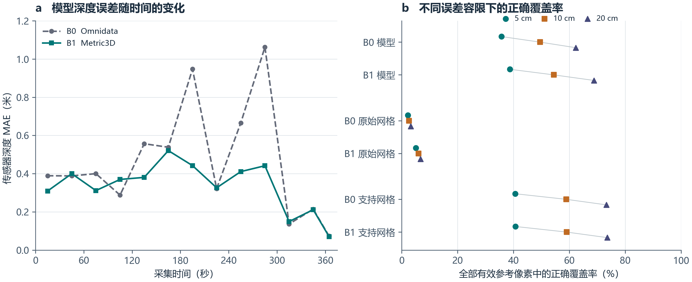

# capture-full 重建质量的定量解读

**B1 更适合作为后续 RGB 和深度渲染的基线。** 将 Omnidata 法线换为 Metric3D v2 后，测试集 PSNR 提高 1.06 dB，传感器深度 MAE 下降 31.55%。**最终网格的收益主要来自支持约束导出。** 使用相同支持导出时，B0 和 B1 在 10 cm 内的正确覆盖率分别为 58.88% 和 59.02%，仅差 0.14 个百分点。若应用需要 5 cm 以内的近距表面，B1 支持网格当前覆盖 40.75% 的有效测试参考像素。

两组均使用同一采集、1,478 个训练视角、相同的 2,001,906 点初始化、seed 42 和 30,000 次更新。验证和测试各有 184 帧。下述深度指相机光轴 Z，与同一采集的 0.3–6 m 有效传感器参考比较。测试集有 29,100,252 个有效参考像素，占全部测试图像像素的 17.16%。其余像素的准确性无法由本次近距深度数据判定。[冻结配置与输入](https://github.com/kaiwen123-yang/DN-Splatter/blob/7d4a8a1d7d47379102cc5a17d2bbb7e07231ac42/reports/capture-full-metric3d-30k/20261120-v1/frozen_inputs.json)

需要自己筛选某段时间、某个源帧或某种导出时，可以打开 [Excel 对比明细](指标对比明细.xlsx)。六张表分别保留总览、几何和点云、参考距离、30 秒时间窗、局部与训练、368 个配对留出帧。

## 渲染质量与误差长尾

| 划分及模型 | PSNR ↑ (dB) | SSIM ↑ | LPIPS ↓ | 深度 MAE ↓ (m) | RMSE ↓ (m) | 绝对误差 P50 / P95 ↓ (m) |
|---|---:|---:|---:|---:|---:|---:|
| 验证 B0 | 15.785 | 0.6380 | 0.4378 | 0.487 | 1.015 | 0.098 / 2.489 |
| 验证 B1 | **16.941** | **0.6658** | **0.4097** | **0.313** | **0.695** | **0.083 / 1.491** |
| 测试 B0 | 15.826 | 0.6384 | 0.4384 | 0.492 | 1.021 | 0.103 / 2.479 |
| 测试 B1 | **16.885** | **0.6641** | **0.4130** | **0.336** | **0.785** | **0.082 / 1.676** |

RGB 指标按帧等权。表中深度指标合并全部有效参考像素，两组均有有限正 Z。若每帧等权，测试 MAE 从 0.510 m 降至 0.378 m，改善方向一致。B1 测试深度的 10.23% AbsRel 为逐像素绝对相对误差均值。P50 表明一半像素的绝对误差在 8.2 cm 以内，P95 为 1.68 m，仍有明显的米级长尾。[测试逐帧原始结果](https://github.com/kaiwen123-yang/DN-Splatter/blob/7d4a8a1d7d47379102cc5a17d2bbb7e07231ac42/reports/capture-full-metric3d-30k/20261120-v1/metrics_test.json)

改善在视角之间分布不均。184 张测试图中，119 张的 PSNR 上升，113 张的深度 MAE 下降，79 张两项同时改善。单帧 MAE 配对差的中位数仅下降 0.99 cm。180–210 秒和 270–300 秒各有 15 张测试图，像素合并 MAE 分别从 0.947 降到 0.442 m、从 1.062 降到 0.441 m。两段合计占全测试集绝对误差总和净减少量的 **75.10%**。13 个时间窗中有 9 个深度 MAE 下降，最后一窗只有 5 帧。[逐帧配对与时间窗](https://github.com/kaiwen123-yang/DN-Splatter/blob/7d4a8a1d7d47379102cc5a17d2bbb7e07231ac42/reports/capture-full-metric3d-30k/20261120-v1/paired_test.json)

| 指标 | 验证改善 / 退化帧 | 测试改善 / 退化帧 | 测试配对差中位数 | 测试配对差四分位区间 |
|---|---:|---:|---:|---:|
| PSNR ↑ | 117 / 67 | 119 / 65 | +0.743 dB | −0.409 至 +2.044 dB |
| SSIM ↑ | 127 / 57 | 130 / 54 | +0.0122 | −0.0029 至 +0.0403 |
| LPIPS ↓ | 154 / 30 | 148 / 36 | −0.0104 | −0.0354 至 −0.0025 |
| 每帧深度 MAE ↓ | 111 / 73 | 113 / 71 | −0.0099 m | −0.1981 至 +0.0270 m |
| 每帧深度 RMSE ↓ | 107 / 77 | 106 / 78 | −0.0151 m | −0.2269 至 +0.0588 m |

配对差统一按 B1 减 B0。测试帧按 PSNR 与深度 MAE 分组，两项均改善 79 帧，仅 PSNR 改善 40 帧，仅深度改善 34 帧，两项均退化 31 帧。B1 最差的测试帧为 `frame_00279`（56.27 秒）。该帧 PSNR 为 11.04 dB，深度 MAE 为 2.995 m，对应 B0 为 13.67 dB 和 0.355 m。全场均值掩盖了这个局部退化。

左图每点为一个时间窗内按有效参考像素合并的 MAE。右图使用全部 29,100,252 个测试参考像素作分母，未命中的像素计入分母。[矢量图 PDF](quality.pdf)

## 哪些时段贡献了改善

| 采集时段 (s) | 测试帧数 | PSNR，B0 → B1 (dB) | 模型深度 MAE，B0 → B1 (m) |
|---|---:|---:|---:|
| 0–30 | 14 | 19.92 → 19.58 | 0.389 → 0.309 |
| 30–60 | 15 | 15.38 → 16.15 | 0.388 → 0.400 |
| 60–90 | 15 | 13.79 → 15.29 | 0.400 → 0.311 |
| 90–120 | 15 | 15.00 → 15.58 | 0.288 → 0.370 |
| 120–150 | 15 | 12.67 → 15.07 | 0.557 → 0.380 |
| 150–180 | 15 | 15.30 → 15.80 | 0.538 → 0.521 |
| **180–210** | **15** | **13.88 → 16.78** | **0.947 → 0.442** |
| 210–240 | 15 | 17.36 → 17.46 | 0.322 → 0.326 |
| 240–270 | 15 | 15.60 → 17.65 | 0.666 → 0.411 |
| **270–300** | **15** | **14.21 → 17.93** | **1.062 → 0.441** |
| 300–330 | 15 | 17.78 → 17.82 | 0.136 → 0.149 |
| 330–360 | 15 | 17.18 → 16.92 | 0.214 → 0.211 |
| 360–采集末端 | 5 | 22.07 → 19.23 | 0.073 → 0.071 |

每次去掉一个固定时间窗，再计算剩余测试帧，平均 PSNR 增益仍为 **+0.824 至 +1.177 dB**，像素合并 MAE 的相对降幅为 **22.32% 至 34.15%**。同时去掉 180–210 秒和 270–300 秒，剩余 154 帧、23,178,674 个参考像素，PSNR 仍从 16.172 升到 16.794 dB，深度 MAE 仍从 0.358 降到 0.310 m，降幅缩小为 **13.54%**。这项复查衡量本次轨迹结果对时段选择的敏感性。相邻帧共享场景和视角，这些范围不能外推为跨场景置信区间。[分窗复查明细](detailed_numbers.json)

## 哪些参考距离更准

在 H 盘重读全部 368 个留出视角的传感器 Z 和 B0、B1 渲染 Z，按同一像素的传感器距离分组。前三区间左闭右开，最后一组含 6 m。下表评价模型输出深度，全部分组加权还原后与冻结的整体 MAE、RMSE、AbsRel、5/10/20 cm 正确像素数一致。

| 划分 | 参考 Z (m) | 参考像素占比 | MAE，B0 → B1 (m) | P95，B0 → B1 (m) | 10 cm 正确覆盖，B0 → B1 |
|---|---|---:|---:|---:|---:|
| 验证 | 0.3–1 | 10.42% | 0.0420 → 0.0417 | 0.154 → 0.117 | 91.63% → 93.76% |
| 验证 | 1–2 | 21.69% | 0.1151 → 0.0694 | 0.748 → 0.244 | 78.69% → 84.14% |
| 验证 | 2–4 | 44.55% | 0.4357 → 0.2654 | 2.166 → 1.160 | 46.02% → 50.33% |
| 验证 | 4–6 | 23.34% | 1.1285 → 0.7500 | 4.128 → 2.821 | 14.16% → 16.82% |
| 测试 | 0.3–1 | 10.53% | 0.0513 → 0.0692 | 0.167 → 0.130 | 91.48% → 92.67% |
| 测试 | 1–2 | 21.65% | 0.1074 → 0.0650 | 0.508 → 0.205 | 78.74% → 85.20% |
| 测试 | 2–4 | 44.46% | 0.4282 → 0.2817 | 2.015 → 1.358 | 44.18% → 50.17% |
| 测试 | 4–6 | 23.36% | 1.1663 → 0.8127 | 4.156 → 3.173 | 13.63% → 16.79% |

**1–2 m 是效果较好的实用距离段。** B1 测试 MAE 为 6.50 cm，85.20% 在 10 cm 内。**4–6 m 改善幅度大，剩余误差也最大。** 该段只占 23.36% 的有效测试像素，却贡献全测试集绝对误差净减少量的 53.26%。B1 在该段的有符号偏差（预测减参考）仍为 −0.664 m，25.74% 的像素绝对误差超过 1 m。2–4 m 与 4–6 m 合计贡献约 **95.28%** 的净减少量。时间分组与距离分组描述的是同一批像素，两种贡献率不能相加。

0.3–1 m 有不同表现。B1 的 10 cm 正确覆盖及 P95 均改善，平均绝对误差却增加 1.79 cm。误差超过 1 m 的 B1 像素仅占该段 0.31%，它们对该段平均 MAE 的贡献达到 3.52 cm。B0 对应贡献为 1.28 cm。这说明近距平均误差对少量很大的预测误差很敏感。[分距离核算及尾部计数](detailed_numbers.json)

## 网格能达到什么精度

| 测试结果 | 命中率 | ≤5 cm 正确覆盖 | ≤10 cm 正确覆盖 | ≤20 cm 正确覆盖 | 自适应容差正确覆盖 | 前方冲突 / 全部参考 | 命中 MAE / P95 (m) |
|---|---:|---:|---:|---:|---:|---:|---:|
| B0 模型深度 | 100% | 35.69% | 49.51% | 62.31% | 44.38% | 42.84% | 0.492 / 2.479 |
| B1 模型深度 | 100% | 38.76% | 54.43% | 68.80% | 49.01% | 37.42% | 0.336 / 1.676 |
| B0 原始 Poisson | 99.999% | 2.27% | 2.65% | 3.29% | 2.33% | 97.35% | 2.488 / 5.129 |
| B1 原始 Poisson | 99.999% | 5.11% | 6.02% | 6.77% | 5.29% | 93.89% | 2.432 / 5.112 |
| B1 支持流程，裁前 | 96.93% | 28.09% | 42.81% | 59.32% | 36.31% | 57.34% | 0.372 / 1.812 |
| B0 支持网格，裁后 | 91.27% | 40.67% | 58.88% | 73.30% | 53.55% | 21.38% | 0.204 / 0.857 |
| **B1 支持网格，裁后** | **92.10%** | **40.75%** | **59.02%** | **73.60%** | **53.85%** | **22.29%** | **0.205 / 0.846** |

正确覆盖率要求预测或首个网格交点存在，且绝对误差落在对应容差内。自适应容差为 5 cm 与参考深度的 3% 中的较大值。前方冲突表示预测表面比参考表面更靠近相机、且超出该容差。MAE 和 P95 只在有限正 Z 命中处计算。[完整表面指标与共同命中结果](https://github.com/kaiwen123-yang/DN-Splatter/blob/7d4a8a1d7d47379102cc5a17d2bbb7e07231ac42/reports/capture-full-metric3d-30k/20261120-v1/surface_test_metrics.json)

- **固定 B1，看导出流程。** 从原始 Poisson 到支持裁后，自适应正确覆盖增加 **48.57 个百分点**，前方冲突从 93.89% 降到 22.29%。代价是命中率下降 7.90 个百分点。采样筛选、实际 1 cm 体素融合和 depth 11 Poisson 合并作用后，裁前正确覆盖已达 36.31%，随后的多视角裁剪再提升约 17.54 个百分点。
- **固定支持导出，看法线先验。** B0 到 B1 的自适应正确覆盖增加 **0.30 个百分点**，命中率增加 0.83 个百分点，前方冲突也增加 0.90 个百分点。二者共同命中的 25,935,477 个测试像素上，MAE 为 **0.2011 / 0.2010 m**。本场景对照支持“渲染改善”，最终支持网格精度基本持平。
- **按实际容差看可用范围。** B1 最终网格每 100 个有效参考像素中，约 **59 个**命中且在 10 cm 内，**33 个**命中但误差超过 10 cm，**8 个**没有命中。命中误差中位数为 6.10 cm，P95 为 84.61 cm。固定的三个训练视角裁片也有差异。在两网格共同命中处，桌沿 MAE 为 B0 49.8 / B1 53.7 cm，柱面为 15.4 / 14.8 cm，椅腿为 38.4 / 39.8 cm。这些裁片用于定位问题，整场判断采用全部留出视角。[固定局部结果](https://github.com/kaiwen123-yang/DN-Splatter/blob/7d4a8a1d7d47379102cc5a17d2bbb7e07231ac42/reports/capture-full-metric3d-30k/20261120-v1/surface_local.json)

在点云阶段，B1 原始采样点与支持筛选后的融合点云投影到同一批测试相机时，命中率从 53.60% 升到 78.46%，10 cm 正确覆盖从 14.69% 升到 29.34%，命中 MAE 从 0.924 m 降至 0.492 m。B0 融合点云的 10 cm 正确覆盖为 28.74%。B1 最终支持网格保留 9,534,116 个三角面，裁前为 18,293,412 个。点云采样、融合和表面导出各有不同的实际覆盖。[点云与网格结果](https://github.com/kaiwen123-yang/DN-Splatter/blob/7d4a8a1d7d47379102cc5a17d2bbb7e07231ac42/reports/capture-full-metric3d-30k/20261120-v1/surface_test_metrics.json)

## 旧场景、训练和后续比较

原 s01 的 24 张同源测试图上，B0 和 B1 的平均 PSNR 分别为 18.355、18.407 dB，B1 仅有 9 张提高。同源验证图为 18.549、18.576 dB，7/24 张提高。旧 s01 专用模型在相应测试、验证子集上达到 23.350、23.243 dB，当时的地图、训练范围和位姿均与全程模型不同。换法线几乎没有追回这批早段画面的差距。[同源比较](https://github.com/kaiwen123-yang/DN-Splatter/blob/7d4a8a1d7d47379102cc5a17d2bbb7e07231ac42/reports/capture-full-metric3d-30k/20261120-v1/comparison_s01_same_sources.json)

B0/B1 的最终高斯数为 172,425 / 171,417，B1 少 0.58%。B1 最大一次净减少发生在 step 1,600，从 2,001,906 降到 398,115。单图 Metric3D 诊断深度的测试 MAE 为 0.509 m，正式训练一直使用原传感器 Z。冻结的四邻域法线角度诊断在验证、测试均得到 0 个有效样本，角度指标为空。本轮能量化的是换先验后的渲染和传感器一致性，尚无独立扫描精度或法线角精度结论。[剔除事件](https://github.com/kaiwen123-yang/DN-Splatter/blob/7d4a8a1d7d47379102cc5a17d2bbb7e07231ac42/reports/capture-full-metric3d-30k/20261120-v1/B1_refinement.json) · [先验深度与法线诊断](https://github.com/kaiwen123-yang/DN-Splatter/blob/7d4a8a1d7d47379102cc5a17d2bbb7e07231ac42/reports/capture-full-metric3d-30k/20261120-v1/prior_diagnostic_test.json)

| 保存 step | 5,000 | 10,000 | 15,000 | 20,000 | 25,000 | 29,999 |
|---|---:|---:|---:|---:|---:|---:|
| B0 高斯数 | 228,417 | 356,577 | 347,829 | 217,279 | 189,294 | 172,425 |
| B1 高斯数 | 233,461 | 358,385 | 349,480 | 217,832 | 188,848 | 171,417 |

B1 的 30,000 条正式采样记录覆盖全部 1,478 张训练图，其中 1,038 张被抽到 20 次，440 张被抽到 21 次。停止增密前每图仅有 10 或 11 次曝光。两条计数曲线相近，当前对照未单独改变曝光预算、增密或剔除策略，无法把残余几何误差分配给其中某一个机制。

后续优化可以直接沿用 **B1 验证集**作比较起点。渲染基准为 PSNR **16.941 dB**、深度 MAE **0.313 m**。支持网格基准为 **10 cm 正确覆盖 58.76%、命中 92.33%、前方冲突 22.46%**。这三项一同报告，可以看出精度提升是否伴随表面缺失。测试集保留作配置确定后的最终比较。本次核算表列出完整分母、配对变化、分窗汇总及所用冻结文件的 SHA256。[本次核算数据](numbers.json)
