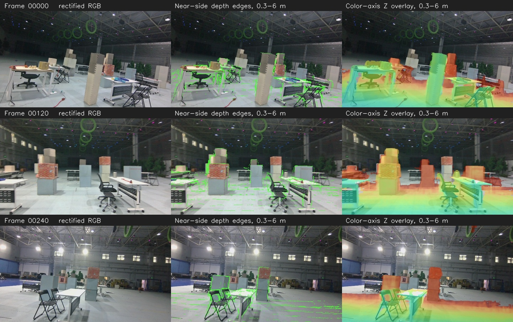
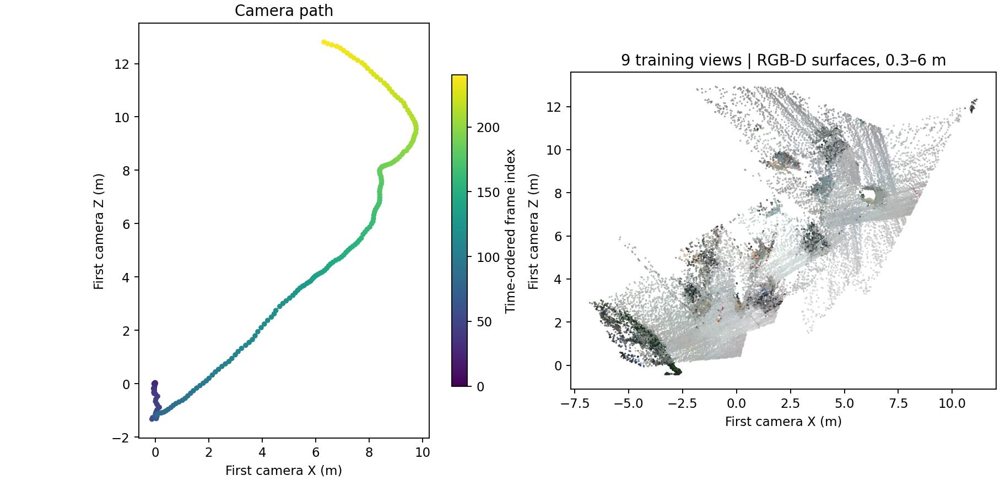
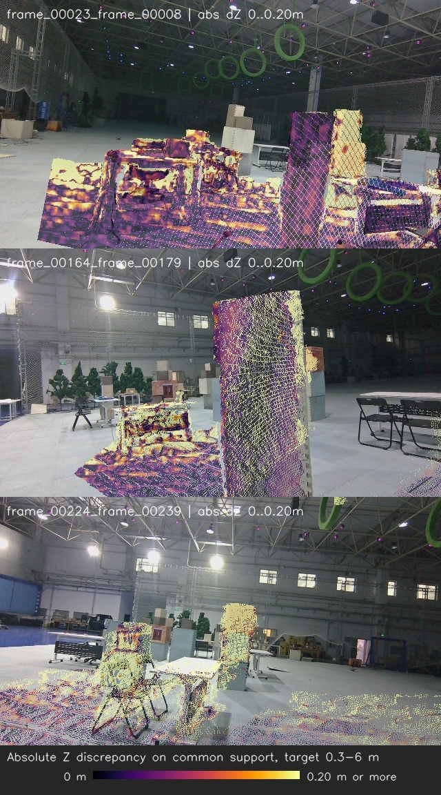

# Gemini 335 首段几何准备结果

**241 对 RGB-D 已导出、传输和逐帧读回。** AutoDL 上的 193 张训练图组成一张固定内参地图，24 张验证图和 24 张测试图全部定位。训练深度给出的单一米制尺度为 **1.46499035 m/SfM 单位**。1280×720 派生数据集包含全部相机位姿、彩色光轴深度和训练帧初始化点云。当前状态为 `geometry_prepared_pending_review`，图像法线待生成。

| 阶段 | 实测结果 |
| --- | --- |
| 首段提取 | 精确窗口 0.465019–48.589426 s。5 Hz 网格最后一个目标为 48.465019 s，最后入选 RGB 为 48.455934 s |
| 配对和筛选 | 241 个目标，241 个不同 RGB、241 个不同深度。两路全部解码，重复、未匹配和剔除均为 0 |
| 紧凑包 | 487 个文件共 88,438,841 字节，含清单。Windows 和 AutoDL 的成员集合、逐文件大小及 SHA256 一致 |
| 同帧配准 | Windows 检查 9 对，AutoDL 处理全部 241 对。抽查的 18 张深度数组在两台机器上 SHA256 逐一相同 |
| 地图和留出定位 | 193/193 张训练图注册，26,866 个稀疏点。48/48 张留出图通过独立 PnP，固定地图文件定位前后哈希一致 |
| 数据读取 | 历史 DN 的 NormalNerfstudio 和 GDataset 对 train/val/test 分别读回 193/24/24 帧，逐帧核对 RGB、深度、相机内参和位姿 |
| 初始化与交付 | 仅用训练 RGB-D 生成 436,361 点彩色 PLY。派生目录 488 个文件共 1,206,355,295 字节，含清单 |

## 时间和片段质量

本轮以审计提交 `a13bb40445c1c049c2931094e533a5ed43472297` 和执行协议提交 `d2887a3e0fb86c3bde4594aa9fa7a3bd5ca182b8` 为依据。原包 `H:\capture.bag\capture.bag` 的路径、5,919,666,852 字节和纳秒修改时间与审计指纹一致。沿用审计 SHA256 `3982cb269ea03ddf4234b45f74be27143eb66bcd807e4e471d0f3a9cd6b03b59`。按 SQLite 索引读取所需的 244 个压缩块，逐消息复核索引与物理记录，完成后再次核对源文件状态。

RGB-D 绝对时差中位数 0.089 ms，P95 为 0.579 ms，最大 0.960 ms。相邻入选 RGB 的间隔为 166.860–201.289 ms。依次检查全部缩略图，并对清晰度最低的 10 帧检查原尺寸裁片。第 42、47、55–56 帧附近的快速转向可见拖影，桌边和椅背仍可跟踪。缩略图中未发现大面积人员遮挡或切换到另一场景。保留全部候选，按保留顺序每十帧的前八帧训练、第九帧验证、第十帧测试，划分先于位姿和尺度求解冻结。[选帧与同步](selection.json) · [视觉检查](quality_review.json) · [冻结清单](split_manifest.json)

## 同帧 D2C

使用设备记录的 depth→color 外参、原生深度每计数 0.001 m、完整 rational Brown 畸变和同一 RGB 光学坐标系。先反向映射 RGB，再以最近正彩色光轴深度处理目标像素冲突。两个针孔网格均保留未观测空洞。原始 0 和 65535 仅在派生深度中置零。下表为 9 组检查中**每帧覆盖率的中位数**，分母是整张目标图的像素数。[网格、边缘和逐帧统计](registration.json)

| 去畸变 RGB 网格 | 所有非哨兵投影 | 0.3–3 m | 0.3–6 m | 0.3–10 m |
| --- | ---: | ---: | ---: | ---: |
| 1280×720 | 33.59% | 6.41% | 14.91% | 17.90% |
| 640×360 | 94.51% | 18.12% | 42.06% | 50.42% |

640 网格 9 帧总覆盖范围为 90.67%–97.99%。以深度断边到最近 RGB Canny 边缘的距离作诊断，三个距离窗口的逐帧中位数再取中位数，分别为 2.24、2.00 和 2.00 px。第 210 帧的 0.3–3 m 窗口只有 396 个断边像素，其最近 RGB 边缘距离中位数达 40.62 px。该统计受弱纹理及非对应图像边缘影响。叠加图能辨认桌面、椅背和箱体，细椅腿和遮挡边界仍有空洞。以上覆盖和边缘距离均无独立真值对照。

[第 120 帧原网格局部放大](previews/table_edge_crop.jpg)

## 相机轨迹和米制尺度

使用 PyCOLMAP 3.13.0 CUDA SIFT 和顺序匹配。只向建图数据库写入训练图，共用一个固定 PINHOLE 相机。增量重建得到一个连通模型，训练重投影误差中位数 0.725 px、P95 为 2.356 px。轨迹点的观测长度中位数为 5，按首末时刻观测计算的三角化夹角中位数为 5.89°。每张留出 RGB 与相邻时间的四个已注册训练视角匹配，在固定三维点上单独估计姿态，每张有 447–1,336 个 PnP 内点。CPU 配额为 25 核，实际使用了 GPU 特征提取和匹配。[地图、位姿和留出分母](pose_quality.json)

尺度只用训练深度。0.3–6 m 主范围在 193 帧、9,825 条轨迹上提供 41,817 个观测，按轨迹出现次数和帧权重平衡。固定尺度下，这些观测的绝对 Z 残差中位数为 6.91 cm，P95 为 35.31 cm，按拟合权重计算的中位数为 8.48 cm。片段早、中、晚独立拟合分别得 1.46566、1.47096、1.45556 m/SfM 单位。0.3–3 m、0.3–6 m 和 0.3–10 m 的拟合分别为 1.45709、1.46499 和 1.46866。全部相机平移和地图点统一缩放，再以第一张训练相机为原点，累计轨迹长度为 22.95 m。最大相邻旋转为 31.56°，出现在画面快速转向的第 55–56 帧。[尺度与分段残差](scale_alignment.json)

## 跨视角一致性与局限

用 10 个留出目标视角和训练源视角形成 20 对检查，保存全部结果。先把源深度变换到目标相机，以 z-buffer 决定可见表面，再与目标实测 Z 比较。下表使用目标深度在 0.3–6 m 的共同观测像素，保留遮挡候选和全部分歧。数值为各对绝对 Z 差中位数的范围。[逐对覆盖、遮挡与残差](cross_view.json)

| 检查 | 对数 | 各对的绝对 Z 差中位数 |
| --- | ---: | ---: |
| 邻近训练帧 → 留出帧 | 9 | 2.78–5.69 cm |
| 相隔约 3 s | 9 | 5.23–21.45 cm |
| 另外两组早段重访 | 2 | 7.92、11.27 cm |

第 164→179 帧的共同观测有 49,470 像素，其中 3,803 个源投影深于 20 m，目标实测在 6 m 内。该对绝对差 P95 为 23.41 m。即使要求两边都在 0.3–6 m，P95 仍有 2.25 m。第 224→239 帧的共同观测降到 27,484 像素，中位数差 21.45 cm。预览中可见高柱边缘、桌椅背后和地面遮挡交替。轨迹与尺度支持生成近景数据，宽基线下的深度、遮挡与视角误差尚无法唯一分解。本采集没有外部几何真值。

## 数据位置与读取边界

- Windows 紧凑包位于 `.local/capture-geometry/20261119-s01-5hz-3982cb26/transfer/`。AutoDL 在 `/root/autodl-tmp/DN-Splatter/.local/capture-geometry/20261119-s01-5hz-3982cb26/transfer/` 接收校验。两端清单 SHA256 均为 `7a838fe4594da50a01c52f5d0e64a49c283e5228bdcda7286d90a6aede78b833`。[传输回执和逐文件清单](transfer_manifest.json)
- 派生数据集位于 `/root/autodl-tmp/DN-Splatter/.local/data/custom/capture-s01/20261119-s01-5hz-3982cb26`。清单 SHA256 为 `2cc67f7af6ad6444131529ee392879c064bc6a76394220784e7b4b79a039b278`。包含 241 张去畸变 RGB、241 张米制 float32 深度、OpenGL c2w、划分、源帧映射及训练帧初始化 PLY。1280 网格使用预定的 0.3–6 m 派生范围，241 张深度图有效覆盖为 9.06%–22.69%，中位数 16.28%。原值和未截断的 D2C 图均保留。[数据目录清单与读取核验](dataset_manifest.json)
- 初始化使用 193 张训练图的同网格 RGB-D，按两个像素轴各隔 4 像素取样，排除遮挡竞争和近侧断边，用 3 cm 体素合并 1,063,257 个样点。读取核验将图像法线和点云法线选项关闭，保留真实初始化 PLY。同一采集内的时间留出不提供独立新轨迹的泛化证据。Omnidata 图像法线、DN 训练和 Poisson 本轮均未执行。[执行命令](execution.md) · [产物索引](artifact_manifest.json)
