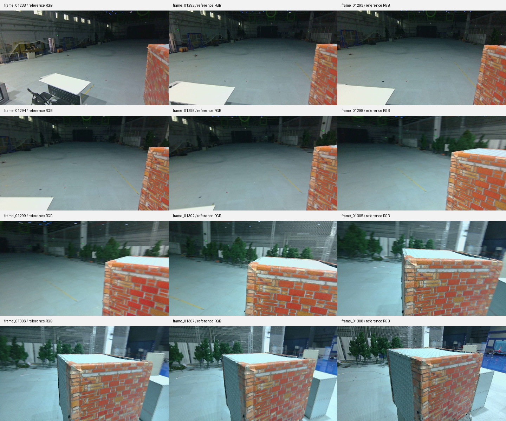

# capture-full 质量复核：相机轨迹、深度支持与下一整轮几何处理

证据固定于 `3728dae350a240d317702d57e560554d529679c6`，审查日期 2026-11-21。本报告只分析已经完成的 B0 / B1，不表示服务器正在重训。B1 使用 Metric3Dv2 法线，传感器 Z、相机、划分和初始化保持原样。计算、来源文件哈希、逐帧对齐残差和候选异常帧记录见 [geometry_findings.json](geometry_findings.json)。

**本轮新增证据要求调整此前“完全冻结几何”的建议：先在下一次完整任务中核对并修复已经定位到的局部相机异常，再开展主训练。没有依据推倒全部地图重建；也没有依据把所有画质问题归于这段异常。早期同源轨迹总体接近，当前最广泛的退化仍需结合训练、增密和表面导出处理。**

## 1. 新公开的逐帧相机矩阵暴露了一个具体局部问题

`metric_c2w.json` 已包含 full 的 1,846 个和 s01 的 241 个米制 OpenGL camera-to-world 矩阵。此前报告没有这些数组，因此只能检查注册率、重投影和少量跨视角对；本轮能够直接检查轨迹连续性。[逐帧矩阵][poses]

### 1.1 两个相邻时间位置出现约 175° 旋转和米级平移

| 相邻主帧 | 实际采集时间，秒 | 时间差 | 相机中心差 | 相对转角 |
| --- | --- | ---: | ---: | ---: |
| 01293 → 01294 | 259.072400 → 259.267626 | 0.195226 s | **1.985 m** | **174.871°** |
| 01306 → 01307 | 261.676508 → 261.876733 | 0.200225 s | **1.696 m** | **174.235°** |

两个边界之间包含 **13 张主帧：11 train、1 val（01298）、1 test（01299）**。按这些估计位姿直接计算，边界对应约 10.17 / 8.47 m/s 和 895.7 / 870.2 °/s。它们是明显的核对目标；这些数字描述估计相机轨迹，并不等于已测得相机真实运动。全程其余相邻中心差的最大值为 0.309 m。[逐帧矩阵][poses]、[选帧时间与来源][selection]

**数值轨迹与公开视频的参考 RGB 共同强烈支持局部错误位姿分支或源帧关联问题。** 已实际查看 01292→01293→01294→01295 和 01305→01306→01307→01308：前一组是同一大厅／桌沿／砖柱的连续小幅右转，后一组连续绕同一砖柱右转，两处均没有约 175° 的反向。01294 完整视频帧的标题明确为 `Reference frame_01294 train 259.268 s`；其 B0 / B1 渲染却出现了另一侧的桌椅与柱面，与正前方大厅的参考明显不一致。

这一直接视觉证据排除了“仅凭运动太快就猜位姿错”的局限，但仍需在源特征和几何对应上确定具体成因并重定位。13 帧只是全程的一小段，不能用它解释所有低 PSNR、首段约 5 dB 的普遍下降或全部网格问题。

媒体来源为 [公开发布][release] 的遮挡隐私版 `reference_B0_B1_public.mp4`，422,641,230 字节，SHA256 `92ea11d322e1d7caf6b552c204de68b1d3dceaa5662490dedf786681e653857e`，与服务器未遮挡原版是不同文件。按解码后零基视频帧索引提取 1288、1292、1293、1294、1295、1298、1299、1302、1305、1306、1307、1308、1310、1513、1514、1515；实际查看下方联系图的前 12 张及 01294 完整三联帧，16 是提取数。每张提取帧的 SHA256 与实际查看范围已记录在 JSON 中。

已经排查了几类容易制造假异常的计算问题：

- 全部 1,846 个旋转都在数值精度内属于 SO(3)：`max |RᵀR-I|=4.44×10⁻¹⁵`，行列式范围约 `[0.9999999999999963, 1.0000000000000042]`，齐次矩阵末行正确。
- 相对角度用 `acos((trace(RᵢᵀRⱼ)-1)/2)` 计算，并截断到合法数值区间，没有使用可能有正负号歧义的四元数。
- 将所有 OpenGL 相机统一换回 OpenCV 后，相邻相对角度与原计算完全一致。固定的相机轴约定变化不能解释局部 175° 跳变。
- 帧名数字排序为连续 `frame_00000…frame_01845`；边界使用的是对应源 RGB 的真实设备时间。导出脚本直接读取 `transforms.json` 中的矩阵，没有按帧条件翻转。[数据集代码][dataset]、[B1 准备代码][prepare]

### 1.2 低重投影残差不能排除局部地图分支错误

异常候选段中的 val 01298 仍有 **478 个 PnP 内点、0.974 px 中位重投影误差**；test 01299 有 **221 个内点、1.356 px 中位误差**。二者使用的四个近时训练候选全部落在同一可疑区间内。如果这批训练地图本身在错误位置或朝向上自洽，留出 PnP 可以继续得到看似正常的二维残差。[地图与 PnP][pnp]

这不是在判定 PnP 一定失败，而是说明“全部注册”和“重投影小”不足以证明绝对几何正确。B1 的 01299 并非最差图，其深度 MAE 约 0.591 m，因此不能只按渲染最坏帧挑选几何问题。

此前通过辅助图补齐的 01514 也应顺带检查：01513→01514、01514→01515 的中心差为 0.309 / 0.292 m，而 01513→01515 仅 0.143 m；01514 距两侧中心中点约 0.292 m。这里的角度变化小得多，真实快速移动仍有可能，证据弱于上述双跳变，不应直接当成错位。

## 2. 首段确实与旧 s01 接近，但必须把刚体与尺度对齐分开

先按原始 RGB 索引、RGB 设备时间、深度设备时间／索引、RGB 载荷 SHA256 和深度像素 SHA256 核对，首 **241 对来源全部相同**，无字段不一致；其划分为 193 / 24 / 24。因此以下不是仅按相似帧名拼接两条轨迹。

以这 193 张训练图的相机中心拟合 s01→full 变换，然后对全部 241 张报告差异。训练对齐与留出差异分开计算，避免用留出相机参与主对齐估计。

| 对齐方式 | 拟合尺度 | 241 帧中心差中位数 | 中心差 P95 | 中心差 RMSE | 24 张 test 中心差 RMSE |
| --- | ---: | ---: | ---: | ---: | ---: |
| SE(3)，仅旋转＋平移 | 固定 1 | **2.72 cm** | **5.63 cm** | **3.06 cm** | 3.16 cm |
| Sim(3)，另拟合统一尺度 | **0.9950529** | **5.44 mm** | **1.32 cm** | **8.47 mm** | 8.27 mm |

对应的旋转差中位数为 **0.069°**，P95 为 **0.150°**，最大为 **0.327°**。以全部 241 帧拟合作敏感性检查，结论基本不变；完整参数与逐帧结果在 JSON 中。

这些结果说明早段两次估计的主要位置差异有约 0.5% 的整体尺度分量，去掉它后残差较小。**Sim(3) 的毫米级残差不能冒充米制绝对位姿精度**；它是两条估计轨迹经过尺度拟合后的相似程度。SE(3) 的厘米差也仍可能影响高频纹理，且两条轨迹可能共享系统误差。

但它不支持“全程训练后首段已发生大规模轨迹崩坏”作为广泛画质下降的首要解释。相同 24 张 test，s01 约 23.35 dB，full B0 18.36 dB，B1 18.41 dB；换法线没有恢复首段画质。训练视角暴露次数、增密条件和模型容量依然是必须处理的主要方向。[同源渲染对照][same]

## 3. 17.16% 深度参考覆盖不能全部解释为远景缺失

B1 test 的 184 张 1280×720 RGB 共 169,574,400 个像素，其中 **29,100,252 个具有 0.3–6 m 传感器参考，覆盖 17.1608%**。训练图每帧有效比例的中位数为 **17.36%**，最小 **1.58%**，最大 **33.95%**。[输入覆盖][inputs]、[分距离统计][bins]

目前数据流程把原生 **848×480** 深度点通过外参投到去畸变 **1280×720** RGB 网格，投影坐标四舍五入，每个源点最多占一个目标像素，碰撞时保留前方 Z。即使原生深度全部有效、完全落在 RGB 内且完全无碰撞，这种实现的目标像素占比也至多为 **44.17%**。因此规则的高分辨率网格空洞是代码能预期的现象。[投影代码][rectify]

实际 17.16% 还混合了原生无效值、深度与 RGB 的视场差异、投影越界、碰撞、RGB 去畸变边缘和 0.3–6 m 截断。现有聚合表不能严谨分解各项占比。首段 640 网格的 90.67%–97.99% 是另一分辨率、另一时段、不同裁剪口径，不能直接当作全程正式监督应有覆盖。

### 深度损失没有因四邻域空洞整体失效

本次法线参考诊断要求局部四邻域的传感器 Z 都有效，结果可用样本为 0，法线角度为 null。这说明**该诊断在当前稀疏网格上没有可评价样本**，不能据此声称 Metric3D 法线已由传感器角度验证，也不能声称训练深度 loss 为零。[先验诊断][prior]

已直接核对训练固定版本 `811f5cd` 的 `EdgeAwareLogL1`：它用当前像素的有效 Z mask 筛选损失，再分别对有效 x/y 项求均值；邻域 RGB 梯度只是权重，不要求相邻深度同时有效。因此它也不会简单按整幅图面积把深度项乘上 0.1716。[历史损失代码][loss]

真正要改进的是传感器观测的空间支持、局部几何和表面导出的可用性。下一整轮应一次输出原生→投影→裁剪各阶段计数，并在原生网格或独立生成的 640 深度网格计算法线参考。可保留 1280 RGB 渲染，另用原生深度相机射线监督，或用具有真实投影来源的独立 640 深度渲染；避免将零深度直接双线性缩放，也避免把填孔生成的数值当成新传感器观测。若改变训练深度路径，必须记为新方法变更，旧 B0/B1 评估口径仍保留。

## 4. B1 的剩余深度错误主要在中远距离，而且方向有偏

| 参考距离 | 占有效参考 | B0 MAE | B1 MAE | B1 误差≤10 cm 比例 | B1 有符号偏差（预测−参考） |
| --- | ---: | ---: | ---: | ---: | ---: |
| 0.3–1 m | 10.53% | 5.13 cm | **6.92 cm** | 92.67% | +2.22 cm |
| 1–2 m | 21.65% | 10.74 cm | **6.50 cm** | 85.20% | +0.65 cm |
| 2–4 m | 44.46% | 42.82 cm | **28.17 cm** | 50.17% | **−18.37 cm** |
| 4–6 m | 23.36% | 1.166 m | **0.813 m** | **16.79%** | **−66.43 cm** |

这是同次传感器 Z 一致性，不是独立真值几何精度。B1 的 4–6 m 有效参考中，**25.74% 的像素误差超过 1 m**，P95 为 **3.173 m**。负偏差意味着很多预测表面在参考前方；可与浮动表面、混合的渲染深度、错位或遮挡有关，不能仅凭这张表判断是相机标定错误。[分距离统计][bins]

0.3–1 m 的 MAE 上升也不能省略：该段中位数和 P95 稍好，少量极端正误差却拉高均值。应继续同时保留均值、分位数、正确覆盖和完整坏帧，不只展示有利的 MAE 总降幅。

Metric3D 单目深度在相同 test 参考上的诊断 MAE 为 **0.509 m**；本轮改善来自“换法线＋保留传感器深度”的完成实验，没有证据支持直接用它替换所有传感器 Z。[先验诊断][prior]

## 5. 全局米制没有倍数错位证据，远景支持与细结构初始化值得改善

当前传感深度保存为 float32 米制光轴 Z；深度单位因子与相机尺度因子均为 1，自动相机缩放关闭。`scene_scale=21` 是场景包围盒设置，不是把坐标缩放 21 倍。OpenCV / Nerfstudio 像素中心的 +0.5 主点转换只做一次，OpenGL 相机轴转换也只做一次。读取器对全部 1,846 帧的 RGB、Z、内参和矩阵已逐项读回核对。没有发现当前材料支持的整体单位或轴约定错误。[配置][config]、[读取核验][reader]、[数据集代码][dataset]

训练尺度为 **1.4541853 m/SfM 单位**。早／中／晚训练观测独立拟合值为 1.46774 / 1.45554 / 1.44367；跨度约 1.65%，但各组看到的距离和表面不同，不能直接称为已测轨迹漂移。6–10 m 组独立尺度比统一尺度高约 3.93%，其固定尺度残差 P95 约 1.34 m，**不宜为了补背景便把未验证的 6–10 m 深度全部作为强监督加入**。[尺度一致性][scale]

已有全程 40 个有向跨视角对也显示宽基线局限：18 个相邻对在局部平滑支持上的“各对 P50 的中位数”为 2.02 cm，“各对 P95 的中位数”为 16.80 cm；18 个约 3 秒间隔对对应为 6.77 cm 和 1.053 m。这不是把全部像素合并后的分位数，也不是纯位姿误差；宽基线可见表面变化与遮挡仍参与残差。抽样没有覆盖本次发现的全部局部异常，不能以这些对代替全轨迹核验。[此前跨视角复算][cross]

初始化有两个明确限制：

1. 当前 2,001,906 点全部来自主训练帧 **640 网格、0.3–6 m、每轴步长 4、3 cm 体素平均**，并排除竞争遮挡与膨胀后的近侧深度边缘。这有利于抑制边缘错点，但可能削弱细椅腿等小结构的初始支持；还需结合实际可见点和后续裁剪判定，不能只把 3 cm 当作最终误差下限。
2. 地图中的 SfM 点已转换到同一米制世界坐标并单独保存，**没有并入训练初始化 PLY**。因此可靠远景稀疏点是可用的补充来源。应按训练观测、重投影、视角基线、正深度和跨视角支持筛选，并保留来源标记；不要把全图任意稀疏点、远距离原始噪声或单目填孔无差别加入。[数据集代码][dataset]

“某些远墙缺乏稳定初始化”目前是有代码依据的风险，不是已经完成的逐像素归因。下一整轮可同步统计每个训练视角的初始化投影支持与深度支持，确定实际缺口；无须为此先开展多轮小规模训练。

## 6. 下一次完整任务中的几何工作应当这样收敛

**先做局部纠正，然后直接完成整场训练、全留出评估和多种表面导出。** 这不是另开一轮只有检查、等待确认的小任务。

1. 读取 01288–01312 和 01510–01518 的确切源 RGB-D，检查时间／文件关联；用两侧稳定训练帧和独立外部地图支持确认候选跳变是否真实。没有证据时不手动翻 180°，也不以线性插值相机冒充重定位。
2. 若确认局部误定位，固定区间外稳定训练地图、世界尺度与内参。用区间外训练观测支持的 3D 点重新 PnP，再加入可靠相邻 RGB-D 相对几何做有边界的局部优化。若允许局部点或相机 BA，稳定外部锚点与全局规范保持固定；不重做整个 SfM / SLAM。
3. 01298 / 01299 等留出图只在修正后的固定训练地图上重定位。留出 RGB-D 不参与训练地图 BA、尺度拟合或点云融合。保留全部 1,846 个主时间位置与冻结划分，未解决的项单列说明，不按最终质量删图或缩小评估分母。如果有边界的局部修复仍有困难，保留实际估计值并记录剩余不确定性，继续已授权完整实验；不以插值补造结果，也不转入无期限的小修复循环。
4. 如果训练位姿发生变化，从主训练源观测重建完整初始化。既有点云经过跨帧体素平均，不能只移动几枚旧点就消除可疑 11 张训练图的影响。旧 B0/B1 数据与结果保留，新的位姿清单及变动范围明确记录。
5. 在同一整轮补齐深度投影各阶段覆盖，并生成**仅用主训练传感器数据的完整 TSDF 参考重建**。它用于判断输入几何本身能支持怎样的桌沿、柱面和椅腿，与模型的 supported Poisson / TSDF 同图比较。该传感器融合结果仍依赖相同位姿，不能叫独立真值，也不预先保证某种网格导出一定更好。

必要的局部修复与输入支持改进应和训练侧的充分视角访问、可实际触发的增密、合理裁剪共同推进。修好这 13 帧会排除一个具体污染源；是否恢复全程质量，应由整场的同源图、全部 val/test、远近距离分层和完整表面结果回答。

[poses]: https://github.com/kaiwen123-yang/DN-Splatter/blob/3728dae350a240d317702d57e560554d529679c6/reports/capture-full-metric3d-30k/20261120-v1/metric_c2w.json
[selection]: https://github.com/kaiwen123-yang/DN-Splatter/blob/3728dae350a240d317702d57e560554d529679c6/reports/capture-full-dn-30k/20261119-v1/selection.json
[pnp]: https://github.com/kaiwen123-yang/DN-Splatter/blob/3728dae350a240d317702d57e560554d529679c6/reports/capture-full-dn-30k/20261119-v1/pose_summary.json
[dataset]: https://github.com/kaiwen123-yang/DN-Splatter/blob/3728dae350a240d317702d57e560554d529679c6/scripts/capture_dataset.py
[prepare]: https://github.com/kaiwen123-yang/DN-Splatter/blob/3728dae350a240d317702d57e560554d529679c6/scripts/capture_metric3d_prepare.py
[same]: https://github.com/kaiwen123-yang/DN-Splatter/blob/3728dae350a240d317702d57e560554d529679c6/reports/capture-full-metric3d-30k/20261120-v1/comparison_s01_same_sources.json
[inputs]: https://github.com/kaiwen123-yang/DN-Splatter/blob/3728dae350a240d317702d57e560554d529679c6/reports/capture-full-dn-30k/20261119-v1/inputs.json
[bins]: https://github.com/kaiwen123-yang/DN-Splatter/blob/3728dae350a240d317702d57e560554d529679c6/reports/capture-full-quality/2026-11-21/detailed_numbers.json
[rectify]: https://github.com/kaiwen123-yang/DN-Splatter/blob/3728dae350a240d317702d57e560554d529679c6/scripts/capture_rectify.py
[prior]: https://github.com/kaiwen123-yang/DN-Splatter/blob/3728dae350a240d317702d57e560554d529679c6/reports/capture-full-metric3d-30k/20261120-v1/prior_diagnostic_test.json
[loss]: https://github.com/maturk/dn-splatter/blob/811f5cdf342d92d12a9d9a4be185d374c430c184/dn_splatter/losses.py
[config]: https://github.com/kaiwen123-yang/DN-Splatter/blob/3728dae350a240d317702d57e560554d529679c6/reports/capture-full-metric3d-30k/20261120-v1/config.yml
[reader]: https://github.com/kaiwen123-yang/DN-Splatter/blob/3728dae350a240d317702d57e560554d529679c6/reports/capture-full-metric3d-30k/20261120-v1/reader_check.json
[scale]: https://github.com/kaiwen123-yang/DN-Splatter/blob/3728dae350a240d317702d57e560554d529679c6/reports/capture-full-dn-30k/20261119-v1/scale_fit.json
[release]: https://github.com/kaiwen123-yang/DN-Splatter/releases/tag/capture-full-metric3d-30k-20261120-v1
[cross]: https://github.com/kaiwen123-yang/DN-Splatter/blob/3728dae350a240d317702d57e560554d529679c6/reports/capture-full-review/2026-11-20/geometry_findings.json
