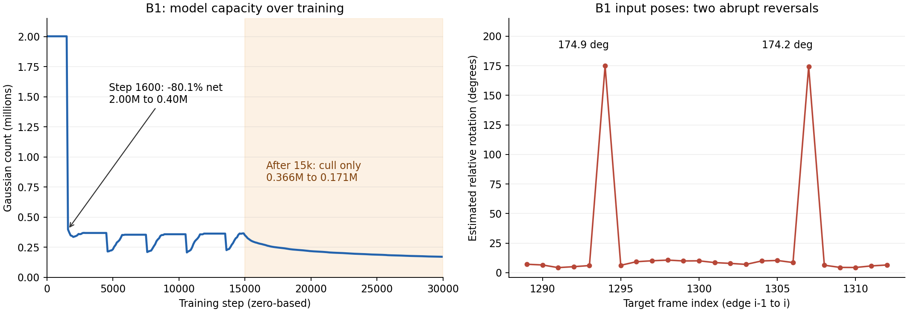
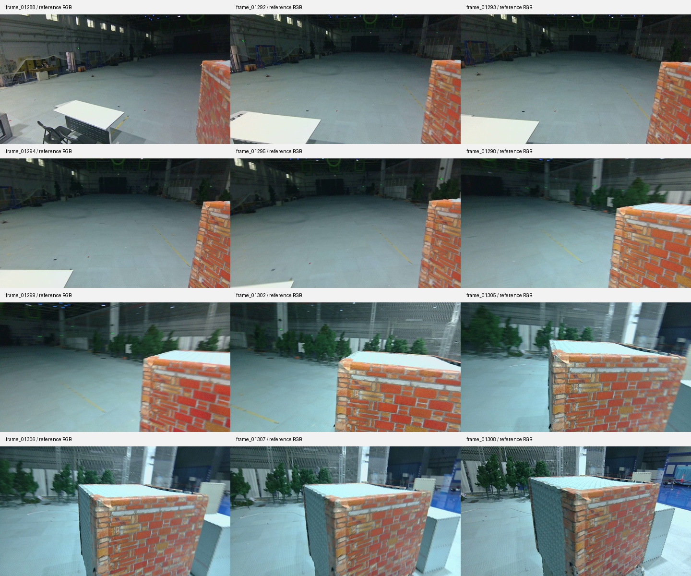

# capture-full 质量审查：为什么仍然差，下一轮怎样提高

审查日期：2026-11-21（北京时间）。读取的完整证据版本：`3728dae350a240d317702d57e560554d529679c6`。**本次完成的是代码、日志、相机矩阵、已发布指标和代表图像的审查，以及下一完整实验的计划；没有在AutoDL启动新训练。**

## 结论

用户认为完整场景质量仍然差，这个判断有充分依据。Metric3D已改善模型，但支持筛选后的最终网格几乎没有整体改善。当前优先工作是**修正已定位的局部位姿错误、解决过早大规模删点和后半程退化、补足可靠远景初始化，再完整训练并比较表面出口**。继续只换法线、把Poisson层数调高，或单纯接着最终171k高斯模型加步数，都不是首选。

现在已经具备具体机制证据，不必再回到只做环境检查或几个样例的验证循环。下一任务固定为一个B2完整240k训练，包含准备、全量评价和网格；[执行计划](../../../docs/14_capture_quality_plan.md)、[机器协议](../../../configs/capture_quality_protocol.json)、[服务器提示词](../../../prompts/autodl_capture_quality.md)、[本地提示词](../../../prompts/local_capture_quality.md)。

## 1. 最新结果改善在哪里，仍差在哪里

以下来自同一184张test；RGB按帧等权，模型深度使用同次采集0.3–6m参考像素合并。网格命中MAE只在命中参考处，正确覆盖率则包含全部参考分母。

| 指标 | B0 Omnidata | B1 Metric3D | 判断 |
| --- | ---: | ---: | --- |
| RGB PSNR | 15.826dB | 16.885dB | 有改善，仍有大面积背景损失 |
| RGB SSIM / LPIPS | .6384 / .4384 | .6641 / .4130 | 有改善，未恢复首段原质量 |
| 模型深度MAE | .492m | .336m | 降低约31.5% |
| 支持网格命中MAE | .204m | .205m | 整体无明显改善 |
| 支持网格≤10cm正确覆盖 | 58.88% | 59.02% | 几乎持平 |
| 支持网格前方冲突 | 21.38% | 22.29% | 略变差 |

两网格共同命中像素上的MAE为.201133→.200958m，仅改善约0.18mm。不能把模型深度的31.5%改善说成网格也改善31.5%。每100个有有效参考的测试像素，当前支持网格大约59个误差≤10cm、33个命中但误差更大、8个缺失。参考只覆盖全部测试图像的17.16%，上述比例不能推广成整个大厅绝对几何准确率。

模型4–6m参考上的MAE仍.813m，且平均预测偏近.664m；原s01相同24张test的PSNR，旧专用模型23.350dB、B0为18.355、B1为18.407，换法线几乎没追回首段画质。[已有完整分析][quality]、[距离分组][bins]

## 2. 论文比较必须先说清楚

此前VR Room单场景已经接近论文Table4：PSNR26.972对论文26.8，官方网格C-L1约2.552cm对2.5cm，F-score@5cm86.86%对87.1%。这支持固定历史实现和Blackwell流程能工作；它不是全论文复现，也不代表全程自采大厅已经达到相同水平。[首轮复核][vr]、[论文][dn]

自采场景的相机、范围、参考传感器与评价协议不同，16.89dB不能直接当作与VR Room26.8dB同条件对比。与此同时，实际缺失背景、糊桌沿、粘连椅腿和几十厘米参考误差确实需要改善，不能用“数据不同”来回避这些问题。

## 3. 直接证据一：早期删掉八成，后半程仍持续缩减

B1 step1600从2,001,906降至398,115，净减80.11%。删除并集1,644,258，其中主要掩码为低opacity1,627,349，world/screen均为0；已扣除split父替换，不能把所有删除都误判为错误cull。那时每个训练视角只曝光1–2次。B0也出现几乎相同的突降。[训练复核](training_review.md)

15k停止增密后继续删除，step14900的365,752到最终171,417，后半程又减少53.13%。更关键的是，把实际采样关联到同一批478个训练视角，10–15k与25–30k的等权在线PSNR从19.969降至15.243dB，437/478下降。这是训练日志的强定位证据，**尚不是固定checkpoint全量评价，也不能独立证明所有损失都由cull造成**。

下一整轮先对B1现成6个checkpoint做完整184val，然后直接主训练。降低opacity阈值、让重置后的点充分恢复、每轮重shuffle、延长生长阶段、禁止增长结束后只删不补，是比盲目增加训练步数更有针对性的改动。更多高斯并不自动等于更好，最终由完整评价判断。

图表由[复算脚本](../../../scripts/capture_quality_evidence.py)读取原始事件和相机矩阵生成，数值见[recomputed_core.json](recomputed_core.json)。

## 4. 直接证据二：局部相机朝向翻转与参考画面不符

| 边界 | 时间差 | 估计中心位移 | 估计转角 |
| --- | ---: | ---: | ---: |
| 01293→01294 | .195s | 1.985m | 174.87° |
| 01306→01307 | .200s | 1.696m | 174.24° |

实际从公开全程视频提取的参考RGB中，相机连续地绕同一砖柱右转，没有上述相邻帧180°反向。01294的B0/B1渲染甚至出现了另一方向的桌椅。这些数值和实际图像强烈支持局部错误位姿分支或帧关联问题，下一轮需要用真实特征及RGB-D数据修复，不能再仅凭全部注册成功就冻结这段几何。[几何复核](geometry_review.md)

但中间仅13帧，并不能解释全程普遍下降。首段241对来源逐项一致；仅用193训练相机对齐后，s01/full相机中心SE(3) RMSE3.06cm，允许另拟合尺度的Sim(3)残差8.47mm、尺度.99505。后者不是绝对精度，却说明早段不存在已知的大范围轨迹翻转。训练问题必须一起处理。

01514单帧有29cm中心局部异常，参考画面明显模糊；其证据弱于上述两次175°跳变，只作为同一次局部准备的核对项，不盲目替换。

## 5. 初始化与监督支持的边界

当前初始化只来自训练传感器.3–6m；已有米制SfM点另外保存，未进入DN初始化。可靠远墙/顶棚稀疏点因此是合理补充。新方案合并训练多视角支持良好的SfM点，保持传感器为近景主要来源，不把6–10m未知可靠性原始深度全部变成强监督，也不用单目深度替代真实Z。

17.16%有效参考不等于其余全是远景：848×480原生深度一对一前投影到1280×720时，即使没有碰撞和无效值理论覆盖最多44.17%，再受视场、遮挡和距离截断影响。历史深度loss在有效元素上mean，不要求相邻深度都有效；所以“覆盖稀疏”不等于“loss为零”或“权重自动只剩17%”。[几何复核](geometry_review.md)、[训练损失核对](training_review.md)

原生网格TSDF可避免RGB前投影的规则采样孔洞，用完整训练数据检验输入自身能生成怎样的表面。它依赖同一传感器/相机估计，是参照结果，不是独立真值。

## 6. 为什么不能继续只加Poisson精细度

B1原始Poisson有58.83%的参考像素首先碰到0.3m以内伪面；支持筛选确实有效，把≤10cm正确覆盖从6.02%提高到59.02%。但支持版已是depth11、名义最细格1.20cm、约953万面，实际误差仍为几十厘米。输入表面不一致时，增加三角面不能把它变正确。[网格复核](mesh_review.md)

下一轮同时交付训练传感器TSDF、新模型TSDF及同协议支持Poisson。前者隔离输入几何，后两者比较模型表面出口。TSDF不预设胜利：2DGS原文也报告过对不连续3DGS/SuGaR深度直接TSDF可能更差；换成面算法不能凭空恢复正确细杆。[2DGS Appendix C][2dgs]

## 7. 一次完整B2的重点

| 改动 | 解决的实际风险 |
| --- | --- |
| 局部训练地图纠正、留出重新定位 | 确切的175°错误位姿候选 |
| 重建传感器初始化＋可靠训练SfM补充 | 错误点污染与远景缺少初始支持 |
| 每轮shuffle，cull .1→.005 | 过早清理和后续时序遍历 |
| 明确reset cap .01和至少3遍恢复 | opacity重置后再次大规模删点 |
| 240k总预算，120k持续增密，之后不删点 | 大场景曝光不足及后半程容量退化 |
| 全量固定val节点，最终全test | 用完整冻结模型衡量改善 |
| 三种完整几何产物 | 区分输入、模型与成面阶段的问题 |

8个30k节点是同一次训练里的完整阶段，不是8次短试验。保持原划分与完整时间位置、RGB分辨率、真实深度范围、Metric3D法线和主损失；改变的相机/初始化/采样/调度全部另存，因果解读限于联合适配。

工程目标是val RGB至少+2dB、深度MAE至少−25%、网格10cm正确覆盖≥70%且命中≥90%/前方冲突≤15%。这些是希望达到的实际改善目标，**不是预测、不等同论文标准、不作为中途停机条件**。最后给出是否达到，不靠缩小分母美化。

若这轮后模型改善而网格不改善，再以完整几何对照选择AGS-Mesh/真实2DGS等表面方法；若传感器TSDF也出现明显重影，再重点进行更广范围的轨迹优化。先完成这套针对已知问题的任务，不在同一轮再铺开多个新方法。

## 8. 可复核性与限制

- 已读取已发布报告、源代码、全部B1采样/细化统计与相机矩阵，复算来源/对齐和数量关系。
- 下载并核验公开全程视频SHA256 `92ea11d322e1d7caf6b552c204de68b1d3dceaa5662490dedf786681e653857e`；实际审阅诊断帧与代表局部，**不声称逐帧看完完整6分钟视频**。
- 详细数字、来源哈希及证据等级见 [training_findings.json](training_findings.json)、[geometry_findings.json](geometry_findings.json)、[mesh_findings.json](mesh_findings.json)。
- 本轮没有直接登录AutoDL、读取私有bag或运行新模型，状态不能写成“正在训练”。执行提示词会让已授权本地Codex接续真实服务器。

[quality]: https://github.com/kaiwen123-yang/DN-Splatter/blob/3728dae350a240d317702d57e560554d529679c6/reports/capture-full-quality/2026-11-21/overview.md
[bins]: https://github.com/kaiwen123-yang/DN-Splatter/blob/3728dae350a240d317702d57e560554d529679c6/reports/capture-full-quality/2026-11-21/detailed_numbers.json
[vr]: https://github.com/kaiwen123-yang/DN-Splatter/blob/3728dae350a240d317702d57e560554d529679c6/reports/review_2026-11-19.md
[dn]: https://arxiv.org/html/2403.17822v3
[2dgs]: https://arxiv.org/html/2403.17888v3#A3
