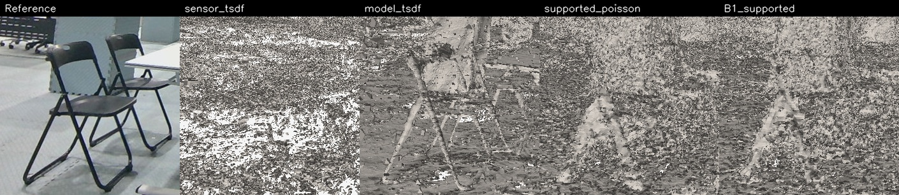

# 自采大厅的重建质量还差在哪里

2026 年 11 月 22 日。实验基线为 `fee8821`，B2 已从头完成 240,000 次更新，验证集选中 210k。本次新增的是针对现有数据、模型结果和网格的诊断。下面的改进方案尚未实施。

**优先修复跨视角表面一致性。** 现有模型能画出桌椅和屋架，但在特定视角会把远处表面放到镜头前一米，导出时还会把局部观测清楚的柱面融掉。画面上的泡沫块纹理损失则有另一条证据链。它需要更清晰、对齐更好的多视角颜色观测，以及足够局部化的高斯。以下按问题能从哪里验证、修复要花多少代价来排序。

## 论文对照与大厅基线

| 数据和评价 | 已有结果 | 可回答的问题 |
| --- | --- | --- |
| 论文 MuSHRoom VR Room，表 4 完整方法 | PSNR 26.8 dB，SSIM 0.879，5 cm 网格 F-score 87.1% | 同一基准场景、30k 的参照 |
| 本项目 VR Room，30k | within 轨迹 42 帧为 26.972 dB / 0.8811，with 轨迹 186 帧为 23.745 dB / 0.8267。可见性裁剪后网格 F-score 为 86.86% | 同场景几何接近原表。原表只列一组渲染指标，两条轨迹的结果都应保留 |
| 自采大厅 B2，184 张开发测试图 | 210k 渲染 24.681 dB / 0.8044，LPIPS 0.2010。模型深度 MAE 12.36 cm。支持 Poisson 网格 10 cm 正确覆盖 61.95% | 与同一大厅 B0、B1，以及今后的改法配对比较 |

大厅用同次 Gemini 335 采集的 0.3–6 m 有效光轴深度评价，每个测试参考像素是一条观测射线。论文网格 F-score 同时衡量重建与独立参考表面间的准确性和完整性。两者的距离阈值、分母和参考源都不同。B1→B2 同为 30k 时，模型深度 MAE 已从 33.65 cm 降到 12.96 cm，继续到 210k 才到 12.36 cm，240k 为 12.72 cm。继续堆步数的优先级据此下调。[论文表 4](https://openaccess.thecvf.com/content/WACV2025/papers/Turkulainen_DN-Splatter_Depth_and_Normal_Priors_for_Gaussian_Splatting_and_Meshing_WACV_2025_paper.pdf#page=7) · [本项目 VR Room](../../vr-room-iphone-30k/summary.md) · [B2 同预算对照与全量指标](../../capture-full-quality-v2/20261121-v1/B2_完整指标对比.md)

## 同一个场景，三种不同的失败

**远处距离错误。** 在 B2 开发测试集上，4–6 m 占参考像素的 23.36%，贡献深度总绝对误差的 54.54%。该段模型 MAE 为 28.85 cm，10 cm 内占 33.98%，支持 Poisson 网格只占 25.28%。1–2 m 的相应数值为 4.08 cm、95.29% 和 84.51%。第 329 帧尤其典型：远处屋架清楚、前景桌椅可辨，但 4–6 m 的 63,229 个参考像素平均预测偏近 1.17 m。该帧全距离 MAE 为 93.85 cm。全测试的深度误差只在 17.16% 的 RGB 像素处有传感器参考，更远的顶棚外观可以观察，几何精度尚无相同依据。[开发测试逐帧与距离统计](../../capture-full-quality-v2/20261121-v1/test_step-000209999.json.gz) · [第 329 帧](../../capture-full-quality-v2/20261121-v1/previews/frame_00329_timeline.jpg)

**网格有面，物体却不成形。** B2 直接预测深度的 10 cm 正确率为 72.72%。同分母下，支持 Poisson 网格命中 96.27%、10 cm 正确覆盖 61.95%、前方冲突 22.26%；模型 TSDF 相应为 98.03%、56.10%、14.21%，其命中误差 P95 达 2.98 m。前景伪面与穿过漏面后命中更远物体都需要处理。固定椅子裁剪里，模型 TSDF 仍能分辨椅背和部分椅腿，支持 Poisson 将腿和地面连成碎片。单视角预测与多视角网格之间 10.77 个百分点的差还包含跨视角预测不一致，无法全部归给 Poisson 算子。[全部网格统计](../../capture-full-quality-v2/20261121-v1/surfaces_test.json)

**近景高频纹理发糊。** 第 1419 帧实拍前景泡沫块的齿边和面上凸纹清楚，B2 保住块体轮廓，压平了大部分细纹。对公开三栏视频去掉标题并逐帧拟合最优三通道增益和偏移后，该帧仍保留 95.34% 的像素均方误差。验证集、开发测试集各 181 张可见画面的中位收益为 0.16、0.17 dB，测试中也有 15 张可提高超过 1 dB。全局颜色补偿可解释部分视角；多数视角的残差应继续查局部错位、源图清晰度、投影足迹与表观差异。这是压缩视频上的诊断，正式指标沿用完整的 184/184 帧。[光度拟合结果及抽样定义](video_affine_check.json) · [第 1419 帧](../../capture-full-quality-v2/20261121-v1/previews/frame_01419_timeline.jpg)

## 深度投影、局部位姿和融合，问题分别出现在哪里

**两张训练帧仍在错误的轨迹分支上。** 使用 B2 冻结位姿、原生标定和真实深度，将全部 1,478 张训练图按时间相邻成对，向两个方向投影。在原生网格每八个像素采样一次，每个目标像素取最近的投影点，只统计两边都有有效量测的位置。2,954 个有向帧对共 8,045,328 次有效比较，79.65% 在 10 cm 内。1303→1304 和 1305→1306 两对的双向一致率分别为 9.8% 和 5.4%，对应转角 171.67°、171.94°，光心位移 1.59、1.64 m。1304 与 1305 两帧彼此却有 88.3% 一致，说明仅在坏段内部互证会接受错误分支。1514 的邻接一致率为 50.7% 和 41.6%，该帧又有实拍拖影，应单独处理。另取时间相隔至少 10 s、光心距 ≤0.5 m、朝向差 ≤15° 的全部 394 个训练帧对，在共有有效采样上有 88.79% 一致。它只覆盖 127 个训练视角，说明部分重访相当可靠，不能推断到全场轨迹。[原生深度双向复算](native_neighbor_check.json) · [B2 位姿逐项记录](../../capture-full-quality-v2/20261121-v1/pose.json)

**单帧积分可以放对表面，加入更多视角后已有表面会消失。** 用原项目 Open3D 0.18 和 B2 实际调用的积分函数，核对 0、330、1420 三个训练相机。用原生数据重新生成的 RGB 网格参考对三帧均逐像素吻合。对已交付的全程传感器网格逐块遍历全部 31,638,067 个三角面取第一交点，回到同一训练相机比较。每行三种规模沿用完全相同的参考像素。表中正确覆盖以全部参考为分母，MAE 仅对命中计算。[原生及 RGB 相机积分回投](tsdf_closure_check.json)

| 训练帧 | 单帧融合 10 cm 正确覆盖 | 邻近 5 或 9 帧融合 | 全程 1,478 帧融合 | 命中 MAE，从单帧到邻近帧、再到全程 |
| --- | ---: | ---: | ---: | --- |
| 00000 | 75.49% | 73.64% | 13.61% | 0.60 → 5.50 → 185.04 cm |
| 00330 | 76.38% | 58.45% | 2.45% | 0.50 → 10.69 → 113.37 cm |
| 01420 | 83.30% | 80.11% | 5.80% | 0.33 → 7.13 → 219.42 cm |

倾斜无噪声平面的命中 MAE 约 0.25 mm。这样可以在三个实际相机上把失真定位到多视角积分环节，留出相机定位误差无法解释这张表。在完整的 184 张开发测试图上，这份全程传感器网格的 10 cm 正确覆盖是 5.79%，命中 MAE 为 1.82 m。同帧自检使用同一套标定，物理标定偏差与长程轨迹误差仍需要独立观测区分。[全量网格评价](../../capture-full-quality-v2/20261121-v1/surfaces_test.json)

另在四个确认有缺面的原生训练观测周围，逐体素复算 Open3D 的有符号距离积分。每块为边长 16 cm 的 16³ 个体素。只用观测前后 2 s 的训练帧，四块内分别有 343、932、549、1,093 条体素边发生正负变号，表面可以穿过这些位置。使用全程 1,478 帧后，四块内的 4,096 个体素各自全部有观测、全部为正，交付网格在四块内也都没有顶点。以第 900 帧的近处柱面为例，时间窗外有 49 条量测靠近原表面，112 条把同一点当作前方空域。这四处是有意选取的失败样例，说明**至少部分表面在融合时就被消掉了**。造成冲突的位姿误差、遮挡或运动、深度量测偏差仍需分别识别。增加 Poisson 的八叉树深度无法恢复已经在输入几何中消失的面。[四处体素与完整 PLY 的复算](tsdf_block_check.json) · [Open3D RGB-D 积分](https://www.open3d.org/docs/0.18.0/tutorial/pipelines/rgbd_integration.html)

## 建议的实施顺序

### 1. 用冻结 B2 改善成面，并在同一批视角归因

保留 B2 210k、原始相机和三个既有网格作为基线。用相互可见的训练视角先形成局部表面，再将局部表面合入全局。深度残差的容差随距离按训练观测的重复性估计，同时记录观测角度、到深度断边的距离和来源视角。近乎相同的机位只计一组支持。前表面遮住背景时，把背景标为不可见；一个视角在前景边缘穿过柱子看到后墙时，优先寻求另一组不同机位的证据，再更新原表面处的自由空间。真实、重复证实的空域仍要清除伪面。

在训练相机上对照模型深度、局部融合深度、全局融合深度和最终网格的第一交点。当前支持 Poisson 将同一个 1 cm 体素内的点和法线做平均，按三角面中心至少两帧支持且支持票多于冲突票来留面。新导出应在深度断边保留前后两层，在细杆两侧区分朝向，并检查跨断边三角形的内部和边缘；有充分覆盖的平坦区才平滑。先在固定模型、固定相机上交付一份完整的模型表面。原生传感器表面另列，使用模型预测值构建的结果也独立标识，以便知道改善来自哪里。[旧导出实现](../../../scripts/capture_metric3d_mesh.py) · [已有支持网格协议](../../../docs/13_capture_supported_mesh.md)

### 2. 修正有证据的相机，并给中远景可靠的几何监督

用坏段外的主训练观测和不同机位的真实对应，联合估计 1304、1305，固定外部地图、尺度和内参。把区间外的重投影与双向深度残差同时作为接受条件。1514 使用实际清晰邻帧和固定地图尝试定位，不能确定时保留失败标记。再检查 60–90 s 等高误差区内的平面内点和深度边界，按短时间邻接、跨时间重访、近距和远距分别量出残差。如果同一子图内多个不同朝向的静态平面随一次重访整体错位，优先用训练图像匹配和可信 RGB-D 面约束求局部刚体校正，并重新融合；若残差随深度或斜视角变化，优先估计传感器重复性；若冲突集中在轮廓，优先处理前后景遮挡。不同成因可以同时存在。修复两个跳变只有局部获益的直接证据。

若需要一轮新训练，沿用 B2 划分与主要训练预算，从纠正后训练几何重新生成初始化。新增加的约束优先用**训练视角间一致的真实深度与自由空间**。在遮挡边缘对前后表面分别处理；缺失处保留未知。4–6 m 样本按重复测量可靠度和不同观察方向加权，直接把远处所有量测加大权重会同时放大系统偏差。对没有传感器参考的位置，可用有视差的多视角三角化提供弱几何约束，并标记来源。仅凭颜色或单目法线确定不了表面的米制距离。

现有渲染器输出每条射线上各高斯贡献的加权期望深度。前后两层共同贡献时，期望值可能落在两层中间。对训练中的固定细杆、柱边、前景错面的射线记录贡献深度分布，比较期望深度与主要可见表面的位置。若证实混层广泛，再在同一正式训练中约束高置信单表面射线的深度分散，并在轮廓处保留前后景。若表面表示本身成为主要限制，2DGS 的射线与圆盘求交、深度畸变正则，或 AGS-Mesh 的自适应监督，都可作为单独的方法路线。作者在其他数据上的增益不能代作本大厅的预期值。[2DGS 原论文](https://www.cvlibs.net/publications/Huang2024SIGGRAPH.pdf) · [AGS-Mesh 方法及消融](https://arxiv.org/html/2411.19271v2#S4)

### 3. 用清晰的训练视角恢复纹理

从泡沫凸纹、桌沿文字或纹理、细网格各取固定区域。将实际训练图像按同一表面重投影到相邻训练视角，看清晰源图是否同时覆盖、边缘错开几个像素、是否仅在某一视角反光。对应边缘错位时先修几何；源图清晰、已对齐且多视角一致，模型仍画糊时，才把更多小尺度高斯分配给这些区域。可按持续存在的多视角高频残差引导局部细分，限制模糊帧在高频颜色更新中的权重。若一个表面从未被清晰、多方向地看到，可在允许补采时从近处、侧向和另一高度补一次，慢速转动、保留横向基线和闭环重访。补采属于新的数据版本，原大厅对照继续独立报告。

### 判断一次改进是否值得保留

- **主判断看网格。** 延用既有验证目标：全参考 10 cm 正确覆盖 ≥70%，命中 ≥90%，前方冲突 ≤15%。B2 的验证值分别为 61.61%、96.43%、22.50%。共同命中上的 MAE、P95，以及固定椅腿是否分离、桌沿是否重影、柱面是否连续，都与原网格并排报告。删掉大块错误区域可能改善命中 MAE，正确覆盖能同时反映这种损失。
- **保护已经得到的模型质量。** 新训练与 B2 210k 的验证 PSNR 24.644 dB、SSIM 0.8045、LPIPS 0.1990、模型深度 MAE 12.04 cm 比较。逐项给出变化，尤其保留 4–6 m、运动段和固定局部原尺寸图。模型导出改进本身不改变冻结模型的 RGB。
- **比较保持同分母。** 每次正式选择用全部 184 val，按冻结方案报告全部 184 开发 test。主划分 1478/184/184 保留。留出仅定位和评价，地图优化、深度置信度估计、阈值拟合和网格融合均只用训练观测。若相机修正后重训，按新旧各自相机报告端到端结果，并在未改位姿的相同视角补充成对指标。无需为每一项建议另开短训练。

新增数字可用[训练帧相互投影](../../../scripts/capture_native_neighbor_check.py)、[原生积分回投](../../../scripts/capture_tsdf_closure_check.py)、[指定体素块积分](../../../scripts/capture_tsdf_block_check.py)和[视频颜色拟合](../../../scripts/capture_video_affine_check.py)复算。
