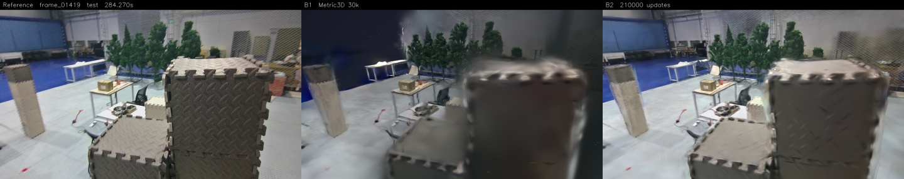
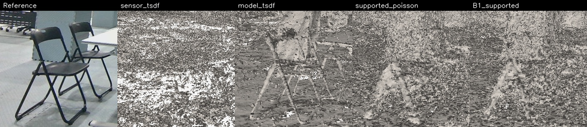

# 2026-11-23：B2 已改善模型，下一步完成 B3 的完整表面实验

## 结论与审阅范围

**当前推荐是接续现有 B3，把冻结模型成面、训练端准备、条件训练和完整交付做完。B2 已经完成，不应再次启动同一个 B2；也没有证据支持仅追加相同训练步数就能解决当前网格问题。**

本次读取冻结于 `d6405240df30c49e71365f87fdce4ec7ce7c7462`（提交时间北京时间 2026-11-23 19:19:53）。完整取回该树的 507 个跟踪文件并核对 Git blob SHA 和大小；重点语义审阅 B2 结果、11-22 几何诊断、B3 协议及实际入口、训练/位姿/权重/纹理/融合代码，并查看真实预览。文件完整性核验不代表逐行审计了全部文件。

本次是仓库审阅。没有连接 AutoDL 读取实时进程或重新执行 GPU 实验。GitHub 只有 B3 的历史启动回执，无法据此声称服务器现在仍在运行、B3 已结束或训练已经开始。本报告及提示词是新交付，下面的数值均来自已存在的实验结果。

专项分析：[训练](training_review.md)、[几何与输入](geometry_review.md)、[网格](mesh_review.md)。下一执行入口：[接续当前 B3 的 Codex 提示词](../../../prompts/capture_quality_continue_20261123.md)。

## 1. 当前效果究竟怎样

在同一套 184 张开发测试图上，B2 已显著改善 RGB 与模型深度，但最终网格的改善很小。深度参照仍是同次采集的有效传感器 Z，不是独立扫描真值。

| 项目 | B1 | B2，验证集选中的 210k | 解释 |
| --- | ---: | ---: | --- |
| RGB PSNR | 16.885 dB | 24.681 dB | 提升 7.796 dB |
| RGB SSIM | 0.6641 | 0.8044 | 主体结构更稳定 |
| RGB LPIPS | 0.4130 | 0.2010 | 感知误差下降 |
| 模型深度 MAE，全参考像素合并 | 33.65 cm | 12.36 cm | 降低 63.27% |
| 同支持流程 Poisson 的 10 cm 正确覆盖 | 59.02% | 61.95% | 仅增加约 2.92 个百分点，按未舍入值计算 |
| 同支持流程 Poisson 的命中 MAE | 20.51 cm | 20.73 cm | 没有改善；两者命中像素集合不同 |

来源：[B2 quality.json](../../capture-full-quality-v2/20261121-v1/quality.json)、[完整指标对照](../../capture-full-quality-v2/20261121-v1/B2_完整指标对比.md)。

“10 cm 正确覆盖”的分母是全部有效参考像素：射线命中且第一交点深度误差不超过 10 cm 才记为正确。缺面不会因从分母中消失而提高这个数。它与论文的 3D F-score@5cm 不是同一个指标。

实际图像也支持区分模型与网格：`frame_01419` 的 B2 背景、桌子和箱体轮廓优于 B1，但泡沫块凸纹与齿边仍被抹平；椅腿网格仍严重碎裂、粘连。局部 `model_tsdf` 有时比全局指标更高的 `supported_poisson` 更容易辨认细杆，单一平均分不能替代物体细节检查。

## 2. 为什么现在不应继续盲目加训练步数

| B2 节点 | Test PSNR | 模型深度 MAE |
| --- | ---: | ---: |
| 30k，事后同预算补评 | 23.265 dB | 12.964 cm |
| 210k，按 val 选择 | 24.681 dB | 12.358 cm |
| 240k，最终节点 | 24.703 dB | 12.724 cm |

30k 到 210k 多执行 180k 更新，RGB 提升约 1.415 dB，深度 MAE 仅再降低 4.67%；240k 的深度反而略差。B2 相比 B1 的大部分深度收益在 30k 就已出现，不能将联合位姿、初始化、采样、容量调度改动的收益全归因于 240k。

源码与细化事件记录表明，B2 已经在 120k 后停止增删和 opacity reset，最终约 761,513 个高斯。旧的后半程持续删点问题不能继续作为尚未处理的首要故障。也没有证据支持高斯数越多就必然越好。

`curve.json` 存在内容标注错误：外层 run_id 指向 B2，内部六个 checkpoint 路径与数据实际属于 B1。B2 的曲线应使用 [selection.json](../../capture-full-quality-v2/20261121-v1/selection.json) 中八个节点和 `val_step-*.json.gz`；不要用这份错标文件再得出训练退化结论。完整细节见 [训练复核](training_review.md)。

## 3. 剩余问题的优先级

### 3.1 多视角融合会抹掉本来存在的表面

B2 开发测试集上，模型直接渲染深度的 10 cm 正确率约 72.72%；支持 Poisson 为 61.95%，模型 TSDF 为 56.10%，原生传感器全局 TSDF 只有 5.79%。前两者的约 10.77 个百分点差距包含模型跨视角不一致与成面损失，不能全部归咎于某个导出函数。

更有辨别力的证据来自原生深度融合：11-22 的诊断在同一训练相机回投，单帧积分的 10 cm 正确覆盖约为 75%–83%，用全部 1,478 训练帧积分后降至约 2%–14%。这排除了“只是留出位姿不准”的解释。在四个定点缺面体素块中，局部融合存在正负变号，全部训练帧融合后 4,096 个体素却全部为正，原来的零等值面确实消失。四块是针对失败位置选择的诊断，不代表全场统计比例。

这支持先解决跨时段观测冲突、可见性和自由空间判断。它尚不能单独区分轨迹偏差、遮挡、运动、深度偏差各占多少。B2 的实现已经是 `depth_sampling_stride=1`、1 cm 体素、4 cm TSDF 截断及 0.3–6 m Z；不要重复把默认 stride 或 3 m 截断当已证实根因。

来源：[11-22 诊断](../2026-11-22/overview.md)、[TSDF 闭环](../2026-11-22/tsdf_closure_check.json)、[体素块核验](../2026-11-22/tsdf_block_check.json)。

### 3.2 位姿仍有具体错误，但两帧不能解释全场全部缺陷

B2 已接受 11 个局部位姿改动，剩余 `1304/1305/1514` 需要分别处理。`1303→1304` 与 `1305→1306` 两条边约有 172° 朝向跳变、1.6 m 位移；双向深度 10 cm 一致率约 9.8% 与 5.4%。可疑的 1304、1305 彼此却有 88.3% 一致率，说明两个错误解可以互相支持。

因此，1304/1305 应使用坏段外的训练地图锚点联合定位，并用未参与求解的其他训练机位验证。不能只用二者互相匹配证明修复成功。1514 有拖影，应独立判断可用对应和平面约束，证据不足保留旧位姿及失败标记。不要插值造位姿或删帧缩小分母。

目前 B3 有 1304/1305 的对应分组、PnP 和独立验证实现，但无执行回执。1514 的当前代码仍主要输出诊断和保留旧解，没有完成有证据支持的新位姿求解。已经修好的 11 帧无需再次全局重做。

来源：[B2 pose.json](../../capture-full-quality-v2/20261121-v1/pose.json)、[原生邻接核验](../2026-11-22/native_neighbor_check.json)、[几何复核](geometry_review.md)。

### 3.3 深度覆盖与远处误差决定了大厅重建的难度

全部 1,846 帧的原生深度非哨兵像素约占 93.86%，但 0.3–6 m 范围内约占 48.47%；投影到 1280×720 RGB 后，有效监督只占 RGB 网格约 17.21%。这包含量程、视场与分辨率差异，不能把余下全部像素都解释为传感器失效。

在 B2 开发测试参考中，4–6 m 像素占约 23.36%，贡献约 54.54% 的绝对误差总量；该段 MAE 约 28.85 cm，而 1–2 m 约 4.08 cm。因此要看距离分档，训练时区分可信与冲突的观测。没有有效深度的远墙、顶棚仍主要依赖多视角 RGB，不能把单目预测填充后当作新增测量真值。

本轮使用现成的 B3 训练端独立观测权重方案。它保留真实 Z，只改变每个观测对损失的贡献；遮挡、未知、断边不等同于负证据，源帧/近重复视角不能为自身投独立支持票。是否启用由额外训练机位的交叉验证决定。

来源：[深度覆盖](../../capture-full-quality-v2/20261121-v1/depth_coverage.json)、[11-22 分距离分析](../2026-11-22/overview.md)。

### 3.4 纹理细节需要可见的清晰多视角证据

真实预览中有清晰泡沫凸纹，但渲染有细节损失。对公开视频做逐帧全局 RGB 增益/偏置拟合，只能解释很小一部分误差；这是压缩视频诊断，不是官方无损图像评价。曝光可能影响部分帧，但不支持把全部模糊归结于曝光。

应沿既有 B3 协议，用训练图的重复观察判断同一细节是否清晰、是否对齐，以及高斯是否真正贡献这些像素。仅在这些证据成立时讨论增加局部表示能力。错位图像监督更多高斯会造成重影；低分辨率深度和法线平滑也可能缺乏毫米级纹理的几何约束。

B3 的表面筛选需要远离原生深度边缘 2 px 的可靠支持。以原生 fx≈414 px 推算，3 m 处 1 px 约对应 7.2 mm，细杆若只有几像素宽，可能没有足够内部像素通过筛选。这里是投影尺度推算，不是实测椅腿宽度。故 B3 更有希望先改善大面、错层与缺面，不能承诺细椅腿、泡沫齿边立刻达到论文展示水平。

## 4. B3 当前实现到了哪里

| 项目 | 仓库中可证实的状态 | 下一步 |
| --- | --- | --- |
| 真实启动 | 11-22 13:58:46 北京时间回执：A1，34/187 子图，272 帧 | 先查 AutoDL 当前状态，接续原 run |
| A 成面 | 局部子图、原生证据、裁接实现已有；最新提交修复嵌套多边形孔洞三角化 | 完成既定候选，完整 val |
| 主入口 | `launch_capture_surface_quality.sh` 只到 A3→A4 两分支 val，写 `frozen_pair_val.json` 后结束 | 接上 B、条件 C、选点和交付 |
| 位姿 | 部分真实实现，无已执行结果；1514 尚未产生新解 | 完成训练侧证据与实值决定 |
| 深度权重 | 权重构造及 EdgeAwareLogL1 消费路径已有，无启用回执 | 完成跨组验证、输入绑定与实际消费核验 |
| 纹理 | 当前所有块 `eligible=False`，收据固定 `status=incomplete`；训练入口因此拒绝作决定 | 完成诊断，或按协议如实证明接口不足并关闭额外细分 |
| 条件训练与最终结果 | 没有对应完成记录 | 不能提前声称 B3 已提升质量 |

这里的裁接是多视角证据驱动的自动表面替换，不是手工圈掉失败区域。d640 的多边形修复解决拓扑工程错误，不改变 B2 checkpoint 的深度或纹理。

纹理问题不能通过把 `incomplete` 改为 `complete` 绕过。协议允许在无法可靠获得真实高斯贡献时关闭额外细分，但必须完成可做的多视角清晰度/对齐诊断，记录实际接口限制。实现未完成与诊断证明无有效改动是不同状态；不能把前者报成 `skipped_equivalent`。位姿或深度权重只要真实改善并通过验收，仍可触发 C。

另一个需一次解决的实现问题是权重计算吞吐：当前小块循环反复遍历训练帧，8 帧缓存会频繁解压原生深度并重算边缘距离。静态估算，全部 1,478 份 float32 原生 Z 和边缘距离约 4.81 GB，可顺序阶段常驻缓存或用等价分块/GPU 核复用。该估算不是运行耗时测量；优化不得改变分组投票和权重数值定义。

来源：[历史启动回执](../../capture-full-quality-v3/20261122-v1/launch_verified.json)、[主入口](../../../scripts/launch_capture_surface_quality.sh)、[纹理实现](../../../scripts/capture_surface_texture.py)、[训练实现](../../../scripts/capture_surface_train.py)。

## 5. 下一轮的明确任务与判断标准

沿用 `capture-full-quality-v3-20261122-v1` 和 [已冻结协议](../../../configs/capture_surface_quality_protocol.json)，完成一次全量实验。先查现有持久进程和阶段产物，避免第二个协调者重复启动。完成 A 的旧/新模型表面对照及独立传感器参照；完成 B 的三项实值决定；至少一项真实训练改动成立才从独立 B3 初始化执行一次完整 240k。相同输入、相同行为的 240k 重跑没有当前优先价值。

| 判断项 | B2 完整 val | 已冻结的工程目标 |
| --- | ---: | ---: |
| 网格 10 cm 正确覆盖 | 61.61% | ≥70% |
| 网格命中覆盖 | 96.43% | ≥90% |
| 前方冲突 | 22.50% | ≤15% |

70% 是项目预设目标，不是论文指标，也不是效果承诺。网格替换至少还须满足协议规定的不劣于 B2 条件。5 cm 正确覆盖、各距离段、固定物体的视觉结果同时报告；通过 10 cm 指标也不证明椅腿或齿边已恢复。所有选择只用 val，冻结后再一次性评价全部 184 张开发 test，保持完整参考分母。

最后交付旧/新网格与同视角局部图、1846 时间位置对照、全部指标和文件身份；若没有新训练，RGB 视频引用已核验的 B2 视频，并新增旧/新网格轨迹视频。评价差也完成交付，保留 B2 为推荐产物。允许最佳 RGB 与最佳网格来自不同候选。遵循用户当前交付约定：本轮推送 GitHub 代码/小报告，大产物留 AutoDL 并列路径及哈希，默认不做 Windows 归档或服务器清理。

## 6. 与论文的关系，以及 B3 后才需要考虑的方向

VR Room 的固定历史实现同轨迹 PSNR 26.972、SSIM 0.88108、F-score@5cm 86.863%，已经接近论文 Table 4 的 26.8、0.879、87.1%。这限于该场景、该轨迹和已披露实现，不能称全文严格复现。当前主要挑战是将方法迁移到长轨迹大厅并得到可用表面，不能拿自采的射线深度正确率直接与论文 F-score 比较。[VR Room 结果](../../vr-room-iphone-30k/summary.md)；[原论文](https://arxiv.org/html/2403.17822v3)。

若 B3 的可靠训练观测和新成面仍不能恢复细部，下一步应根据结果只选一个主要方向，而非继续扩写融合器：

- **跨视角仍明显错位：**优先针对训练地图进行有实测深度约束的局部/全局几何优化，保留独立核验视角与尺度；新的表面算法无法替错位观测制造一致性。
- **可靠多视角模型深度较好，但网格仍差：**考虑一次完整的、更偏向表面的表示对照，例如带可靠深度/法线约束的 2DGS；或沿 DN 路径采用 AGS-Mesh 的先验一致性与自适应成面。先择其一，沿用相同训练划分与完整评价。论文有依据，但没有在本数据上的效果承诺。
- **薄结构没有足够有效观测：**后续补采物体近距、多方向且曝光清晰的视角；用原始训练 RGB 检查细节证据，不能靠调 Poisson depth 或细化体素保证恢复。

2DGS 原文讨论了深度稀疏/不连续时简单替换为 TSDF 可能更差；AGS-Mesh 则直接处理噪声深度和法线先验，并探索自适应成面。两者都支持“先让多视角几何可信，再选成面”的方向，而非无条件更换网格算法。[2DGS 附录 C](https://arxiv.org/html/2403.17888v3)；[AGS-Mesh](https://arxiv.org/html/2411.19271v2)。

另有已披露的论文/历史实现差异：扁平化项在历史代码中随 normal_lambda 乘 0.1，而论文最终公式的外部权重为 1；内部归一化亦须一起核对。它可作为后续独立因素实验，但当前 VR 基线接近原文，不能仅据此认定它是大厅失败的首因，更不应混入已冻结 B3 改变归因。[来源审计](../../../docs/03_source_audit.md)。
