# Gemini 335 首段 DN-Splatter 基线

约 48 秒的 capture-s01 完成 30,000 次更新，最终零基 step 29999，含 440,882 个高斯。val、test 和原始 Poisson 使用同一最终模型。

最终 checkpoint SHA256 为 `fb6636d164d1edd2ca7a0bdd797078baf5cfb06be440953b4d42b6da750b3ab9`。

## 留出渲染与传感深度一致性

| 划分 | 帧数 | PSNR (dB) | SSIM | LPIPS | 参考像素 | 无效预测 | 参考内零累积 |
|---|---:|---:|---:|---:|---:|---:|---:|
| val | 24 | 23.2433 | 0.77935 | 0.29775 | 3,559,578 | 0 | 0 |
| test | 24 | 23.3502 | 0.77934 | 0.30406 | 3,566,260 | 0 | 0 |

| 划分 | 聚合方式 | MAE (m) | RMSE (m) | AbsRel | 绝对差 P50 (m) | 绝对差 P95 (m) |
|---|---|---:|---:|---:|---:|---:|
| val | 等权帧均值 | 0.13339 | 0.27624 | 0.03300 | 0.05035 | 0.51815 |
| val | 全像素聚合 | 0.12215 | 0.35837 | 0.03067 | 0.04468 | 0.39243 |
| test | 等权帧均值 | 0.19838 | 0.32643 | 0.05087 | 0.12393 | 0.56545 |
| test | 全像素聚合 | 0.16460 | 0.50281 | 0.04251 | 0.04624 | 0.55881 |

RGB 指标逐帧等权。深度参照是同一采集在 0.3–6 m 内的有效传感器 Z；按有效参考像素计分，保留累积不透明度为零的像素。历史渲染器在这些位置填入本帧最大 Z。存在无效预测时，完整参考指标记为未定义，逐帧 JSON 另列条件结果与分母。训练深度正值覆盖的中位数为 16.28%。

[逐帧 val 结果](metrics_val.json) · [逐帧 test 结果](metrics_test.json)

各图上排依次为原始 RGB、渲染 RGB 和法线，下排为传感器 Z、预测 Z 和绝对残差。深度色标为 0.3–6 m，绝对残差色标为 0–0.5 m，空洞用黑色表示。

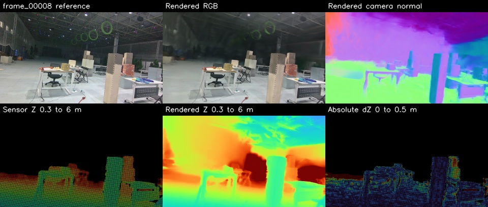

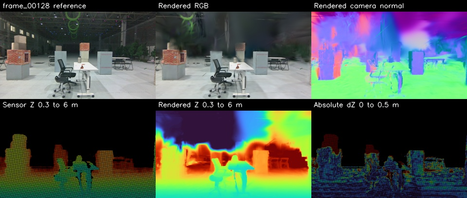

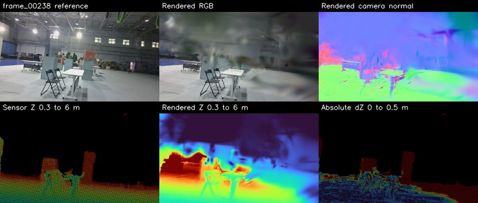

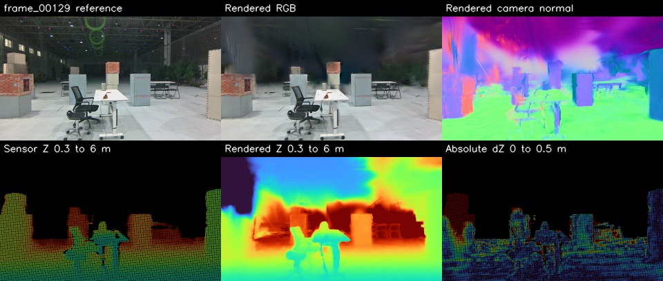

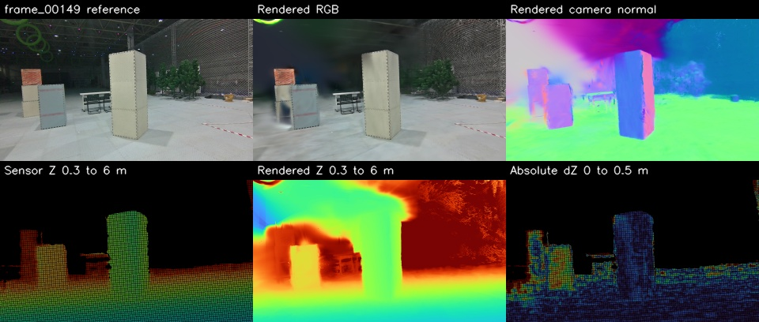

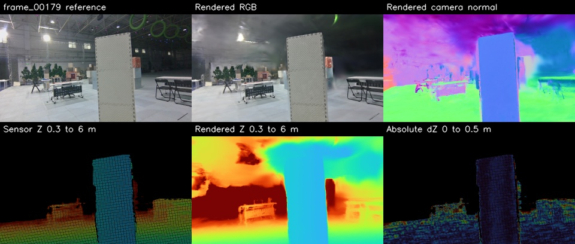

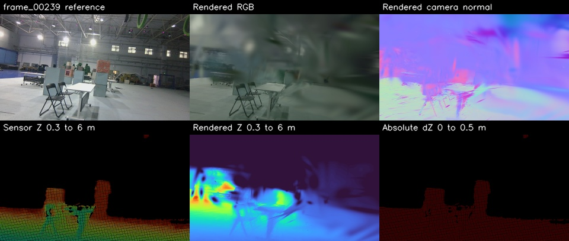

## 原始 Poisson 网格

193 个训练视角共采样 5,000,051 点，其中 43 点累积不透明度为零，570,536 点的模型深度超出传感器监督范围。原始网格有 457,112 个顶点、911,783 个面和 975 个连通分量。采样法线中，非有限值有 0 个，零向量有 0 个。

使用历史 depth 9、最低 1% 密度顶点裁剪、25 线程。远景和闭合补面缺少独立参考。下列固定训练视角局部图并列展示原始 RGB、网格顶点颜色与面法线明暗，供复核桌沿、柱面厚度、折叠椅腿及其间隙。

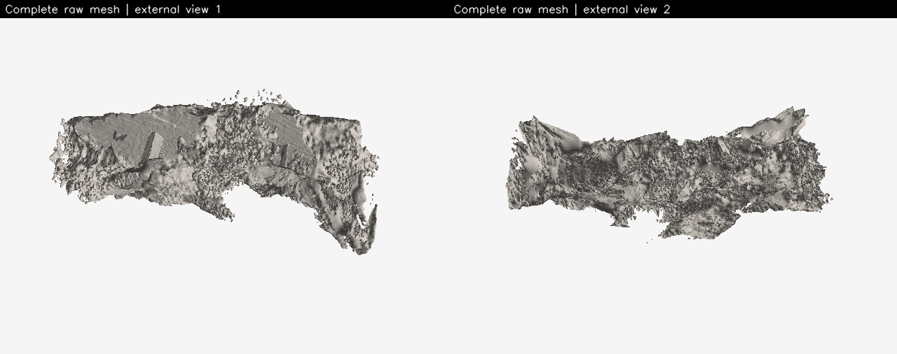

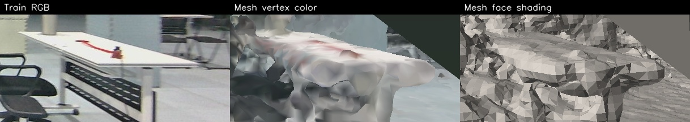

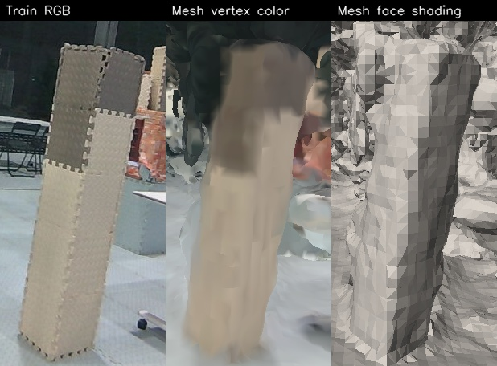

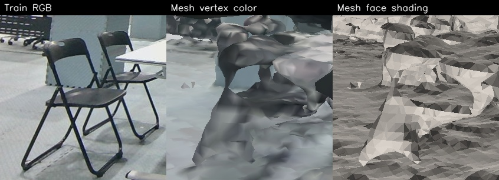

[网格计数、包围盒与局部相机](mesh_validation.json)

## 输入与宽基线局限

正式输入副本保留 1280×720、193/24/24 划分、既有米制位姿以及 436,361 点训练初始化。生成 241 组 Omnidata PNG 与 NPY，正式读取器逐帧检查 RGB、深度、法线、K 与 c2w。原几何成员在发布前再次校验。

40 个有向比较使用固定 640 网格。164→179 的局部平滑支持有 33,000 像素，绝对 Z 差中位数 3.60 cm、P95 2.25 m；反向有 31,652 像素，中位数 3.34 cm、P95 0.196 m。宽基线长尾具有方向性。val 和 test 位于同一轨迹，曾用于几何诊断。数据没有外部真值，结论限于这段采集。

[跨视角分母及正负候选](cross_view_diagnostic.json) · [六幅双向对照图](previews/) · [法线权重与输入指纹](normal_prior.json) · [正式读取](reader_check.json)

## 耗时、资源与大产物

峰值来自采样，GPU 为整卡，RAM 为整个容器。短阶段缺少采样时显示空白。

| 阶段 | 秒 | 采样峰值显存 (MiB) | 采样峰值容器内存 (GiB) |
|---|---:|---:|---:|
| copy | 4.6 |  |  |
| cross_view | 2.9 |  |  |
| omnidata | 75.8 | 8451 | 46.89 |
| manifest | 12.0 | 0 | 45.01 |
| reader | 48.5 | 2877 | 52.89 |
| training | 1436.6 | 5335 | 55.22 |
| val | 51.5 | 783 | 47.63 |
| test | 51.8 | 1479 | 48.69 |
| poisson | 79.6 | 1753 | 50.09 |
| mesh_validation | 16.7 | 3 | 47.52 |

服务器运行目录为 `/root/autodl-tmp/DN-Splatter/.local/runs/capture-s01-dn-30k-20261119-v1`。完整法线、48 帧 RGB/Z/法线渲染、所有 checkpoint、采样 PLY、原始网格及日志逐文件登记大小与 SHA256。

[产物清单](artifact_manifest.json) · [训练与损失](training.json) · [阶段记录](run_manifest.json) · [可重放命令](commands.sh) · [正式配置](config.yml)
