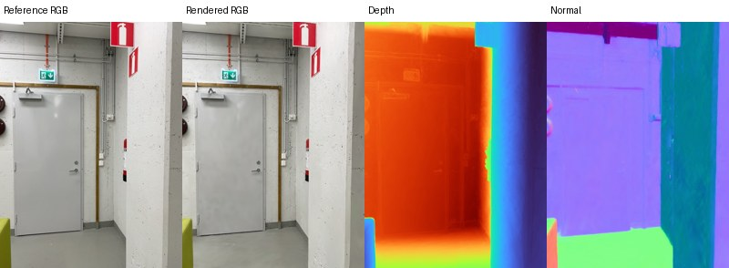
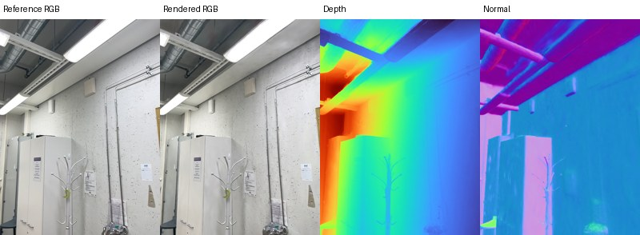
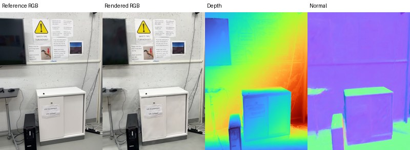
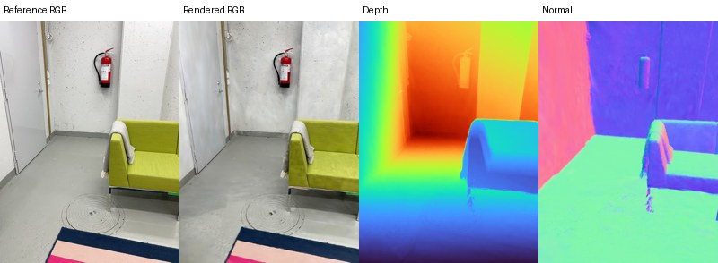
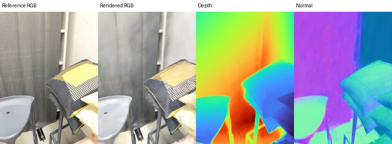
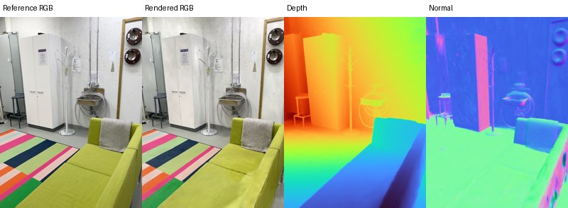
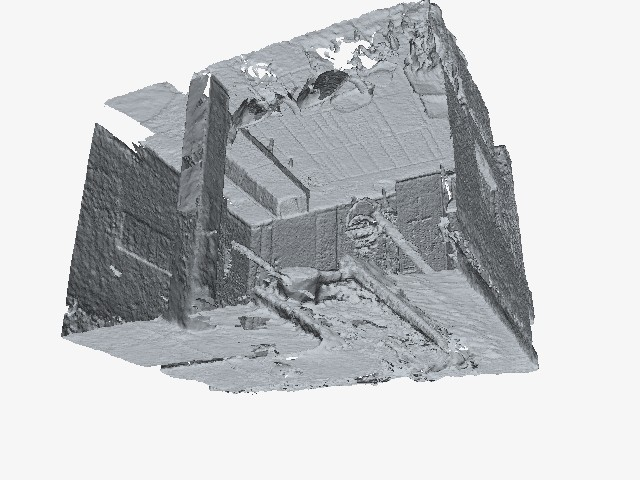
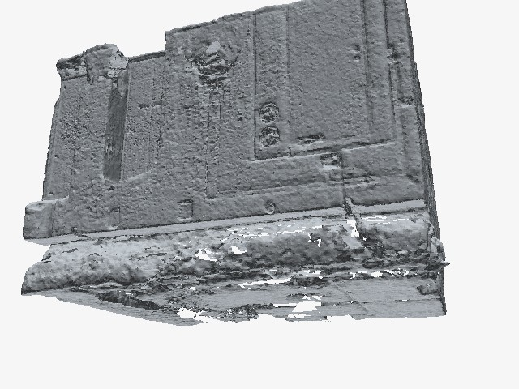

# 2026-11-19：VR Room 首轮复现审查与下一轮建议

审查日期：2026-11-19（Asia/Shanghai）。审查对象固定为用户仓库提交 [c747cc92](https://github.com/kaiwen123-yang/DN-Splatter/commit/c747cc92d70055d5d5ceb70699e85b77faad87da)，运行编号 `vr-room-iphone-30k`。本报告读取已发布的配置、指标、清单、脚本和预览，并核对论文及固定官方源码；**本次审查没有启动新的本地或服务器训练、渲染或网格实验，也没有更改首轮原始指标。**

## 1. 结论与下一步选择

**VR Room 的 Blackwell 运行、累计 30k 训练、图像/深度评价、Poisson 网格和几何评价均已有完成证据；核心图像与几何指标接近论文 Table 4。可以进入第二场景与自有数据接入阶段，无需重新安装环境或从头重跑这一轮。**

目前最准确的结论是“固定历史官方实现的 VR Room 单场景基线完成，主要指标接近论文公开数值”。它尚不能证明六场景均值、完整消融或全文复现，也不能据一次运行宣称统计显著超过论文。F-score 比论文少约 0.237 个百分点，现有证据不支持为这一小差距直接加训练步数或大规模调参。

下一轮建议分为三部分：先复用同一 checkpoint 补齐逐帧和网格诊断，再固定 `coffee_room` 做一次完整 30k，随后将同一算法环境用于用户真实数据。自有数据的路径和格式尚未提供，数据接入检查可以与第二场景准备并行；不把全文复现、多 seed 或全套消融作为自有数据试用的前置条件。

依据：[运行清单](vr-room-iphone-30k/run_manifest.json)、[真实训练配置](vr-room-iphone-30k/config.yml)、[官方图像/深度指标](vr-room-iphone-30k/rgb_depth_official.json)、[网格指标](vr-room-iphone-30k/mesh_metrics.json)。

## 2. 本轮完成证据

| 项目 | 实际记录 |
| --- | --- |
| 官方 DN-Splatter 源码 | `811f5cdf342d92d12a9d9a4be185d374c430c184`，加已发布最小补丁 |
| 场景与传感器 | MuSHRoom `vr_room` / iPhone |
| 训练 / 同轨迹留出 / 独立轨迹帧数 | 376 / 42 / 186 |
| 未注册的官方留出帧 ID | 空列表 |
| RGB / 传感器深度尺寸 | 均为 738 × 994 |
| 初始化 | 从允许的训练帧深度构建 1,000,160 点 |
| 训练随机种子 | 42 |
| 训练更新数 | 单次初始请求 30,000；最终 checkpoint step 29,999 |
| 恢复追加训练 | 清单只有初始训练段，没有恢复追加段 |
| 最终高斯数 | 1,084,297 |
| Faro 用于训练或初始化 | 否 |
| Poisson 目标 / 实际采样点 | 5,000,000 / 5,000,048 |
| Poisson 深度 / 线程 | 9 / 25 |
| 原始 Poisson 网格 | 772,004 顶点，1,539,985 三角形 |
| 裁剪后网格 | 2,272,775 顶点，3,938,721 三角形 |

裁剪版本顶点数增加，与官方裁剪前的三角网格细分过程一致，不能仅凭数量增加判定为重复网格错误。`frames.json` 的帧名、尺寸、先验路径与配置的两轨迹划分一致；初始化器明确排除 `test.txt`，未发现以 Faro 真值训练的配置。

数据和权重下载清单记录了来源、大小、Zenodo MD5 及 SHA-256。发布脚本检查 DN-Splatter 与 gsplat 工作副本变更和已登记补丁相符。当前证据足以确认正式运行完成；本报告没有重新在服务器上读取大 checkpoint 或重算网格。

依据：[帧清单](vr-room-iphone-30k/frames.json)、[实际命令](vr-room-iphone-30k/commands.sh)、[网格验证记录](vr-room-iphone-30k/mesh_validation.json)、[输入配准抽查](vr-room-iphone-30k/input_alignment.json)、[补丁说明](../patches/README.md)。

## 3. 与论文 Table 4 的数值比较

论文 Table 4 的完整配置是 `Depth + Normal + normal smoothing`，场景为 VR Room、训练 30k。表中 C-L1 为厘米，NC 和 F1 为百分数。仓库 `mesh_metrics.json` 的距离为米、NC/F1 为 0–1 数值，下表已统一单位。论文数值经过舍入，差值仅表示与公开表值的差，不代表精确的作者运行差值。

| 指标 | 论文完整配置 | 本轮结果 | 本轮减论文 | 判断 |
| --- | ---: | ---: | ---: | --- |
| PSNR ↑ | 26.8 dB | 26.971998 dB，within | +0.171998 dB | 接近且略高 |
| SSIM ↑ | 0.879 | 0.88108182，within | +0.00208182 | 接近且略高 |
| C-L1 ↓ | 2.5 cm | 2.551733 cm | +0.051733 cm | 接近，距离略大 |
| NC ↑ | 89.6% | 89.699334% | +0.099334 个百分点 | 接近且略高 |
| F-score@5cm ↑ | 87.1% | 86.862861% | −0.237139 个百分点 | 接近且略低 |

几何明细为 Accuracy 0.02856590 m、Completion 0.02246876 m、C-L1 0.02551733 m、NC 0.89699334、F-score 0.86862861。因此本轮接近论文的依据同时包含几何和图像，不能只归纳为“渲染好看”。

Table 4 没有明确注明单列 PSNR/SSIM 对应哪一条评价轨迹。将本轮 within 放在旁边是一个有依据的参考比较，但不能把相同的 26.8 / 0.879 强加给 with 短轨迹，进而判为复现失败。论文 Table 3 明确区分两轨迹，且报告的是六场景平均值，也不能拿那个均值作为 VR Room 或下一轮 coffee_room 的单场景目标。

当前只有一个训练 seed；导出抽样和几何表面采样尚未单独记录固定随机种子。没有多次测量的区间，不能声称上述小差异统计显著。也不设置未经论证的“允许误差多少就算论文严格复现”的门槛。

论文依据：[WACV 2025 主文](https://openaccess.thecvf.com/content/WACV2025/html/Turkulainen_DN-Splatter_Depth_and_Normal_Priors_for_Gaussian_Splatting_and_Meshing_WACV_2025_paper.html)，Table 3、Table 4；[补充材料](https://openaccess.thecvf.com/content/WACV2025/supplemental/Turkulainen_DN-Splatter_Depth_and_WACV_2025_supplemental.pdf)，A.2 与 B.2。

## 4. 两条轨迹的实际效果

| 指标 | within：42 帧 | with：186 帧 |
| --- | ---: | ---: |
| RGB PSNR ↑ | 26.9720 dB | 23.7448 dB |
| RGB SSIM ↑ | 0.88108 | 0.82667 |
| RGB LPIPS ↓ | 0.10414 | 0.15659 |
| 传感器深度 AbsRel ↓ | 0.019019 | 0.023582 |
| 传感器深度 RMSE ↓ | 0.109236 m | 0.137365 m |
| Faro 审计 AbsRel ↓ | 0.016938 | 0.020619 |
| Faro 审计 RMSE ↓ | 0.097554 m | 0.120569 m |
| Faro 审计有效参考像素总数 | 26,525,046 | 114,993,165 |

Faro 审计表采用“每条轨迹独立、每个注册帧等权”的定义。传感器深度评价与独立 Faro 参考深度评价不是同一组真值，不能混用名称。上述 RMSE 为逐帧 RMSE 的平均，不等同于将所有有效像素汇总后的单个 RMSE。

with 比 within 的 PSNR 下降 3.2272 dB，SSIM 下降 0.05441，LPIPS 上升 0.05245。这说明独立轨迹仍是更有价值的检查对象。可能影响因素包括视角变化、遮挡和训练覆盖程度；仅凭总体均值不能确定是哪一个因素，也不能断言延长训练一定能改善。

网格表面最近邻距离、逐像素轴向深度误差和图像质量描述不同性质。C-L1 约 2.55 cm 与 Faro RMSE 约 9.76 / 12.06 cm 不矛盾；它们的采样、遮挡和离群误差处理不同。F-score 的容差是 5 cm，不能据此宣称毫米级测量精度。

依据：[官方 RGB/传感器深度结果](vr-room-iphone-30k/rgb_depth_official.json)、[官方 Faro 原始结果](vr-room-iphone-30k/faro_official_raw.json)、[独立分轨迹 Faro 审计](vr-room-iphone-30k/faro_audited.json)。

## 5. 已发布图片的直接观察

本轮审阅已直接查看仓库发布的六张图像/深度/法线拼图及两张裁剪网格预览。拼图顺序为参考 RGB、渲染 RGB、渲染深度、渲染法线。观察范围是这些缩略图，尚不等同于逐帧全分辨率检查。

墙面、门、柜体等主结构的 RGB 对应整体较好，说明基本相机关系和场景结构已经重建。`short_capture_frame_00094` 中靠垫纹理、椅子边缘等局部细节较模糊，不能用总体 PSNR 盖过这些细节问题。

### 同轨迹留出视角

### 独立轨迹视角

### 裁剪网格

两张 `mesh_cull` 预览中可见较粗糙的局部表面、孔洞和碎边。因此不能把本轮结果称为无缺陷、完整闭合的高质量网格。**这些图展示的是用于评价的裁剪网格，部分孔洞或边缘可能由可见性裁剪产生。** 下一轮应从相同相机视角并排渲染原始 Poisson 与裁剪版本，再区分重建缺陷和评价裁剪边界；现在不能把全部缺陷归因于训练。

## 6. 评价口径审计：需要补充，但不要求重训

### 6.1 官方裁剪实际使用 418 个 long_capture 视角

固定官方脚本的 `cull_mesh(..., test_ids, ...)` 接收留出 ID，但是循环遍历 `transformations_colmap.json` 时没有使用这些 ID 过滤。因此，本轮原样调用该脚本得到的 official 结果，实际使用全部 418 个 long_capture 注册视角，包括 42 个 within 留出视角。它并非严格只使用 376 个训练视角。

这属于评价脚本的视角选择，不表示训练把测试图像加入了优化。首轮初始化和训练划分仍按注册帧清单排除留出帧。原报告中的“训练视角可见性裁剪”应理解为沿用官方脚本的长轨迹评价口径；若表述为“严格训练帧裁剪”，需要更正。

下一轮保留当前 official 指标，并另存严格使用 376 训练视角的 `strict_train_only` 结果。分别记录实际相机数、帧清单和裁剪参数，不用审计结果覆盖原始值，也不选择性只展示更高的那一项。论文补充材料 B.2 的文字是训练相机可见范围，代码细节与文字存在这项需要披露的区别。

源码：[固定官方可见性裁剪与几何评价](https://github.com/maturk/dn-splatter/blob/811f5cdf342d92d12a9d9a4be185d374c430c184/dn_splatter/eval/eval_mesh_mushroom_vis_cull.py)，`cull_mesh`、`main`。

### 6.2 导出与几何评价随机种子

官方导出使用随机选点，几何评价 `compute_metrics()` 又对两张网格进行表面采样。本轮训练 seed=42 不能自动证明这两个独立进程也固定了随机种子。固定官方脚本没有为该几何采样显式设 NumPy seed。

后续应分别记录训练、导出、几何评价的随机种子。若需要判断 F-score 的 0.237 个百分点差距，先对同一网格采用明确记录的采样种子检查评价波动；这不需要重训，也不能以选择最高的一次评价取代原结果。

源码：[固定导出器](https://github.com/maturk/dn-splatter/blob/811f5cdf342d92d12a9d9a4be185d374c430c184/dn_splatter/export_mesh.py)、[固定几何评价器](https://github.com/maturk/dn-splatter/blob/811f5cdf342d92d12a9d9a4be185d374c430c184/dn_splatter/eval/eval_mesh_mushroom_vis_cull.py)。

### 6.3 Faro 原始与审计指标

本项目已经保存官方原始结果，并在 `audit_split()` 中为每条轨迹单独累计、每帧等权，同时检查所有注册留出帧与 raw depth 渲染文件集合相符。这修正了官方脚本两轨迹共享累计列表及不同大小 batch 等权的问题，是有价值的改进。

不过审计文件仍保留两项历史定义，并已在文件中注明：

- `mse` 对全部像素计算，GT=0 的无效参考像素也参与；RMSE、AbsRel 等则只使用 GT>0.1m。因此不能把 MSE 1.3099 / 1.6417 开方后与相应的 0.09755 / 0.12057m RMSE 对照。
- 历史 `rmse_log` 实现先逐像素开平方再求均值，实际等于 `mean(abs(log(gt)-log(pred)))`，不是标准的 `sqrt(mean((log(gt)-log(pred))**2))`。

建议新增有效像素 MSE、标准 RMSE-log，并明确逐帧平均与有效像素汇总两种聚合。保留原 `raw` 和现有 `audited` 文件，新增版本和计算定义；不改变训练损失。

源码：[本项目审计脚本](../scripts/vr_room_evaluation.py)、[固定官方 Faro 评价](https://github.com/maturk/dn-splatter/blob/811f5cdf342d92d12a9d9a4be185d374c430c184/dn_splatter/data/mushroom_utils/eval_faro.py)、[固定 DepthMetrics](https://github.com/maturk/dn-splatter/blob/811f5cdf342d92d12a9d9a4be185d374c430c184/dn_splatter/metrics.py)。

### 6.4 当前 normal_mae 不宜解释为真实角度精度

`dn_model.py` 将渲染法线编码到 `[0,1]`，评价路径将该编码与同样编码的先验送入 `NormalMetrics`；其角度公式直接对点积执行 `acos`，没有先通过 `2*x-1` 解码并单位化。因此当前 `normal_mae` 不能直接转换成可信的真实法线角度误差。

另外，参考法线来自 Omnidata 先验，并非 Faro 扫描得到的真值法线。新增审计应解码、单位化、确定有效 mask 后计算，并将名称明确为“与法线先验的一致性”。几何表中的 NC 是另一条独立的表面法线评价路径，不能与这一图像法线字段混淆。

源码：[固定模型的法线输出与评价入口](https://github.com/maturk/dn-splatter/blob/811f5cdf342d92d12a9d9a4be185d374c430c184/dn_splatter/dn_model.py)、[固定 NormalMetrics](https://github.com/maturk/dn-splatter/blob/811f5cdf342d92d12a9d9a4be185d374c430c184/dn_splatter/metrics.py)。

### 6.5 历史损失与论文公式的区别继续保留

本轮实际使用历史源码：深度项权重 0.2，法线 L1、法线 TV、高斯扁平化项共同乘 normal_lambda=0.1。论文公式将扁平化项单列。这个区别已在首轮配置和审计中披露，没有为追分悄悄改动。

既然当前基线已经接近公开指标，下一轮应先复用并冻结它。若将来专门比较论文公式版本，另建清楚命名的实验，不能修改现有基线后仍称为同一个结果。

## 7. 环境、耗时和资源：可以直接复用

实测环境记录为 Python **3.10.22**、PyTorch **2.7.1+cu128**、torchvision **0.22.1+cu128**、Nerfstudio **1.1.3**、gsplat **1.0.0**、Open3D **0.18.0**、NumPy **1.26.4**，nvcc **12.8.93**。主机记录 GPU 为 RTX PRO 6000 Blackwell Server Edition，驱动 595.71.05，容器 CPU quota 对应 25 核，内存限额 120 GiB。

下一轮复用 `.local/conda/dn-splatter-bw`、固定源码、编译结果和经验证的权重；仅修复真实新增问题。没有理由重新创建整套环境。状态字段 `blackwell_forward_backward_verified=false` 表示独立探针没有运行，旁边已记录 `standalone_gradient_probe=skipped; verify operation from the formal run`。它不能被解释为正式训练失败；30k、双扩展加载、checkpoint 和导出已经提供实际运行证据，也不应为了消除这个字段再堆叠额外测试。

| 已记录阶段 | 耗时 |
| --- | ---: |
| 正式训练阶段 | 1,633.28 s，约 27.22 min |
| RGB/传感器深度评价 | 101.42 s，约 1.69 min |
| 渲染及官方 Faro | 377.80 s，约 6.30 min |
| Poisson | 215.24 s，约 3.59 min |
| 安装网格栅格器 | 81.24 s，约 1.35 min |
| 几何评价 | 1,073.86 s，约 17.90 min |
| 审计及预览 | 37.60 s，约 0.63 min |

训练于北京时间 2026-11-19 00:20 左右结束，评价阶段于当天 12:08 左右继续。中间约 11 小时 48 分钟间隔不是连续训练耗时。清单所列各阶段合计约 58.72 分钟，不含全部下载、初始环境安装和中间等待；不能据此承诺完整复现始终一小时完成。与论文 RTX4090 的 17.9 分钟也不是同一机器和严格一致的计时边界，不据此判断显卡快慢。

每 15 秒采样记录中，训练阶段整卡显存最大约 10.73 GiB，GPU 利用率样本最大 75%，整个容器内存计费量最大约 63.54 GiB；Poisson 的区间平均 CPU 使用最高约 24.689 核。这些是整设备/整容器采样，不是该进程的精确峰值或平均负载，也可能漏掉瞬时峰值。

用户允许使用全部 CPU/GPU，Poisson 已实际使用 25 线程。训练的 OMP 设置为 12、实际 CPU/GPU 需求低于硬件上限，不构成继续人为限额的证据，也不要求通过加点、加分辨率或额外实验把显存填满。下一轮并行准备时按实际内存峰值安排，避免多个高内存阶段叠加。

依据：[环境清单](environment_actual.txt)、[主机摘要](host_summary.md)、[运行与资源清单](vr-room-iphone-30k/run_manifest.json)。

## 8. 产物保存状态

`artifacts.json` 登记 **1,836 个产物，7,643,794,224 字节，约 7.11884 GiB**，包括 checkpoint、网格及渲染文件；全部状态为 `local_only`。GitHub 当前保存的是指标、配置、哈希和预览等小文件，不能将大文件清单的推送等同于大文件远程备份。

下一轮保留这些原始产物并使用新的 run-id。若已有用户配置好的大文件目的地，可按既定方式上传并验证；不得把未上传产物标记为已备份，也不因清理磁盘删除本轮基线。

依据：[产物清单](vr-room-iphone-30k/artifacts.json)。

## 9. 推荐的下一轮内容

### R2A：同一 checkpoint 的逐帧与几何诊断

保留首轮 checkpoint、配置、原始网格和全部指标，不重新训练 VR Room。导出全部留出帧的逐帧指标、实际有效像素数和评价定义；从原始预测张量或相同 checkpoint 的正式渲染计算，不从缩略 JPEG 反算正式 PSNR。预先固定中位、较差及代表结构的展示规则，并包含已发现问题的 short_capture frame 00094。

对原始 Poisson 与裁剪网格使用同一视角比较；补充上述 Faro、法线与裁剪审计，保留 official、旧 audited、新规范评价之间的区别。首先解释现有缺陷，不先调整学习率、点数、损失或训练步数。

### R2B：固定 coffee_room，复用环境完成第二个场景

预先选择 MuSHRoom `coffee_room` / iPhone，保持同一历史源码、算法权重、数据划分规则、30k、5M/Poisson9 和双轨迹评价。新场景重新构建其训练点云并优化其高斯表示，不能把 VR Room checkpoint 当作通用场景模型直接推理。

第二场景用于检验流程和方法是否可迁移，不能事后只挑结果好的场景报告。若没有作者 coffee_room 单场景值，只报告实测结果与可明确匹配的公开参考，不拿六场景均值做它的单场景达标线。

### R2C：准备自有数据接入

已经有可复用的训练、渲染和网格环境，因此可以开始处理自有数据，不必等待完整论文复现。但用户尚未提供本项目数据的真实路径、结构和标定信息，目前不能保证“文件直接丢进去就能运行”。先确认 RGB 或 RGB-D、逐帧相机内参与位姿、深度单位和与 RGB 的配准、场景静态性及多视角覆盖。

RGB-D、可靠相机位姿和标定齐全时，主要工作是格式转换、单位/坐标核对、法线生成和场景训练；只有 RGB 时还需要估计相机轨迹及适合的深度先验；有 RGB-D 但没有相机位姿时也需先补轨迹。只有单帧、相机基本不动或场景主体持续变形时，不能把它当作已经满足本方法的常规静态多视角输入。

当前未把其他机器人项目的相机或采集记录自动认作本项目数据。拿到路径后，只读盘点实际文件，输出缺失项，再决定可直接转换还是需要补采/补标定。自有数据没有 Faro 真值时仍可训练并导出网格，但不能伪造 Faro 或几何 F-score。

### 暂不作为首要任务的内容

完整 Table 4 消融、多训练 seed、六场景均值、ScanNet++ 和论文公式修订版可在后续按研究目标补齐。如果要证明深度/法线各自贡献，再建立同输入、同初始化和同评价的 RGB-only、depth-only 或 no-TV 对照；不要仅关闭部分损失就未经核实地命名为标准 Splatfacto。当前先完成结果解释、第二场景及真实数据入口，比反复追单个场景的最后几位指标更能推进实际使用。

## 10. 版本与核查入口

- [本轮固定发布提交 c747cc92](https://github.com/kaiwen123-yang/DN-Splatter/tree/c747cc92d70055d5d5ceb70699e85b77faad87da)
- [本轮固定运行清单](https://github.com/kaiwen123-yang/DN-Splatter/blob/c747cc92d70055d5d5ceb70699e85b77faad87da/reports/vr-room-iphone-30k/run_manifest.json)
- [固定历史官方源码 811f5cd](https://github.com/maturk/dn-splatter/tree/811f5cdf342d92d12a9d9a4be185d374c430c184)
- [论文、数据和工具链来源汇总](../docs/sources.md)

本报告新增解释与下一轮建议，不重写首轮结果。所有关于第二场景、规范审计和自有数据的内容仍是后续工作，不能标记为已经运行完成。
